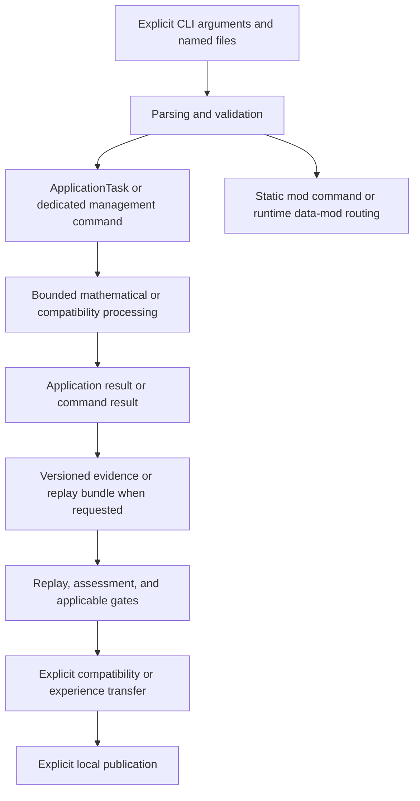

# BRUCE: architecture consolidation — Core 0.102

**IMPLEMENTED AND VERIFIED:** this document consolidates the current
source-tree boundaries for Core 0.102.0. Its implementation claims are tied to
the linked CMake targets, headers, source files, and tests; it does not turn a
roadmap, ADR, or historical acceptance record into a present-tense claim.

For prior architecture context, see the
[historical Blueprint through Core 0.93](03-blueprint-history-through-093.md).
For the original target model, see [system architecture](02-system-architecture.md).
For the current control boundary, see the
[control and publication contract](../contracts/06-control-and-publication.md).

## Scope and evidence boundary

BRUCE is a local Linux mathematical research CLI. The CMake build is C++20 and
links GMP/GMPXX and OpenSSL Crypto. It contains bounded research, Grid,
compatibility, evidence, replay, experience, rule, local-file, and routing
paths. The `bruce` CLI and the `bruce-mod-builder` local Data/Logic mod builder are
defined in `CMakeLists.txt`.

**IMPLEMENTED AND VERIFIED:** the optional static `Language` and `NanoCell`
mods are compiled through `BRUCE_BUILD_MOD_LANGUAGE` and
`BRUCE_BUILD_MOD_NANOCELL`. They are selected at configuration time and linked
into the fixed mod catalog; they are not dynamically loaded executable
plugins. Signed installable mods are a separate local-user mechanism: Data
Mods provide validated Tree routing data; Logic Mods add one signed worker
that can execute only through the existing Linux isolation host. Neither kind
is dynamically linked into the BRUCE process.

**IMPLEMENTIERT UND BELEGT:** the Phase-DAG V2 library executes bounded DAGs,
packs canonical versioned bundles, and verifies them by deterministic replay
with fixed NanoCell and Evidence-Gate adapters. This library is separate from `ApplicationTask`
and from the read-only local inspector below. The NanoCell-enabled
[`apps/phase_dag_v2_cli.hpp`](../../apps/phase_dag_v2_cli.hpp) exposes
`phase-dag-v2 execute`, `inspect` and `replay`: a strict V1 text Spec and
explicit raw context files drive serial execution of at most 16 nodes, using
`nanocell-phase-v1`/`v1` plus `evidence-gate-v1`/`v1`. `execute` exclusively publishes a canonical V2
bundle; both read commands confirm it by replay without original input files
or writes. Metadata reports hide payload bytes; valid FAILED/BLOCKED/CANCELLED
receipts remain exit-0 partial outcomes. This is a bounded CLI, with no arbitrary
adapter selection, generic scheduler, GPU execution, general prover or
free-language input. See the [CLI contract](../cli/commands.md#phase-dag-v2--begrenzte-nanocell-dag-ausführung),
[format](../cli/formats.md#phase-dag-v2-spec-und-bundle),
[generated measurements](../cli/examples.json) and
[real-executable tests](../../tests/mods/nanocell/test_phase_dag_v2_cli.py).

**IMPLEMENTIERT UND BELEGT:** the separate `phase-dag-v3 execute/inspect/replay`
CLI transports actual direct predecessor payload bytes with the fixed
`nanocell-phase-v3`/`v1` and `payload-gate-v1`/`v1` adapters. The NanoCell
producer emits a small versioned result; each gate consumes direct inputs and
emits a reusable manifest payload. Each payload is capped at 65536 bytes and
counts toward the encoded receipt budget, including copied input payloads.
V3 uses separate `BRUCE_PHASE_DAG_SPEC_V3` and `BRUCE_PHASE_DAG_RUN_V3` markers;
canonical bundles embed the bytes needed for portable deterministic replay.
Both readers verify actual replay and report metadata without raw payloads.
V2 remains compatible; the MCP also inspects existing V3 bundles through
its separate read-only route.

The bounded V3 scheduler accepts `PhaseDagControlV3::max_parallel_nodes` in
1..4 (default 1); the CLI exposes `--max-parallel-nodes N` only for `execute`.
Independent, deterministic, thread-safe adapters can run in physical waves
with at most four simultaneous calls. Scheduler state and result adoption
remain serial: receipts and logical trace preserve the existing lexicographic
serial Kahn order, including a newly ready successor before later independent
nodes. Physical start/completion times are not trace events. All results of a
started wave are awaited; cancellation is checked before starting another
physical wave. Start budgets can reduce available concurrency. The same Spec
produces byte-identical bundles for every permitted limit, checked by serial replay.
The parallel limit is local control and is absent from Spec and bundle bytes.
No performance improvement is claimed. No external payload storage or arbitrary
adapter catalog is implemented; V2 and MCP inspection keep their existing
contracts. Sources:
[core](../../include/bruce/phase_dag/phase_dag_v3.hpp),
[fixed adapters](../../mods/nanocell/src/phase_dag_adapter_v3.cpp),
[CLI](../../apps/phase_dag_v3_cli.hpp),
[core contracts](../../tests/unit/phase_dag_v3_tests.cpp),
[adapter contracts](../../tests/mods/nanocell/phase_dag_payload_v3_tests.cpp),
[CLI and documentation tests](../../tests/mods/nanocell/test_phase_dag_v3_cli.py),
[manual](../cli/commands.md#phase-dag-v3--portable-payload-kanten) and
[generated measurements](../cli/examples.json).

**DOKUMENTIERT / KONZEPT:** free-form dialogue, a general formula prover, GPU
execution, a general scheduler, and broader Phase-DAG runtime orchestration.
Historical Cockpit Job/Import/Language/Redis management remains unimplemented.

Completion, successful replay, sample confirmation, and a proof within a
named domain are distinct claims. `VERIFIED_ON_SAMPLES` is not a general proof;
a digest binds bytes but does not authenticate a person; a gate report is an
assessment, not an authorization token.

## Local Mod Lifecycle V2

**IMPLEMENTIERT UND BELEGT:** one local, user-owned installed host combines
durable Data and Logic registries behind `bruce mods`. Package inspection and
trust verification are kind-aware; installation is inactive; activation is
explicit. A common root lock serializes mutations while separate Data and
Logic journals retain their native state. Multiple versions remain installed.
`mods update` atomically installs and activates one version in the affected
registry, is idempotent for identical bytes, rejects a different digest for an
existing identity, disables the prior active version, and permits explicit
rollback through `mods activate`.

`bruce-mod-catalog-v2` is the common discovery projection. Language, NanoCell,
and MCP always appear with `available` or `not_built`; installed
entries expose Data/Logic kind, lifecycle, package digest and capabilities.
Built-in IDs cannot be changed by the installed lifecycle. The default route
V1 contract remains byte-compatible. `--mod-details` opts into route V2 with
candidate and selected-owner identities across the shared active Tree.

An installed active Logic Mod can be run with `mods run`. Binding revalidates
the private 0500 worker and pins its exact bytes before spawning the existing
Logic-Mod V1 supervisor. Data Mods and built-ins are not executable through
this path. A binding already issued retains its pinned worker bytes; later
disable/update controls future bindings. Package build never invokes a shell
or compiler.

The model uses the invoking Linux user and explicit paths. It adds no BRUCE
account, privileged helper, daemon, multi-user API, central service, package
download, or automatic update. See the
[lifecycle contract](../contracts/10-local-mod-lifecycle-v2.md),
[CLI](../cli/commands.md#mods-und-route--built-ins-sowie-installierte-data-logic-mods),
[installed host](../../include/bruce/mod/installed_mod_host_v2.hpp),
[package inspection](../../include/bruce/mod/package_inspection_v2.hpp), and
[integration evidence](../../tests/integration/test_mod_update.py).

## Offline releases, Trust V2 and verification profiles

**IMPLEMENTIERT UND BELEGT:** Core release signing is a separate offline
`bruce-release-tool` path. It consumes the exact TGZ and successful
installation/package audit, derives no version from a free sign argument,
and publishes archive, checksum, Ed25519 envelope, public key and commit
manifest as one new directory. Verification requires an independently pinned
public key. The private seed file must be regular, without symlinks, owned by
the effective user, exactly `0600`, and have one hardlink. See the
[release contract and tests](../implementation/150-release-signing-contract.md).
Production key establishment remains **OFFENE ENTSCHEIDUNG**; public fixture
keys do not establish an official release.

**IMPLEMENTIERT UND BELEGT:** Installed Data/Logic roots opt into Trust V2
only through `mods trust import-v1`, retaining their exact bound V1 trust as
generation 1. A rootwide migration fence and barriers in both registry
journals exclude old V1 binaries; trust rollback does not reverse this fence.
Immutable generations, coordinator journal and active/prepared/previous
digest references implement explicit prepare, verify, activate and rollback.
The default rejects loss of active-Mod trust without writes; explicit
`--deactivate-untrusted` atomically disables affected active Data/Logic Mods
with the trust switch. Rollback uses the same safety rule and never silently
reactivates disabled Mods. All new authorization resolves active trust under
the common lock; external legacy trust inputs cannot override it.
`status` is read-only and does not recover; pending recovery is an error.
Running workers are not killed: `mods run` holds the root lock through
completion, and a subsequent switch governs later bindings/starts.
See [commands, transaction boundaries and evidence](../cli/README.md#local-mod-trust-v2).
This remains a local-user/administrator model without a BRUCE account,
daemon, privileged helper or multi-user service.

**IMPLEMENTIERT UND BELEGT:** The
[CI workflow](../../.github/workflows/ci.yml) explicitly runs the mandatory
Built-in Mod matrix in Release and covers it in Debug. The general Release
CTest step excludes only that already-run matrix. The scoped
`BRUCE_ENABLE_ASAN_UBSAN` profile instruments compatible dynamic targets with
ASan/UBSan; seven deliberately static seccomp/RLIMIT worker fixtures are
excluded and exercised separately without instrumentation. Test partitions
and reasons are enforced by [CMake](../../CMakeLists.txt) and
[configuration tests](../../tests/integration/test_sanitizer_configuration.py).
These are configuration and contract claims, not a claim that every final
acceptance profile has already passed. CI audits packages and fixture-key
contracts; production signing and publication remain manual and offline.

**DOKUMENTIERT / KONZEPT:** online update/distribution, a key server, central
revocation and remote multi-user Mod administration are outside these paths.

## Logic-Mod Plugin V1 isolated worker boundary

**IMPLEMENTIERT UND BELEGT:** Logic-Mod V1 is a separate signed package and
one-process-session execution path. A dedicated outer envelope embeds the
unchanged signed Runtime Data Mod, canonical Logic metadata and exactly one
SHA-256-bound worker. Both signatures use explicit trust. Routing Golden Cases
gate installation; they do not execute the worker. The legacy
`logic-mod-plugin-v1 session` mutex-protected registry makes its session
installation inactive and requires explicit activation of the eligible
mod/version/template/capability. That compatibility command exists only in
memory and never silently replaces an active version. The separate durable
installed host is described above.

Immediately before spawn the host requests a fresh binding, verifies the
private regular owner-only worker file and pins its exact bytes. An issued
binding is an authorization snapshot; disable/revoke gates later bindings and
does not retroactively revoke an already authorized run. Linux static ELF
execution uses sealed executable/request memfds, fixed descriptors, empty
environment, a private cwd, rlimits and host wall/output supervision. Linux
Seccomp User Notification with CONTINUE support is mandatory. The host permits
exactly one initial `execveat` from its trusted pre-exec stub before any worker
instruction runs, then rejects all later execution notifications and kills/
reaps the child. There is no weaker fallback when isolation setup fails.

The untrusted inputfree worker has only stdin and shared stdout/stderr after
exec. The optional Payload Capability V1 worker additionally has exactly one
host-created, sealed read-only Artifact Store snapshot on FD 6. It is available
only to packages declaring `artifact.input.v1` alongside `worker.execute`
and optionally `artifact.output.v1`; the host accepts one canonical local READY
V1.2 object up to 1 MiB, validates its digest/size and binds its manifest ID,
index, digest, size and `artifact-bytes-v1` codec into request/record/replay.
FD 6 permits read/fstat/lseek/close; write and file-backed mmap are denied.
The host resolves again during replay and obtains fresh matching input and
execution authorizations immediately before spawn. The worker cannot open/read
package or host files, access Store paths or other payload references, use
network, shell, subprocesses, truststore/registry writes or raise
budgets/claim scope.
Only `math.rational.power.v1` / `rational-v1` candidates are independently
validated by the host; accepted scope is always `candidate_only`. Private
bounded frames bind registry/package/worker/template identity, normalized input,
budgets, request and response digests. Replay checks a fresh active binding and
every record byte without spawning; it establishes transcript consistency,
not signed attestation of execution. CPU/address-space limits complement the
host's default 250-ms wall, 4096-byte input and 16384-byte combined output limits.

**IMPLEMENTIERT UND BELEGT:** Result Artifact V1 adds explicit host-only
`--output-manifest MANIFEST_ID --store LOCAL_STORE` publication. Exactly four
sorted capability sets are accepted: `worker.execute`,
`artifact.input.v1,worker.execute`, `artifact.output.v1,worker.execute`, and
`artifact.input.v1,artifact.output.v1,worker.execute`. Either/both artifact
references require exactly one shared Store option. Output authorization and
Store preparation precede spawn; fresh output/execution/input bindings match
the same package, registry and worker state immediately before spawn.
Only a normally completed, host-accepted `result` is published, as unchanged
UTF-8 bytes up to 16384 bytes with fixed codec `logic-mod-result-text-v1`.
The host publishes one immutable READY/ACCEPTED object at index zero; identical
manifests are idempotent and different existing manifests conflict. The worker
receives no output identifier, Store path/FD, additional writable FD or new syscall right.
The optional `output.v1` record suffix and success JSON carry only output
identity. Absent output preserves previous record and request bytes. Replay
does not spawn: it fresh-opens the existing Store, checks the fixed complete
one-object manifest and verifies object bytes through Store verification plus
SHA-256 and length against the independently validated result.
See the [result publisher contracts](../../tests/unit/logic_mod_result_artifact_v1_tests.cpp)
and [real result workflows](../../tests/integration/test_logic_mod_result_artifact_v1.py).
Multiple results, result streams, overwrite, garbage collection, remote publish,
free codecs, retries, direct plugin-to-plugin handoff and parallel plugin execution
remain outside V1.

**IMPLEMENTIERT UND BELEGT:** the separate host-only command
`logic-mod-result-inspect RUN_RECORD --store LOCAL_STORE` reads the canonical
record and verifies its optional Result Artifact V1 through existing read-only
Store APIs. It constructs no registry, unpacks no package, starts no worker,
and creates, publishes, repairs or writes no Store/file. Its bounded record
reader pins descriptors, rejects symlinks in every component, and requires a
private regular file owned by the effective user, one hardlink and at most
131072 bytes; FIFOs/devices/directories are rejected before reading.
The ordered metadata-only JSON contract is `logic-mod-result-inspect-v1`.
Binding identity is SHA-256 of the opaque record field, never its raw bytes;
paths, result/input bytes and worker diagnostics are excluded. `READY` means
local output verification succeeded, not fresh authorization, mathematical
replay or execution attestation. Input-only/legacy records yield `NO_OUTPUT`
without opening the Store. Concurrent reads are not an atomic snapshot.
See the [command and file restrictions](../cli/commands.md#logic-mod-result-inspect--lokales-ergebnis-schreibgeschützt-prüfen),
[JSON/status contract](../cli/formats.md#logic-mod-result-inspector-v1-json),
[inspector contracts](../../tests/unit/logic_mod_result_inspector_v1_tests.cpp)
and [real CLI workflows](../../tests/integration/test_logic_mod_result_inspector_v1.py).

**IMPLEMENTIERT UND BELEGT:** Logic-Mod Artifact Chain V1 adds the separate
host-only `logic-mod-chain-v1 run` / `replay` command for exactly two explicit
signed packages and one local Store. A requires exactly
`artifact.output.v1,worker.execute`; B requires exactly
`artifact.input.v1,artifact.output.v1,worker.execute`, with separate registries,
truststores and fresh per-step authorization. Both packages, input lengths/normalization, budgets, native static ELF
structure and distinct output manifest IDs are checked before A.
Only after A succeeds does the host publish its canonical result through the
unchanged Result Artifact V1 path and fresh-resolve exactly its READY object
at index zero for B's existing sealed read-only Payload Capability V1 FD 6.
B cannot select a different handoff and authorizes its own result publication.
The host validator still checks each result against that step's text input;
this does not prove arbitrary use of the payload by B. Worker frames,
FD/Seccomp boundaries and existing record formats remain unchanged.

The separate bounded 524288-byte private chain record embeds both unchanged
run records and both artifact identities. It therefore contains normalized
inputs, results and response frames, but no host paths, worker diagnostics or
separate copy of the transferred artifact payload. Public JSON contains only
status and chain/artifact identities. The record is published only after both
results succeed, privately and without replacing an existing target. A failure
prevents B; a B failure may retain A's artifact, and a later record-publication
failure may retain both. This is no multi-artifact rollback transaction.
Replay starts no worker: it checks current A/B bindings, both embedded
transcripts and both freshly resolved complete READY/ACCEPTED result artifacts
without creating a Store. It establishes transcript consistency, not historical
execution attestation. There are no external payloads for A, more than two
steps, branches, loops, retries, parallelism, streams, free codecs, remote
Stores, network access or general orchestration. See the
[exact CLI](../cli/commands.md#logic-mod-chain-v1--zwei-serielle-artifact-schritte),
[record and JSON](../cli/formats.md#logic-mod-artifact-chain-v1-record-und-json),
[core/replay/preflight contracts](../../tests/unit/logic_mod_artifact_chain_v1_tests.cpp)
and [real-binary workflows](../../tests/integration/test_logic_mod_artifact_chain_v1.py).
The unchanged CLI example generator does not execute this chain.

**IMPLEMENTIERT UND BELEGT:** Logic-Mod Artifact DAG V2 adds the separate
`logic-mod-artifact-dag-v2 run` / `replay` command for a strict JSON Spec with
1–16 signed nodes in one local Store. It executes serially in stable
topological order, choosing the smallest ready node ID. Every package has an
independent registry and explicit truststore; all package/authorization/static
ELF/budget/graph/manifest checks precede the first worker and Store mutation.
Root capability sets are exactly `artifact.output.v1,worker.execute`, nonroots
exactly `artifact.input.v1,artifact.output.v1,worker.execute`.

Before each nonroot, the host freshly verifies all direct predecessor result
artifacts and publishes their ID-sorted canonical input document under that
node's explicit, globally distinct internal input manifest. Only its READY
object zero reaches the unchanged sealed Payload Capability V1 FD 6. Workers
receive no Store/path access or extra FD/Seccomp rights. Undeclared ancestors
are not separately included; host validation still checks each result against
its text input, without proving arbitrary semantic payload use.

The private canonical record is bounded to 8388608 bytes and published only
after complete success, atomically without replacing an existing file. It
binds the canonical Spec digest, execution order, unchanged Run V1 records,
result identities and internal input identities. Embedded runs retain inputs,
results and response frames; the record contains no host paths, worker
diagnostics or separate payload copies. Public JSON exposes only status and
identities. Replay starts no worker and writes nothing: it rechecks current
bindings, embedded transcripts and every result/internal input artifact from
an existing Store. A failed node stops all further execution; previously
published artifacts may remain and no DAG record is published. Spec/preflight
rejections precede every Store mutation; after successful preflight, worker
preparation can create the Store before a later setup failure, even before the
first worker starts. Record publication can fail after all artifacts exist;
there is no rollback transaction. V2 adds no parallelism, retry, dynamic nodes, remote Store,
network, streams, free codecs or general scheduler, and does not replace
Chain V1 or Phase-DAG. See the [exact CLI](../cli/commands.md#logic-mod-artifact-dag-v2--begrenzter-serieller-artifact-dag),
[Spec/payload/record/JSON formats](../cli/formats.md#logic-mod-artifact-dag-v2-spec-payload-record-und-json),
[core contracts](../../tests/unit/logic_mod_artifact_dag_v2_tests.cpp) and
[real-binary workflows](../../tests/integration/test_logic_mod_artifact_dag_v2.py).
The DAG V2 negative preflight fixtures use literal non-ELF worker bytes in a
late signed package; structural corruption of a native ELF is not independently
repeated as a DAG V2 regression. The unchanged CLI example generator does not
execute this DAG.

**IMPLEMENTIERT UND BELEGT:** Logic-Mod Artifact DAG V3 adds bounded physical
waves through `logic-mod-artifact-dag-v3 run` with the optional trailing
`--max-parallel-nodes 1..4` (default 1). Admission retains V2's strict
`schema_version:2` Spec, preflight and per-node authorization/budgets. Higher
limits select independent ready nodes in the existing stable topological
order; every started worker is awaited and reaped before the next wave.
Successors made ready by that wave wait for a later wave. Results retain the
canonical V2 logical order independently of physical completion order.
The local control enters neither Spec digest, DAG ID nor record; identical
deterministic worker transcripts produce byte-identical V2-format records
for limits 1–4. V3 replay reuses read-only V2 verification, starts no worker
and accepts no parallel option.

Workers keep separate authorization, budgets and distinct manifests in the
common local Store, with the unchanged sealed read-only FD-6 contract and
unchanged Worker/FD/Seccomp rights. A failed wave is fully drained before
return, successful peers can retain artifacts, no further wave starts and
only complete success publishes a DAG record. Runtime exceptions likewise
drain all started workers. There is no rollback, retry, global resource
budget, fairness/priority policy, dynamic nodes, remote Store, network/GPU
execution or general orchestration. V2 and Phase-DAG remain independent.
See the [exact CLI](../cli/commands.md#logic-mod-artifact-dag-v3--begrenzte-parallele-artifact-wellen),
[compatible formats](../cli/formats.md#logic-mod-artifact-dag-v3-kompatible-formate),
[core contracts](../../tests/unit/logic_mod_artifact_dag_v3_tests.cpp) and
[real-binary workflows](../../tests/integration/test_logic_mod_artifact_dag_v3.py).
The unchanged CLI example generator does not execute V3.

**IMPLEMENTIERT UND BELEGT:** Logic-Mod Artifact DAG V4 adds local host
budgets to the V3 wave model through `logic-mod-artifact-dag-v4 run`:
`--max-parallel-nodes 1..4` (default 1), `--max-total-wall-ms 1..60000`,
`--max-total-payload-bytes 0..8388608`, `--max-started-workers 1..16`
(default 16), and `--cancel-after-ms 1..60000`. The byte/time/cancellation
limits are otherwise absent by default. Strict, nonduplicated trailing
run options are validated before file access; replay accepts none of them.

Before each complete frozen wave the host checks monotone elapsed time,
cumulative worker starts and cumulative bytes of internal input documents
per receiving node. Root nodes consume zero internal payload bytes; this
is no process-memory or whole-Store byte budget. A wave exceeding remaining
start/byte allowance is refused before publishing its inputs, without reducing
its width. Reached timers stop only before a wave, with cancellation checked
first. Running workers always drain and are reaped; the final successful
wave may complete successfully after a timer elapses. Existing worker-local
budgets remain independent. Controlled stops report
`DAG_GLOBAL_BUDGET_EXHAUSTED` or `DAG_HOST_CANCELLED`, with no success record
and no later wave; completed artifacts remain. Node failure retains
`DAG_NODE_FAILED`. There is no rollback or global mid-worker kill.

V4 preserves the V2/V3 Spec, digest, DAG ID, internal payload and successful
record formats; its controls and physical measurements are not serialized.
Identical deterministic worker transcripts retain byte-identical records.
Replay is read-only and starts no worker. The JSON contract is
`logic-mod-artifact-dag-v4`, with metadata only and no host controls or raw
payloads. V4 adds no retries, fairness, priority policy, dynamic nodes,
remote Store, GPU/network execution or general orchestration; existing
Worker/FD/Seccomp rights, V2/V3 and Phase-DAG remain unchanged.
See the [exact CLI](../cli/commands.md#logic-mod-artifact-dag-v4--lokale-hostbudgets-für-artifact-wellen),
[compatible formats](../cli/formats.md#logic-mod-artifact-dag-v4-lokale-budgets-ohne-formatwechsel),
[core contracts](../../tests/unit/logic_mod_artifact_dag_v4_tests.cpp) and
[real-binary workflows](../../tests/integration/test_logic_mod_artifact_dag_v4.py).
The unchanged CLI example verifier does not execute V4.

**IMPLEMENTIERT UND BELEGT:** Logic-Mod Artifact DAG V5 is a narrow,
host-only recovery extension of V4. Its optional `--remote-restore HTTPS_BASE`
run control uses Artifact Store V4 only to restore an already expected direct
predecessor of a nonroot node. The expected manifest ID, object digest and
size are derived from the locally bound predecessor output; remote data cannot
name a new artifact or influence DAG identity, Spec, record, result binding or
the worker protocol. The control remains outside every canonical V2 record and
successful V2/V3/V4/V5 records stay byte-identical for equal deterministic
worker transcripts.

Immediately before the existing FD-6 handoff, the host examines the expected
local predecessor. A safely existing manifest is a local hit and performs no
remote access. A proven missing manifest may invoke V4 Restore; an already
present object must first pass local digest/size verification, while an absent
object is downloaded by that restore. A symlink, unreadable path, nonregular
object, corrupt manifest or identity mismatch fails closed: no remote request
and no successor worker start. A successful restore is not trusted by itself; the host rereads
and verifies the locally published READY/ACCEPTED manifest, codec, digest,
size and result binding before creating the unchanged sealed read-only FD 6.

Root nodes never restore. Workers do not receive the remote URL, credentials,
network permissions or Store paths. V5 has no automatic mirror, credential
storage, retry, remote worker, external payload-store, GPU or general
orchestration facility. V5 replay remains V2-format, local, read-only,
worker-free and fully offline; its parser rejects the run-only remote option.
See the [exact CLI](../cli/commands.md#logic-mod-artifact-dag-v5--hostseitiger-remote-restore-erwarteter-vorgänger),
[format preservation](../cli/formats.md#logic-mod-artifact-dag-v5-remote-restore-ohne-formatwechsel),
[V5 host core](../../src/mod/logic_mod_artifact_dag_v5.cpp),
[unit contracts](../../tests/unit/logic_mod_artifact_dag_v5_tests.cpp) and
[TLS CLI workflows](../../tests/integration/test_logic_mod_artifact_dag_v5_cli.py).
The unchanged CLI example verifier does not execute V5.

**IMPLEMENTIERT UND BELEGT:** Logic-Mod Artifact DAG V6 ergänzt ausschließlich
seinen Linux-lokalen `run`-Pfad um einen hostbesessenen Attempt pro gestartetem
Knoten und ein privates Diagnose-Sidecar. Der öffentliche Aufruf verlangt
`--report REPORT`; der Host schreibt exakt
`REPORT.run/control/supervision-v6.jsonl` unter owner-only Modi (`0700`/`0600`).
Die Spur enthält kanonische, global sequenzierte Lifecycle-Ereignisse sowie
markierte Peak-Verfügbarkeit, aber keine PID/PGID, Pfade, Payloads, URLs,
Frames oder Geheimnisse. Sie ist kein fachlicher DAG-Record und wird von
Replay nicht gelesen.

Der bestehende versiegelte Worker, seine Signatur-/Truststore-Autorisierung,
Seccomp und gegebenenfalls read-only FD 6 bleiben die Ausführungsgrenze. Der
Host überwacht nur die gebundene Prozessgruppe, reapet sie und erzwingt bei
hostseitigem Cancel eine feste Policy: bis 1000 ms warten, dann `SIGTERM`, bis
50 ms weiter warten, dann `SIGKILL`. Das ist kein Worker-Cancel-Protokoll, kein
öffentlicher PID-Endpunkt und keine cgroup- oder hostweite Budgetzusage.
`PR_SET_PDEATHSIG` bindet den direkten Child; die bestehende Seccomp-Grenze
verbietet dessen Nachfahrenerzeugung, ohne daraus eine allgemeine PDEATHSIG-
Nachkommenzusage abzuleiten.

V6 übernimmt V4-Wellen-/Budgetsemantik und V5-Remote-Restore vor FD 6, ohne
Spec, DAG-ID oder kanonische V2-Recordbytes zu ändern. Erfolgreiche
deterministische V2–V6-Läufe bleiben bytekompatibel. V6-Replay ist weiterhin
lokal, schreibgeschützt, workerfrei, sidecarfrei und offline. Nicht Teil von
V6 sind GPU-, Netzwerk- oder Remote-Worker, freie Codeplugins, Retries,
globale Orchestrierung, cgroup-Aggregate oder eine belastbare öffentliche
`MEMORY_LIMIT`-Zuordnung; unklare Prozessenden werden `PROCESS_CRASHED`.
Siehe [V6-CLI](../cli/commands.md#logic-mod-artifact-dag-v6--linux-lokale-hostsupervision-mit-diagnose-sidecar),
[Formatgrenze](../cli/formats.md#logic-mod-artifact-dag-v6-supervision-ohne-formatwechsel),
[V6-Core](../../src/mod/logic_mod_artifact_dag_v6.cpp),
[Attempt-Handle](../../src/mod/logic_mod_worker_attempt_v6.cpp) und
[CLI-Workflows](../../tests/integration/test_logic_mod_artifact_dag_v6_cli.py).

The exact public session route is `logic-mod-plugin-v1 session`; its action list
includes install/activate/run/inspect/replay/disable/revoke within that single
invocation. Existing `mods`/`route`, Worker, Artifact Store and bundle formats
are separate. See the [commands and limits](../cli/commands.md#logic-mod-plugin-v1--explizite-isolierte-sitzung),
[package/protocol/record format](../cli/formats.md#logic-mod-plugin-v1-paket-und-laufrecord),
[package contracts](../../tests/unit/logic_mod_plugin_v1_tests.cpp),
[worker contracts](../../tests/unit/logic_mod_worker_v1_tests.cpp) and
[real-binary workflows](../../tests/integration/test_logic_mod_plugin_v1.py).

**DOKUMENTIERT / KONZEPT:** durable Logic installation/activation, general
plugin languages, a production Logic package builder, Wasm, host-loaded shared
libraries, automatic updates, marketplace, multiple payloads, payload writing,
streaming, remote payload fetch during a run, free payload codecs and
plugin-to-plugin execution.
The CLI example verifier does not execute Logic sessions; dedicated contracts
provide their execution evidence.

## DAG-Scheduler V2 bounded direct payload flow

**IMPLEMENTIERT UND BELEGT:** the independent
[C++20 contract](../../include/bruce/dag_scheduler/dag_scheduler_v2.hpp) and
[executor](../../src/dag_scheduler/dag_scheduler_v2.cpp) belong to `bruce_core`
without new dependencies. Serial lexicographic Kahn selection executes one
synchronous callback at a time. Callbacks receive the unchanged request and
only verified direct READY predecessor payloads, producer-ID sorted, with
result codes and digests. Requests and successful payloads have a 65,536-byte
limit and exact SHA-256 validation. The 1..4,194,304-byte receipt budget counts
retained output payloads and every input copy; requests and metadata do not
count. It is not a process-memory budget.

Invalid callback returns, propagated callback exceptions and receipt-budget
overflow publish no partial run; prior callback side effects are outside that
guarantee. Valid failed returns have no payload or digest. Non-READY terminal
predecessors block descendants before cancellation or start budget is checked;
non-READY receipts retain no inputs or output. Receipts sort by node ID, while
the logical trace remains chronological. At equal spec, control and callback
returns the core is deterministic. Valid but different callback returns across
runs cannot be automatically detected from one invocation; callbacks are not
rerun for detection, which would duplicate side effects. Purity remains the
embedder's responsibility.

The unconditional [CLI](../../apps/dag_scheduler_v2_cli.hpp) accepts only
`bruce dag-scheduler-v2 demo flow`, also with NanoCell/MCP OFF. The fixed
four-node flow starts `a-source`, `b-transform`, `c-independent`, `d-join`,
with start budget 4 and receipt budget 4096 bytes. It retains 56 payloadbytes
including direct input copies. Its deterministic `dag-scheduler-v2-cli-v1`
JSON exposes digests and sizes without raw request/payload bytes, with exit 0;
invalid arguments emit the compact error-only usage JSON with exit 2.

V2 adds no free CLI inputs, files, persistence, bundle/replay, external stores,
threads, GPU/network execution or general runtime orchestration. V1 and
Phase-DAG V2/V3 remain unchanged. V2 bundle/persistence/replay, external
payload or artifact stores, Phase-DAG V3 adapters, parallelism, GPU, network
and general orchestration remain **DOKUMENTIERT / KONZEPT**. The separate
Phase-DAG V3 parallel option remains its existing implemented contract.
Byte limits/digests and metadata-only CLI rendering do not provide
cryptographic confidentiality or access control.

Evidence: [core contracts](../../tests/unit/dag_scheduler_v2_tests.cpp),
[real-binary workflows](../../tests/integration/test_dag_scheduler_v2_cli.py),
[documentation contracts](../../tests/integration/test_cli_docs.py) and
[exact manual and generator limits](../cli/commands.md#dag-scheduler-v2--fester-direkter-payload-fluss).
The unchanged example generator does not execute V2; its generated examples
and validation do not prove V2 behavior. The existing OFF MCP generator
assumption and sandbox socket limitation are separate verification limits.

## DAG-Scheduler V5 worker boundary and read-only run inspection

**IMPLEMENTIERT UND BELEGT:** The independent V5 route in
[`apps/dag_scheduler_v5_cli.hpp`](../../apps/dag_scheduler_v5_cli.hpp) executes
the fixed V3 callback catalog through Bruce-supervised local child processes.
The worker boundary, framed control protocol, per-attempt budgets and private
append-only run log are implemented in
[`worker_boundary_v1.hpp`](../../include/bruce/worker/worker_boundary_v1.hpp),
[`worker_supervisor_v1.hpp`](../../include/bruce/worker/worker_supervisor_v1.hpp)
and [`worker_run_log_v1.hpp`](../../include/bruce/worker/worker_run_log_v1.hpp).
V5 remains a bounded local endpoint: `literal-v1`, `append-v1` and `join-v1`
are fixed, retry is explicit through `--retry`, and `--workers` selects one to
four independent ready nodes. It is not a free process launcher, plugin
registry, network executor or general runtime scheduler.

**IMPLEMENTIERT UND BELEGT:** V5 now also exposes the exact read-only route
`bruce dag-scheduler-v5 inspect BUNDLE`. The
[`WorkerRunInspectorV1`](../../include/bruce/worker/worker_run_inspector_v1.hpp)
and its implementation read only `BUNDLE.run/`, validate canonical JSONL
events and per-attempt transitions, and verify referenced artifacts by size
and SHA-256 with descriptor-relative `O_NOFOLLOW` traversal. The CLI checks the
canonical Execute report against the observed run before rendering the bounded
`dag-scheduler-v5-inspect-v1` metadata report. A complete valid run returns
`VALID`/Exit 0; a structurally valid run without `RUN_FINISHED` returns
`INCOMPLETE`/Exit 1; corruption, truncation, path violations, digest/size
mismatches and manipulated report values return compact `PROTOCOL_ERROR`/Exit
2. The inspector starts no process, calls no adapter, performs no replay or
repair, and writes no file. Its JSON parser rejects nesting deeper than 64
levels before stack growth can become unbounded.

Evidence: [inspector core](../../src/worker/worker_run_inspector_v1.cpp),
[CLI contracts](../../tests/unit/dag_scheduler_v5_cli_tests.cpp),
[inspector unit contracts](../../tests/unit/worker_run_inspector_v1_tests.cpp),
[real-binary inspector workflows](../../tests/integration/test_dag_scheduler_v5_inspector.py),
and [CLI manual](../cli/commands.md#v5-run-inspector).

### Common Runtime Host V2 / Stage 3A single-worker route

**IMPLEMENTIERT UND BELEGT:** The additive application-layer facade in
[`common_runtime_host_v2.hpp`](../../include/bruce/application/common_runtime_host_v2.hpp)
and [`common_runtime_host_v2.cpp`](../../src/application/common_runtime_host_v2.cpp)
owns one local Worker V1 attempt. It validates the host context before spawn,
reuses the existing Worker V1 frame and supervisor contracts, records the
append-only JSONL lifecycle, projects only validated result metadata, and
supports host-side cancellation through the existing abort marker. The fixed
grace remains `1000 ms`; the worker's observed usage and artifact digest/size
are reported without exposing payload bytes.

The Stage 3A V5 gate is deliberately narrow: ordinary
`dag-scheduler-v5 execute` with one Spec node, `--workers 1`, no explicit
`--retry`, and no payload, stream, flow or handoff extension uses Host V2.
At Stage 3A delivery, the public V5 command, report schema and Worker V1 wire
contract remained unchanged and multi-node, retry and extension routes retained
their existing implementation. The later Stage 3B/3C/3D gates are described below. When a valid external cancel marker has been observed before
result polling, Host V2 records `CANCEL_REQUESTED` first and maps a late
`READY` result to `CANCELLED` without accepting an artifact.

Evidence: [Host V2 facade](../../src/application/common_runtime_host_v2.cpp),
[Host V2 unit contracts](../../tests/unit/common_runtime_host_v2_tests.cpp),
[V5 routing](../../apps/dag_scheduler_v5_cli.hpp), and the
[Stage 3A workflows](../../tests/integration/test_common_runtime_host_v2_stage3.py).
The Linux memory limit and peak measurement remain the existing per-worker-PID
Supervisor behavior; Stage 3A makes no aggregate process-group memory claim.
Free language, general proving, GPU/network execution, free code plugins,
external payload stores and broad cross-runtime orchestration remain
**DOKUMENTIERT / KONZEPT**. :codex-annotation{index="1"}

### Common Runtime Host V2 / Stage 3B batch route

**IMPLEMENTIERT UND BELEGT:** The additive batch facade in
[`common_runtime_host_v2_batch.hpp`](../../include/bruce/application/common_runtime_host_v2_batch.hpp)
and [`common_runtime_host_v2_batch.cpp`](../../src/application/common_runtime_host_v2_batch.cpp)
owns the selected ordinary multi-node V5 run. It creates one shared JSONL
run-log and sequence counter, starts one Worker V1 supervisor handle per active
attempt, enforces the existing `--workers` limit (1..4), and reaps every Worker
and watchdog before `RUN_FINISHED`. The existing V5 scheduler remains
responsible for spec parsing, dependency gating, canonical receipt order,
`max-started-nodes`, output-total checks and transitive `BLOCKED` propagation.

The Stage 3B gate is narrow: ordinary
`dag-scheduler-v5 execute` with more than one Spec node, `--retry 0`, and no
payload, stream, flow or handoff extension uses the batch host. A valid abort
marker is linearized as `CANCEL_REQUESTED` before result polling; no waiting
node starts afterward, and a late `READY` is projected as `CANCELLED` without
artifact acceptance. The public V5 command, report schema, Worker V1 frames,
per-worker budgets and metadata-only result boundary remain unchanged. The
single-node Stage 3A route and all excluded routes retained their established
implementations at Stage 3B delivery; Stage 3C extends the ordinary retry gate
below.

Evidence: [batch facade](../../src/application/common_runtime_host_v2_batch.cpp),
[batch unit contracts](../../tests/unit/common_runtime_host_v2_batch_tests.cpp),
[V5 routing](../../apps/dag_scheduler_v5_cli.hpp), and the
[Stage 3B workflows](../../tests/integration/test_common_runtime_host_v2_stage3b.py).
RLIMIT_AS and peak telemetry remain per observed Worker PID; Stage 3B makes no
aggregate process-group memory claim. Automatic retries, payload integration,
external payload stores, GPU/network execution, dynamic plugins, free language,
general proving and broad cross-runtime orchestration remain
**DOKUMENTIERT / KONZEPT**. :codex-annotation{index="1"}

### Common Runtime Host V2 / Stage 3C explicit retries

**IMPLEMENTIERT UND BELEGT:** Ordinary local `dag-scheduler-v5 execute`
uses the Batch Host for multi-node runs with `--retry 0..3` and for single-node
runs with `--workers 1 --retry 1..3`. Single-node `--workers 1 --retry 0`
retains the Stage 3A facade. At Stage 3C delivery, payload, stream, flow and
handoff extensions remained outside this gate; Stage 3D migrates the local
V13/V14 payload route below. The public command, report schema and Worker V1 frames are
unchanged.

The scheduler retries only `PROCESS_CRASHED`, `TIMEOUT` and `PROTOCOL_ERROR`
while explicit retry budget remains. `--retry N` permits at most `N+1`
attempts per node. Each attempt has a fresh ID and private directory; retries
do not consume another `max-started-nodes` slot. `record_attempt_retry_v2`
closes a failed historical attempt without artifact acceptance. A later
accepted attempt can finish READY, while exhaustion retains the final failure
and every history entry. The scheduler owns serial retry routing and acceptance
exclusivity; the Batch Host does not independently prohibit multiple READY
attempts for the same node.

Cancel prevents further dispatch and decides every pending result, including
already projected READY/FAILED and a node waiting between retries, as CANCELLED.
Started attempts keep their IDs and usage; no late artifact is accepted. A
single post-result `CANCEL_REQUESTED/CANCELLED` is valid before any acceptance
or rejection. The RunLog/Inspector lifecycle also adds the narrowly scoped
`RESULT_REJECTED/OUTPUT_LIMIT_EXCEEDED`: only an unaccepted canonical READY
artifact may receive this metadata-free receipt-budget decision. It becomes
FAILED for inspection; duplicate decisions or later acceptance are invalid.
This is an additive private lifecycle rule, not a new Worker V1 frame.

Evidence: [retry decision](../../src/application/common_runtime_host_v2_batch.cpp),
[V5 routing](../../apps/dag_scheduler_v5_cli.hpp),
[Batch Host contracts](../../tests/unit/common_runtime_host_v2_batch_tests.cpp),
[RunLog](../../src/worker/worker_run_log_v1.cpp),
[Inspector contracts](../../tests/unit/worker_run_inspector_v1_tests.cpp), and
[Stage 3C workflows](../../tests/integration/test_common_runtime_host_v2_stage3c.py).
Automatic retries, external payload stores, GPU/network execution, dynamic
plugins, free language, general proving and broad runtime orchestration remain **DOKUMENTIERT / KONZEPT**. :codex-annotation{index="1"}

### Common Runtime Host V2 / Stage 3D local payload route

**IMPLEMENTIERT UND BELEGT:** Local `dag-scheduler-v5 payload` V13/V14,
including local `--external-inputs`, one or multiple nodes, `--workers 1..4`
and explicit `--retry 0..3`, now uses `CommonRuntimeHostV2Batch` through the
existing `execute_multi_node_v2` scheduler. The scheduler retains DAG gating,
input provenance/materialization, canonical receipt order, Store publication
and public reports; the Host owns worker start/poll/cancel/reap and private
JSONL lifecycle. Worker V1 frames, CLI syntax, Payload V13/V14 reports and
Artifact Store V1 formats are unchanged. Stream V15, Flow V2 and Handoff V1
retain their existing execution paths.

Each payload attempt sets an absolute monotone deadline before input
materialization and passes it to the Host. Checks cover preparation, dispatch,
active monitoring, pending READY processing and post-publication acceptance.
Store publication is synchronous: checks before and after publication do not
hard-interrupt every filesystem call. Preparation/start-budget failure uses
`record_scheduler_failure_v2` and can finish FAILED with zero attempts; no
worker attempt is invented. Invalid owner-control markers finish FAILED,
retain actual dispatched history and cannot become ordinary successful Cancel.

The private `RESULT_REJECTED` decision accepts only `OUTPUT_LIMIT_EXCEEDED`,
`TIMEOUT`, `ARTIFACT_REFERENCE_INVALID`, `ARTIFACT_MANIFEST_INVALID`,
`ARTIFACT_DIGEST_MISMATCH` and `ARTIFACT_STORE_VIOLATION`. It follows a canonical
unaccepted READY result, contains no artifact/usage fields and projects FAILED
with original measured usage retained. TIMEOUT remains retry-pending until an
explicit retry decision; other reasons are terminal. A post-result Cancel
closes the attempt series and blocks restart/acceptance. Both Worker and
Payload Inspectors validate these decisions and zero-attempt FAILED/CANCELLED
completion; existing Single Host finish usage remains valid.

Publication alone does not accept a result. Manifest IDs, public/private
references and successor readiness are committed only after Host acceptance,
which probes owner cancel again. Immutable Store objects/manifests may remain
when publication is followed by rejection or Cancel; there is no automatic
Store rollback or deletion.

Evidence: [Batch Host](../../src/application/common_runtime_host_v2_batch.cpp),
[V5 scheduler](../../apps/dag_scheduler_v5_cli.hpp),
[Payload Inspector](../../src/artifact/payload_run_inspector_v1.cpp),
[Stage 3D workflows](../../tests/integration/test_common_runtime_host_v2_stage3d.py),
[Stage 3D spec](../superpowers/specs/2026-10-16-common-runtime-host-v2-stage3d-payload-host-design.md).
External services/stores, GPU/network workers, free code plugins, free
language, general proving and broad orchestration remain **DOKUMENTIERT / KONZEPT**.
:codex-annotation{index="1"}

The private run log and local sidecar remain a bounded diagnostic/recovery
trace, not a durable content-addressed Artifact Store. Payload download,
external payload storage, dynamic code plugins, GPU/network execution, free
language, general proving and cross-application runtime orchestration remain
**DOKUMENTIERT / KONZEPT**.

### V5 Execute Handoff Lineage V1

**IMPLEMENTIERT UND BELEGT:** The opt-in
`bruce dag-scheduler-v5 execute SPEC --output BUNDLE --handoff-v1` records
actual direct producer-to-consumer input bindings in the canonical,
owner-only `BUNDLE.handoff-v1.json` sidecar. It binds the original Spec and
unchanged Execute report bytes by SHA-256, retains Spec dependency order and
every durably started attempt, including failed retries, and excludes an
attempt that never passed preflight. The read-only
`bruce dag-scheduler-v5 inspect BUNDLE --handoff-v1` checks this record
against the report, private run log, requests, accepted producer artifacts
and consumer inputs. Complete consistent runs return `VALID`/Exit 0 even
when the observed run status is FAILED, BLOCKED or CANCELLED; consistent
unfinished logs return `INCOMPLETE`/Exit 1. Unsafe or inconsistent data
returns `PROTOCOL_ERROR`/Exit 2. The public result is metadata only and
states `lineage_scope=LOCAL_CONSISTENCY`.

The sidecar is atomically and exclusively adopted after the legacy report;
write or adoption failure returns `HANDOFF_RECORD_INVALID`/Exit 2 with empty
stdout while leaving legacy files for diagnosis. Bounded descriptor-relative
`O_NOFOLLOW|O_CLOEXEC` access, owner-only `0700` directories and `0600`
files, single-hardlink checks and identity checks limit local filesystem
substitution. Inspection does not start a worker or write, repair, replay or
resume a run. The WorkerRequest/frame and non-opt-in Execute report bytes
remain unchanged. The separate payload route uses
[Payload Flow V2](#dag-scheduler-v5-artifact-payload-flow-v2) for its own
persisted edge record. This record establishes local consistency at the
inspection time, not historical authenticity or mathematical proof.

Evidence: [lineage codec](../../src/artifact/execute_handoff_lineage_v1.cpp),
[read-only inspector](../../src/artifact/execute_handoff_inspector_v1.cpp),
[codec contracts](../../tests/unit/execute_handoff_lineage_v1_tests.cpp),
[inspector contracts](../../tests/unit/execute_handoff_inspector_v1_tests.cpp),
[real-binary workflows](../../tests/integration/test_dag_scheduler_v5_handoff.py)
and run evidence (archival local path, not versioned:
`runs/bruce-execute-handoff-lineage-v1-2026-10-15.md`).
Free language, general proving, GPU/network execution, free plugins,
external stores, recovery/resume and broad orchestration remain
**DOKUMENTIERT / KONZEPT**.

## DAG-Scheduler V5 Worker Abort Control V1

**IMPLEMENTIERT UND BELEGT:** The V5 host exposes the explicit local control
route `bruce dag-scheduler-v5 cancel BUNDLE`. It derives the bound private
run root `BUNDLE.run/` and atomically creates the owner-only
`control/cancel.request` marker with the exact bytes
`BRUCE_WORKER_CANCEL_V1\n`. Descriptor-relative `O_NOFOLLOW` validation,
`0600` permissions, hardlink checks, exact byte validation and `fsync` keep
the marker fail-closed and idempotent. A second request returns
`ALREADY_REQUESTED`; a completed run takes precedence and returns
`ALREADY_FINISHED`; missing or unsafe state returns
`CANCEL_TARGET_UNAVAILABLE`/Exit 1.

The running V5 host polls that marker before dispatch and while processing
live attempts. On observation it freezes new starts and retries, logs exactly
one `CANCEL_REQUESTED` event per active attempt, requests cancellation on all
live handles in the same scheduler iteration through the existing
`worker_v1::request_cancel` boundary, and marks unstarted nodes `CANCELLED`
without attempt or artifact metadata. The existing Linux supervisor retains
the fixed 1000-ms grace, 50-ms TERM-to-KILL escalation, process-group cleanup
and reaping. `PROCESS_EXITED`, `RESULT_RECEIVED` and `RUN_FINISHED` bind the
cancelled status; no `ARTIFACT_ACCEPTED` is emitted for a cancelled attempt.

Cancellation is parent-side observation-linearized. A receipt accepted before
the marker is observed remains accepted; an uncommitted result after that
observation becomes `CANCELLED`. The metadata-only execute report exits 1 with
top-level/receipt `CANCELLED`; the read-only Inspector validates such a
complete run as `VALID` with `run_status=CANCELLED`, while Publish rejects
cancelled runs. The control route has no direct PID/signal interface and does
not expand the trusted worker boundary into a free process launcher.

Evidence: [Abort marker core](../../include/bruce/worker/worker_abort_control_v1.hpp),
[V5 CLI](../../apps/dag_scheduler_v5_cli.hpp),
[unit contracts](../../tests/unit/worker_abort_control_v1_tests.cpp),
[CLI contracts](../../tests/unit/dag_scheduler_v5_cli_tests.cpp),
[abort workflows](../../tests/integration/test_dag_scheduler_v5_abort.py),
and Task 3 evidence (archival local path, not versioned:
`runs/worker-abort-control-v1-task3.md`).

Free language, general proving, GPU/network execution, free code plugins,
external payload stores and broad cross-runtime orchestration remain
**DOKUMENTIERT / KONZEPT**.

## V5 Artifact Publish V1

**IMPLEMENTIERT UND BELEGT:** A separate explicit bridge now connects a
validated local V5 run to Artifact Store V1:

```text
bruce dag-scheduler-v5 publish BUNDLE --store STORE
```

The route is inspector-first. It validates the canonical Execute report and
the descriptor-bound `BUNDLE.run/` tree before opening the store or writing the
first object. Only a complete `RUN_FINISHED`, `VALID`/`READY` run with exactly
one verified `ARTIFACT_ACCEPTED` result per V5 node is publishable. Input files
bind the expected node set and deterministic Spec order; each result is then
re-bound by `put_file` to its reported SHA-256 and size.

For each accepted node the bridge publishes one canonical
`BRUCE_ARTIFACT_MANIFEST_V1`, binding run/node/attempt, `READY`, the adapter
result code and one object with `origin=artifact/<node>`. The manifest ID is
deterministic (`v5-` plus SHA-256 of the canonical run/node/attempt binding).
The public `dag-scheduler-v5-publish-v1` report is metadata-only with fixed
outer order `contract`, `action`, `status`, `run_id`, `manifests`; each entry
uses `node_id`, `attempt_id`, `reference`, `manifest_id`, `sha256`,
`size_bytes`. Repeating an identical publish is idempotent. Conflicting or
corrupt existing objects/manifests are rejected without overwrite.

The bridge does not modify the Execute report or run log, start workers, call
adapters, replay a run, or download payloads. Multi-object publication is not
transactional: a later error may leave an already immutable but unreferenced
object. V1.1 has no deletion, rollback or garbage collection. Incomplete,
failed, blocked, cancelled, manipulated or unsafe inputs map to the compact
`PROTOCOL_ERROR`/Exit 2 boundary. This is an explicit local publication step,
not automatic Execute integration, a remote store, a network transport or a
general runtime orchestrator.

Evidence: [publish route](../../apps/dag_scheduler_v5_cli.hpp),
[unit contracts](../../tests/unit/dag_scheduler_v5_cli_tests.cpp),
[filesystem workflows](../../tests/integration/test_dag_scheduler_v5_publish.py),
[Artifact Store](../../include/bruce/artifact/artifact_store_v1.hpp), and
[design specification](../../docs/superpowers/specs/2026-10-15-worker-artifact-publish-v1-design.md).

## DAG-Scheduler V5 Artifact Payload Flow V1.3

**IMPLEMENTIERT UND BELEGT:** The explicit
`bruce dag-scheduler-v5 payload SPEC --output BUNDLE --store STORE` route
connects direct predecessor outputs to the existing Bruce-supervised V5 child.
It is a separate branch in
[`apps/dag_scheduler_v5_cli.hpp`](../../apps/dag_scheduler_v5_cli.hpp); V5
`execute`, `inspect`, `publish`, Artifact Store Resolve, and V2/V3/V4 formats
remain separate contracts.

The route preserves the architecture's authority boundary. Bruce parses and
validates the complete V3 DAG, opens the existing local Store, creates the
direct-edge `ArtifactInputRefV13`, verifies the canonical `READY` manifest and
content-addressed object, materializes bounded bytes into a fresh private
Attempt file, starts the child, verifies its output and publishes the next
`READY` object/manifest. The child receives only a relative private reference,
expected digest/size and existing budgets; it cannot open the Store, use the
network, start processes, load plugins or publish manifests.

`ArtifactInputRefV13` contains exactly `manifest_id`, `object_index`,
`sha256` and `size_bytes`. It is formed by Bruce from an accepted direct DAG
edge, never from a free external Store reference. `origin` remains metadata.
The selected object is read descriptor-relatively with `O_NOFOLLOW`, streamed
in fixed bounded chunks and verified again at the destination. A later input
failure removes all private files created for that Attempt.

The unchanged WorkerRequest boundary permits 16 total input references. The
request occupies one slot, so V1.3 accepts at most 15 direct payload objects
per node. Existing defaults/maxima remain authoritative: wall
`30000/600000 ms`, input `65536/1048576`, output `65536/5242880`, operations
`1000000/10000000`, memory `268435456/2147483648`, retry `0/3` and workers
`1/4`. The wall budget is end-to-end from reference resolution through
materialization, worker, verification and publication.

Publication precedes successor unlock. A reference, manifest, integrity,
Store, permission, materialization or input-limit failure makes the node
`FAILED` and transitively dependent nodes `BLOCKED`; no partial `READY`
manifest is accepted. Retry remains CLI-only and assigns a fresh Attempt ID;
artifact and integrity failures are not implicitly retried. Reports remain
metadata-only and expose no payload bytes, private paths, Manifest IDs, PIDs
or OS diagnostics.

Evidence: [payload core](../../include/bruce/artifact/artifact_payload_v1.hpp),
[Store copy boundary](../../include/bruce/artifact/artifact_store_v1.hpp),
[payload unit contracts](../../tests/unit/artifact_payload_v1_tests.cpp),
[payload CLI contracts](../../tests/unit/dag_scheduler_v5_payload_cli_tests.cpp),
[payload workflows](../../tests/integration/test_dag_scheduler_v5_payload.py).

Free or unchecked Manifest references outside the controlled V1.4 sidecar,
remote/external stores, network or GPU execution, free code plugins, free
language, general proving and broad cross-runtime orchestration remain
**DOKUMENTIERT / KONZEPT**.

## DAG-Scheduler V5 Artifact Payload Flow V1.4

**IMPLEMENTIERT UND BELEGT:** V1.4 adds a controlled external-input edge to
the V1.3 payload route through the explicit option
`--external-inputs INPUTS`. The sidecar is a Bruce-owned, owner-only canonical
JSON file with contract `bruce-dag-scheduler-v5-external-inputs-v14`. Each
binding maps one existing DAG node to ordered references containing
`manifest_id`, `object_index`, `sha256`, `size_bytes`, `source_run_id`,
`source_node_id` and `source_attempt_id`.

The authority boundary remains unchanged: Bruce parses the complete DAG and
sidecar before Store access, opens only the selected local Artifact Store,
checks canonical `READY` status plus source provenance, object index, digest
and exact size, then materializes bounded bytes into owner-only private attempt
files. Direct in-run predecessor inputs and external sidecar inputs are
combined before the unchanged WorkerRequest limit is checked. The request
occupies one of 16 total input slots, so no node may receive more than 15
payload objects. The worker receives only relative private references and
expected metadata; it never receives Store paths, manifests, sidecar bytes,
network access, process launch authority or plugin loading authority.

V1.4 reports `dag-scheduler-v5-payload-v14` only when the option is present.
`external_inputs_digest` is the digest of the exact sidecar bytes, and each
receipt exposes only `external_input_count` and `external_input_bytes` in
addition to the existing metadata-only fields. V1.3 calls without the option
retain their original contract and behavior. Sidecar syntax/file-safety,
unknown-node, duplicate-object and arity failures stop preflight with Exit 2;
manifest, object, Store, input-limit or deadline failures discovered during a
started run produce `FAILED`, recursively `BLOCKED` descendants and Exit 1.

Evidence: [V1.4 CLI](../../apps/dag_scheduler_v5_cli.hpp),
[V1.4 type contract](../../include/bruce/artifact/artifact_payload_external_v1.hpp),
[V1.4 parser](../../src/artifact/artifact_payload_external_v1.cpp),
[V1.4 workflow](../../tests/integration/test_dag_scheduler_v5_payload.py),
and [V1.4 design](../../docs/superpowers/specs/2026-10-15-artifact-payload-v1-external-inputs-design.md).

## DAG-Scheduler V5 Artifact Payload Stream V1.5

**IMPLEMENTIERT UND BELEGT:** only the explicit
`bruce dag-scheduler-v5 payload SPEC --output BUNDLE --store STORE --stream-v15`
path selects the V1.5 private stream preparation. For production, `--stream-v15` is payload-only,
valueless and accepted once, also with V1.4 external inputs. Execute, inspect and
publish reject it. The separate payload-inspect route uses the option only to
request verification of retained streams. Without the option, behavior stays unchanged; V1.3/V1.4
reports gain no stream fields and retain their existing contracts.

Bruce owns an isolated `payload-inputs/<attempt-id>/input-<index>/` directory
per attempt/input. Its `stream-payload/` contains owner-only `header.jsonl`,
ordered chunk files and `seal.json`. Directories have mode `0700`, files `0600`.
Chunks have a fixed 65,536-byte size except the last partial chunk; empty
payloads have no chunks. Canonical metadata, exact membership, SHA-256 digest,
exact size, chunk count, file type, ownership, permissions and single-link
identity are verified using descriptor-relative `O_NOFOLLOW` access. Byte
limits cap source reads before consumption, and monotonic deadlines cover
construction, verification and compatibility copying. Staging is verified and
fsynced before exclusive atomic adoption. Deadline checks cannot interrupt a
kernel filesystem operation already in progress.

The parent-approved integration boundary preserves the existing regular-file
supervisor contract: verified chunks are copied with a bounded 8 KiB buffer to
an owner-only regular compatibility file `input.bin`, then reopened and checked
for exact size and digest. **WorkerRequest binds that regular compatibility
file, not the stream directory.** The worker-v1 frame and supervisor remain
unchanged. This adds a bounded copy and does not provide a zero-copy worker
interface; existing child adapter/input limits remain in force. A temporary
source from the existing Store materializer is removed after successful stream
preparation. Retry attempts use separate directories.

All preparation and final prelaunch deadline failures remove the entire current
attempt input subtree, including already adopted inputs and partial copies,
clear pending references, launch no worker (`ATTEMPT_STARTED` is absent), and
publish nothing to the Store. Successful private stream/compatibility files
remain confidential local run artifacts; temporary sources and staging residue
are removed. Public stdout, stderr, bundle and run-log remain metadata-only:
no payload bytes/hex, private roots, stream paths/names or header/seal contents.
Verification authenticates owner-only storage at check time; it is not
kernel-enforced immutability against later writes by the same user.

Evidence: [stream core](../../src/artifact/artifact_payload_stream_v1.cpp),
[stream contracts](../../tests/unit/artifact_payload_stream_v1_tests.cpp),
[CLI contracts](../../tests/unit/dag_scheduler_v5_payload_cli_tests.cpp), and
[real payload workflows](../../tests/integration/test_dag_scheduler_v5_payload.py).
The workflows cover direct/external streams, mixed ordering, legacy report-byte
comparison (masking only nondeterministic wall time/RSS), chunk/seal/file
corruption, final deadline cleanup, Store stability and public-output leakage.

External/network stores, GPU execution, free plugins, free language, general
proving and large runtime orchestration remain **DOKUMENTIERT / KONZEPT**.

## Payload Run Inspector V1

**IMPLEMENTIERT UND BELEGT:** the separate read-only route
`bruce dag-scheduler-v5 payload-inspect BUNDLE [--stream-v15]` validates local
V1.3/V1.4 payload reports, their run logs, requests and referenced outputs.
The existing Execute inspector and V1.3/V1.4 writers/reports remain unchanged.
The new `dag-scheduler-v5-payload-inspect-v1` metadata report separates inspection
status from workflow outcome: `VALID`/exit 0 also permits `run_status=FAILED`;
`INCOMPLETE`/exit 1 means consistent complete lines without `RUN_FINISHED`.
Corruption, truncation, unsafe files, observed mutation or deadline expiry
produce only `{"error":"PROTOCOL_ERROR"}` on stderr and exit 2, no stdout.

`--stream-v15` requests verification; it does not prove the historical mode.
Without it, `stream_check=NOT_REQUESTED`; with it, `VERIFIED_PRESENT` counts only
retained verified streams, including zero when the whole tree is absent.
`input_completeness=NOT_PROVABLE` and `external_provenance=NOT_CHECKED` are always
reported. Neither a removed input tree nor later inserted consistent streams
can establish historical completeness, ordering or external provenance without
a persisted authenticated input index. The inspector never promises this.
It requires canonical header/seal/chunk content, matching regular `input.bin`,
known started attempts and contiguous input indices; names alone are no proof.
Legacy inputs, staging residue and unknown entries are errors, never repaired.

A dedicated payload state machine handles reserved preflight attempts and
READY results rejected during host publication, including SHA-256 verification
of unaccepted outputs. The CLI only parses, delegates and renders metadata.
No worker/adapter starts, Store access, replay, repair, publication, payload
materialization or file writes occur. Public output omits payload bytes/hex,
digests, private paths, stream/manifest details and OS diagnostics.
The fixed 30000 ms monotonic deadline guards opens/reads/hashes, with buffers
at most 65536 bytes, 64 JSON levels, Retry 0..3, Workers 1..4 and at most 15
inputs per attempt. Each input is at most 1048576 bytes; summed inputs stay
within the run input budget. Descriptor-relative `O_NOFOLLOW`, owner-only
stream directories/files (0700/0600), owner/single-link checks and snapshot
rechecks reject observed changes. Kernel calls already in progress cannot be
interrupted; atime can change on read, and this is not an immutable snapshot.

Evidence: [payload core](../../src/artifact/payload_run_inspector_v1.cpp),
[private stream inspector](../../src/artifact/payload_run_stream_inspector_v1.cpp),
[core contracts](../../tests/unit/payload_run_inspector_v1_tests.cpp),
[stream contracts](../../tests/unit/payload_run_stream_inspector_v1_tests.cpp),
[CLI contracts](../../tests/unit/dag_scheduler_v5_payload_inspector_cli_tests.cpp),
and [real workflows](../../tests/integration/test_dag_scheduler_v5_payload_inspector.py).
The workflow matrix covers V1.3/V1.4, solo/multi, streams, mixed inputs, FAILED,
Retry, BLOCKED, publication failure, removed Store/tree, corruption, repeatability
and before/after file snapshots. Recovery, resume, a historical input index and
large runtime orchestration remain **DOKUMENTIERT / KONZEPT**.

## Artifact Store V1

**IMPLEMENTIERT UND BELEGT:** Artifact Store V1 is an independent local
content-addressed persistence boundary. Its exact public routes are
`bruce artifact-store-v1 import FILE --store STORE`,
`bruce artifact-store-v1 inspect DIGEST --store STORE`, and
`bruce artifact-store-v1 verify DIGEST --store STORE`; V1.2 adds the separate
read-only route `bruce artifact-store-v1 resolve MANIFEST_ID --store STORE`.
The store derives
`objects/<digest-prefix>/<sha256>.blob` from the object digest and binds the
digest to the complete byte count. The object limit is the repository
`bruce::max_file_bytes` value: 32 MiB (33,554,432 bytes). The limit is applied
before an input can be copied beyond the bound and applies again while an
existing object is verified.

The implementation boundary is streaming SHA-256/copy, owner-only
source/object/manifest files and directories, descriptor-relative `O_NOFOLLOW` traversal, regular-file and
single-hardlink checks, `fsync`, and exclusive atomic publication. Repeated
publication of a verified identical object is idempotent; an existing
different or corrupt inode is a conflict and is never overwritten. The
optional `BRUCE_ARTIFACT_MANIFEST_V1` codec is canonical metadata only and
binds run/node/attempt/status/result metadata to up to 1024 digest/size
objects. The CLI deliberately renders only `contract`, `action`, `status`,
`sha256`, and `size_bytes`.

The CLI collapses malformed syntax, missing or corrupt objects, digest/size
mismatches, path escapes, symlinks, hardlinks, unsafe permissions and size
violations to the stable `PROTOCOL_ERROR`/Exit 2 envelope. It does not expose
payload bytes, OS diagnostics or filesystem paths. This boundary provides
local integrity and publication safety; SHA-256 is neither encryption nor
authentication, and the store is not an authorization service.

The V5 `execute` route does not automatically connect receipts to this store;
the explicit publish bridge above is separate. Payload download, garbage
collection, network transport, external or remote providers, dynamic code
plugins and broad runtime orchestration remain **DOKUMENTIERT / KONZEPT**. The
implementation does not alter V2, V3, V4 or V5 output contracts.

## Artifact Store V2 filesystem mirror fetch

**IMPLEMENTIERT UND BELEGT:** V2 adds one explicit materialization boundary:

```text
bruce artifact-store-v2 fetch SHA256 SIZE --store LOCAL_STORE --provider PROVIDER_ID --providers PROVIDERS.json
```

The route has fixed argument order and validates the entire request before
file access. A canonical owner-only provider file allowlists absolute
filesystem roots using exactly
`{"contract":"bruce-artifact-store-providers-v2","providers":[{"id":"mirror-a","root":"/absolute/root"}]}`
plus one LF. Providers are strictly ID-sorted and unique; no other fields or
whitespace are accepted. See the [exact format](../cli/formats.md#artifact-store-v2-providerdatei-und-fetch-bericht)
for token, encoding and path restrictions.

Only the named provider is opened, and only the expected digest derives
`objects/<first-two-hex>/<sha256>.blob`. Descriptor-relative no-follow
traversal rejects symlink components; protected mirror directories and the
regular single-hardlink object require effective-UID ownership and owner-only
permissions. Shared ancestors such as `/tmp` may be shared. A fixed 64 KiB
buffer streams into private local staging, checking stable source metadata,
exact size and SHA-256 within **32 MiB (33,554,432 bytes)**. Only then is the
destination opened and publication delegated to unchanged V1. Repetition is
idempotent; corrupt/conflicting existing objects are never overwritten.

Success returns only `contract`, `action`, `status`, `provider`, `sha256`,
`size_bytes`, in that order, with contract `artifact-store-fetch-v2`, status
`FETCHED`, LF, stdout/Exit 0 and empty stderr. Every error gives the fixed
V2 `PROTOCOL_ERROR` envelope, LF, stderr/Exit 2 and empty stdout. Neither
report contains payload, paths or OS diagnostics. Digest/size rejection
before publication leaves no new local object. A V1 post-rename directory
sync error is resolved as success only after fresh full V1 verification;
if verification itself suffers another I/O failure, protocol error does not
exclude a visible complete object. There is no unsafe rollback, stronger
crash-durability guarantee or guarantee against a malicious same-UID process.
Private staging cleanup covers normal returns and exceptions, not abrupt
termination. Integrity and local ownership checks do not provide encryption
or remote authentication/authorization.

V2 creates no manifest. Existing local manifests can subsequently resolve
the fetched object through V1.2 and feed V1.3/V1.4 payload paths without the
mirror copy. V1/V1.2 syntax/report bytes, worker frames and bundle contracts
remain unchanged; workers never fetch. No network provider, free source
path/URL, host, port, header, credential, remote publish/delete/GC/retention,
synchronization, cache or automatic DAG loading is accepted. Network/GPU
execution, free code plugins, free language, general proving and broader
runtime orchestration remain **DOKUMENTIERT / KONZEPT**.

Evidence: [core](../../src/artifact/artifact_store_v2.cpp),
[closed CLI](../../apps/artifact_store_v2_cli.hpp),
[core contracts](../../tests/unit/artifact_store_v2_tests.cpp),
[CLI contracts](../../tests/unit/artifact_store_v2_cli_tests.cpp) and
[real-binary/legacy compatibility workflows](../../tests/integration/test_artifact_store_v2.py).
The unchanged generated CLI examples do not execute V2.

## Artifact Store V3 HTTPS fetch

**IMPLEMENTIERT UND BELEGT:** V3 adds exactly one closed, explicit HTTPS
materialization route into the unchanged local V1 store:

```text
bruce artifact-store-v3 fetch SHA256 SIZE --store LOCAL_STORE --provider PROVIDER_ID --providers PROVIDERS.json
```

Argument order is fixed and checked before file/network access. A canonical,
owner-only, effective-UID-owned, single-hardlink regular file, opened without
symlink traversal, allowlists sorted unique provider IDs and HTTPS origins
under `bruce-artifact-store-providers-v3`. Origins admit lowercase DNS or
canonical IPv4, an optional canonical decimal port and a restricted path
prefix. They exclude URL credentials, query, fragment, percent encoding,
IPv6 literals and traversal. Only the expected identity derives
`GET <origin>/objects/<first-two-hex>/<sha256>.blob`; no URL or request-header
freedom is exposed. See the [exact format](../cli/formats.md#artifact-store-v3-https-providerdatei-und-fetch-bericht).

The vendored cpp-httplib/OpenSSL client requires certificate and hostname
verification using OpenSSL default trust paths and their process environment.
Only HTTP 200 is accepted; redirects, retries, compression and credentials
are excluded. The first resolved address must work: the one-socket gate
also rejects trying a later DNS address. There is no DNS pinning.

A supervised Linux child owns DNS/TLS/HTTP only. It requires `close_range`
to close inherited descriptors except its private IPC endpoint. The parent
owns absolute monotonic deadlines, bounded framing, child termination/reaping
and all store access. DNS, connect and TLS authentication share a 5-second
budget; the entire transport including response framing, TLS cleanup and
clean child exit shares a 30-second budget from the original start.
Configuration reading and local publication are outside these network
budgets. No detached network work is introduced; this process boundary is
not a sandbox against malicious same-UID code.

Vendored header/line limits bound metadata. Child and parent cap response
bytes at **32 MiB (33,554,432 bytes)** with IPC chunks up to 64 KiB. The
parent buffers at most the expected size, requires complete transport,
exact length and SHA-256, and only then opens V1 for atomic/idempotent
publication. No manifest is fetched or published. V1 post-rename sync
recovery requires fresh verification; a second I/O failure may still leave
a visible complete object with a protocol error. No rollback or stronger
crash-durability guarantee is added.

The ordered success report uses `artifact-store-fetch-v3`, `FETCHED`, provider
ID, digest and size, stdout/LF/Exit 0 and empty stderr. All failures use only
the V3 `PROTOCOL_ERROR` envelope, stderr/LF/Exit 2 and empty stdout. Reports
expose no payload, path, origin, hostname or TLS/OS diagnostics. V1/V1.2/V2
report bytes and V5/worker/bundle contracts remain unchanged; V1.2/V1.4
consume only the resulting local copy, even after the provider stops.

There is no credential/token/mTLS API, proxy, retry, redirect, cache, sync,
remote publish/delete/GC/retention, automatic DAG loading, worker networking,
GPU, plugin or general runtime extension. Additional provider services and
broader orchestration remain **DOKUMENTIERT / KONZEPT**.

Evidence: [core](../../src/artifact/artifact_store_v3.cpp),
[closed CLI](../../apps/artifact_store_v3_cli.hpp),
[core contracts](../../tests/unit/artifact_store_v3_tests.cpp),
[CLI contracts](../../tests/unit/artifact_store_v3_cli_tests.cpp) and
[local TLS/legacy compatibility workflows](../../tests/integration/test_artifact_store_v3.py).
The unchanged CLI example generator does not execute V3. Local TLS fixtures
establish transport behavior; no public Internet provider or DNS fault
injection is claimed by these tests.

## Artifact Store V4 host-only remote mirror

**IMPLEMENTIERT UND BELEGT:** Two explicit host commands transfer a complete
READY artifact through a restricted HTTPS base:

```text
bruce artifact-store-v4 mirror MANIFEST_ID --store LOCAL_STORE --remote HTTPS_BASE
bruce artifact-store-v4 restore MANIFEST_ID --store LOCAL_STORE --remote HTTPS_BASE
```

The closed grammar validates IDs, option order and the V3 HTTPS origin rules
before filesystem/network access. Mirror verifies and snapshots all local
objects first, uploads their unchanged bytes to fixed content-addressed
paths, then uploads a bound manifest envelope last. Local store contents are
preserved on upload failure. Remote partial uploads are possible; no rollback
or remote durability guarantee is added.

Restore requires an absent local manifest. It verifies the requested ID,
manifest digest, exact length, canonical V1 READY format and every object's
SHA-256 and size before local publication begins. Existing entries are never
replaced; a corrupt existing object fails. Verified objects are published
through V1, with the manifest last. Publication I/O failures may leave complete
verified entries; no transaction or stronger V1 crash guarantee is claimed.

The complete envelope is capped at 1 MiB; aggregate referenced object bytes
at 32 MiB, counting repeated references. All requests share one absolute
30-second operation deadline; each DNS/connect/TLS phase has at most
5 seconds. Local filesystem calls remain non-preemptive. The supervised
V3 transport verifies TLS certificates/hostnames and uses OpenSSL default
trust paths. GET requires 200; PUT accepts 200/201/204 with at most 64 KiB of
acknowledgement bytes. A 204 without Content-Length is accepted, as is exactly
`Content-Length: 0`; conflicting framing, duplicate lengths, encoding,
redirects and retries fail. See the [command contract](../cli/commands.md#artifact-store-v4--hostseitiger-https-mirror-und-restore)
and [envelope/report format](../cli/formats.md#artifact-store-v4-mirror-envelope-und-bericht).

Ordered `artifact-store-mirror-v4` JSON exposes only manifest ID/digest/size,
object count and total bytes, with `MIRRORED` or `RESTORED`. All failures use
only `PROTOCOL_ERROR`, stderr/LF/Exit 2 and empty stdout. URLs, credentials,
paths and payloads never enter public reports or worker frames. Workers
continue consuming verified local FD-6 snapshots. Resolve works from the
restored local copy after the remote stops. Automatic DAG synchronization,
credential storage, remote deletion, conflict resolution, peer-to-peer and
remote replay remain outside V4. Integrity is not remote author identity.

Evidence: [core](../../src/artifact/artifact_store_v4.cpp),
[CLI](../../apps/artifact_store_v4_cli.hpp),
[unit contracts](../../tests/unit/artifact_store_v4_tests.cpp) and
[real local HTTPS workflows](../../tests/integration/test_artifact_store_v4.py),
including PUT 204 without Content-Length. Loopback fixtures do not establish
public provider operation. The unchanged CLI example generator does not
exercise V4; its output is no V4 runtime evidence.

## DAG-Scheduler V5 Artifact Payload Flow V2

**IMPLEMENTIERT UND BELEGT:** Flow V2 ist eine additive Host-Lineage-Schicht
über dem bestehenden V1.3-Store-/Workerpfad. `payload --flow-v2` publiziert
nach dem unveränderten Legacy-BUNDLE zusätzlich `BUNDLE.flow-v2.json`; der
separate read-only-Aufruf lautet `payload-inspect BUNDLE --flow-v2`. Der
bestehende direkte In-Memory-Payloadfluss des DAG-Schedulers V2 bleibt davon
getrennt und unverändert.

Das Sidecar bindet `run_id`, Spec-Digest, den exakten Legacy-Report-Digest,
den Streammodus, die ursprüngliche Node-/Dependency-Reihenfolge und alle
`ATTEMPT_STARTED`-geordneten Consumer-Attempts. Jede Inputbindung bindet
Producer-Node/-Attempt, kanonische Manifest-ID, Objektindex 0, SHA-256, Größe
und lückenlosen Inputindex. Rootnodes erhalten leere Inputlisten; gestartete
Fehlversuche und Retries werden nicht durch spätere Zustände ersetzt.

Bruce erstellt das Sidecar erst nach erfolgreichem Legacy-Report und adoptiert
es atomar. Sidecarfehler liefern `FLOW_RECORD_INVALID` mit Exit 2 und leerem
stdout. `--external-inputs` wird im Flow-V2-Modus mit
`FLOW_V2_EXTERNAL_INPUTS_UNSUPPORTED` vor Spec-/Store-/Runroot-Zugriff
abgewiesen. Ohne Opt-in bleiben V1.3, V1.4, V1.5 sowie bestehende
Legacybytes unverändert. Der Inspector liest nur lokal, startet keinen Worker,
öffnet keinen Store und meldet ausschließlich metadata-only
`dag-scheduler-v5-payload-flow-inspect-v2`; `VALID`/Exit 0, `INCOMPLETE`/Exit 1
und `PROTOCOL_ERROR`/Exit 2 bilden die drei öffentlichen Zustände.

Belege: [V5-CLI](../../apps/dag_scheduler_v5_cli.hpp),
[Flow-Modell](../../src/artifact/payload_flow_v2.cpp),
[Flow-Inspector](../../src/artifact/payload_flow_inspector_v2.cpp),
[Payload-Tests](../../tests/integration/test_dag_scheduler_v5_payload.py) und
[Inspector-Tests](../../tests/integration/test_dag_scheduler_v5_payload_flow_inspector.py).
Externe Payloadspeicher, Netzwerk-/GPU-Ausführung, freie Code-Plugins, freie
Sprache, allgemeines Beweisen und übergreifende Runtime-Orchestrierung bleiben
**DOKUMENTIERT / KONZEPT**.

## Artifact Store V1.2 Resolve

**IMPLEMENTIERT UND BELEGT:** Resolve is a controlled reference-resolution
boundary over an already published manifest. It accepts exactly
`bruce artifact-store-v1 resolve MANIFEST_ID --store STORE`, validates the
opaque manifest ID before opening the store, reads the canonical manifest and
fully verifies every referenced object against its digest and exact byte size.
The result is emitted only after the last object succeeds, preserving manifest
order and returning metadata only. Empty `origin` remains `""`, zero objects
remain `objects:[]`, and `media_type` is intentionally omitted.

The fixed success contract is `artifact-store-resolve-v1` with field order
`contract`, `action`, `status`, `manifest_id`, `run_id`, `node_id`,
`attempt_id`, `manifest_status`, `result_code`, `objects`; each object uses
`sha256`, `size_bytes`, `origin`. `status` is `RESOLVED`, while
`manifest_status` is copied from the stored manifest. Any syntax, manifest,
permission, path, size or object-integrity failure produces no stdout and the
exact route-specific `PROTOCOL_ERROR` envelope on stderr with Exit 2. Resolve
does not materialize or download payloads, expose private paths, write a cache
or index, start a process, use a network/provider, or add a new diagnostic
budget; there is no new diagnostic budget in V1.2. The existing import, inspect
and verify contracts remain unchanged.

Evidence: [resolve route](../../apps/artifact_store_v1_cli.hpp),
[resolve core](../../src/artifact/artifact_store_v1.cpp),
[resolve unit contracts](../../tests/unit/artifact_store_v1_cli_tests.cpp),
[resolve filesystem workflows](../../tests/integration/test_artifact_store_resolve_v1.py),
and [resolve design](../../docs/superpowers/specs/2026-10-15-artifact-store-resolve-v1-design.md).

Evidence: [Artifact Store API](../../include/bruce/artifact/artifact_store_v1.hpp),
[Manifest API](../../include/bruce/artifact/artifact_manifest_v1.hpp),
[CLI route](../../apps/artifact_store_v1_cli.hpp),
[core tests](../../tests/unit/artifact_store_v1_tests.cpp),
[CLI tests](../../tests/unit/artifact_store_v1_cli_tests.cpp), and
[filesystem workflows](../../tests/integration/test_artifact_store_v1.py).

## DAG-Scheduler V4 canonical local bundles and replay

**IMPLEMENTIERT UND BELEGT:** the [V4 codec](../../include/bruce/dag_scheduler/dag_scheduler_v4.hpp)
and [implementation](../../src/dag_scheduler/dag_scheduler_v4.cpp) bind the
existing V2 Spec, receipts with direct input/output payloads and logical trace
into a canonical `BRUCE_DAG_SCHEDULER_RUN_V4` bundle capped at 5 MiB including
header and SHA-256 payload digest. The decoder checks lengths/counts before
allocation, validates field/payload digests, V2 structure and catalog arity,
and rejects noncanonical order, encoding or trailing bytes. The tighter
V2 request/payload, node and retained-receipt limits still apply.

The unconditional [V4 CLI](../../apps/dag_scheduler_v4_cli.hpp) accepts exactly
`bruce dag-scheduler-v4 execute SPEC --output BUNDLE`,
`bruce dag-scheduler-v4 inspect BUNDLE` and `bruce dag-scheduler-v4 replay BUNDLE`,
also with NanoCell/MCP OFF. Execute reuses the existing V3 parser and
fixed `literal-v1`, `append-v1`, `join-v1` catalog over serial V2. It publishes
through exclusive atomic LocalFiles publication, preserving existing targets
and symlinks; stdout is emitted only after success. Inspect/replay never write.
V2/V3 APIs, routes and successful V3 output remain unchanged.

**Request- und Payload-Rohbytes** are embedded in the bundle; these are local
**vertrauliche Artefakte**. Separate `dag-scheduler-v4-execute-v1`,
`dag-scheduler-v4-inspect-v1`, `dag-scheduler-v4-replay-v1` metadata reports show
only IDs, sizes, digests, budgets, receipts and trace with the canonical-payload
`bundle_digest` and truthful `scheduler_version=dag-scheduler-v2`. No original
V3 text digest is invented. Metadata rendering and SHA-256 provide no
confidentiality, encryption, access control or authentication.

Inspect validates header/digest, decoding and **Kanonizität**, plus structural
run contracts, without callbacks. It reports embedded receipts and trace;
a structurally valid alteration with a recomputed digest may pass inspect.
Replay executes the decoded Spec again with the fixed V3 catalog and demands
full Spec/receipt/trace equality and byte-identical repacking. This confirms
local **Reproduzierbarkeit** under the fixed contract, no mathematical proof,
author identity or truth of input data.

No arbitrary callbacks/scripts, external stores, persistence service, network,
MCP execution, parallelism, V3-run migration or general orchestration is
added. The optional [MCP Inspector](#mcp-inspector) provides structural
V4 metadata inspection without execution. Broader runtime orchestration remains **DOKUMENTIERT / KONZEPT**.
Evidence: [codec contracts](../../tests/unit/dag_scheduler_v4_tests.cpp),
[real-binary workflows](../../tests/integration/test_dag_scheduler_v4_cli.py),
[documentation contract](../../tests/integration/test_cli_docs.py),
[format](../cli/formats.md#dag-scheduler-v4-run-bundle) and
[exact manual/coverage limit](../cli/commands.md#dag-scheduler-v4--kanonische-lokale-bundles-und-replay).
The unchanged example verifier does not execute V4. Its existing MCP
assumption remains an OFF-build documentation limit; socket-denied sandbox
MCP tests are independent of the V4 workflows.

## DAG-Scheduler V3 bounded file adapter over V2

**IMPLEMENTIERT UND BELEGT:** the unconditional
[V3 CLI adapter](../../apps/dag_scheduler_v3_cli.hpp) accepts only
`bruce dag-scheduler-v3 execute SPEC` and `bruce dag-scheduler-v3 inspect SPEC`,
including NanoCell/MCP-OFF builds.
It is a bounded parser and fixed callback registry over unchanged
`DagSchedulerSpecV2` and `execute_dag_scheduler_v2`, with no new scheduler
or core dependency. The `BRUCE_DAG_SCHEDULER_SPEC_V3` ASCII/LF-only file is
limited to 65,536 bytes, permits one optional final LF and rejects CR/NUL,
unknown/duplicate fields, other field order, unsorted nodes/dependencies,
invalid hex, unknown callbacks and invalid arity before any callback.
V2 validates IDs, digests, existing dependencies and acyclicity. Its serial
lexicographic Kahn execution, producer-ID-sorted direct READY inputs, start
budget and receipt accounting including input copies remain authoritative.

Only `literal-v1` (0 dependencies, `LITERAL_READY`), `append-v1` (1,
`APPENDED_READY`) and `join-v1` (2..15, `JOINED_READY`) are selectable.
Append/join check every payload/separator copy before constructing a result
above 65,536 bytes and reject it as `DagSchedulerV3PayloadLimitExceeded`.
Other propagated parser/core/callback/budget errors publish no partial run.
Success emits one deterministic `dag-scheduler-v3-cli-v1` metadata report
with `action=execute`, `spec_version=dag-scheduler-spec-v3`, SHA-256
`spec_digest` of all unchanged file bytes and truthful
`scheduler_version=dag-scheduler-v2`. It preserves V2 receipt sorting and
trace chronology and exposes sizes/digests rather than request/payload bytes
or their hex. This provides no confidentiality or access control.

The read-only Inspector reuses `parse_spec()` and full V3/V2 validation, then
plans locally from node IDs and dependencies: no callbacks are invoked and
`execute_dag_scheduler_v2` is never called. It is adapter functionality, not
a new scheduler. Its `dag-scheduler-v3-inspect-v1` report has `action=inspect`,
the same Spec digest/version, scheduler version, DAG ID and budgets, `nodes`
in canonical Spec order (only `node_id`, `callback_id`, `dependencies`,
`request_size`, `request_digest`) and `planned_start_order` containing only
IDs. Lexicographic Kahn selection gives the static order V2 would start with
all READY outcomes; it includes every node despite a lower start budget.
No request/payload bytes or source hex, receipts, trace or execution result
are exposed. It cannot predict callback failures, payload sizes, receipt-budget
failures or start-budget cancellation. Invalid Specs, cycles and the permanent
65,537-byte boundary are rejected before any report. Repeated inspection is
byteidentical; successful execute bytes are unchanged.

No arbitrary callback execution, persistence, bundle/replay, external stores,
threads/parallelism, GPU/network execution, MCP interface or general
runtime orchestration is added. Such broader integrations remain
**DOKUMENTIERT / KONZEPT**. Phase-DAG V3 is a separate unchanged contract,
including its existing parallel option; V1 and V2 remain unchanged.

Evidence: [real-binary V3 workflows](../../tests/integration/test_dag_scheduler_v3_cli.py),
[parser/concatenation contracts](../../tests/unit/dag_scheduler_v3_cli_tests.cpp),
[documentation contracts](../../tests/integration/test_cli_docs.py),
[canonical format](../cli/formats.md#dag-scheduler-v3-spec-datei) and
[exact manual/coverage caveat](../cli/commands.md#dag-scheduler-v3--begrenzter-spec-dateiadapter).
The unchanged generator does not execute V3 execute or inspect; generated examples/validation
do not prove its behavior. Its existing MCP assumption in OFF builds
and sandbox socket restriction remain separate verification limits.

## DAG-Scheduler V1 serial local reference

**IMPLEMENTIERT UND BELEGT:** the separate adapter-neutral
[C++20 contract](../../include/bruce/dag_scheduler/dag_scheduler_v1.hpp) and
[executor](../../src/dag_scheduler/dag_scheduler_v1.cpp) belong to `bruce_core`
without new dependencies. They validate a fixed sorted unique callback
registry, 1..64 nodes, at most 15 direct dependencies per node, and a 1..64
start budget before execution. IDs/result codes are bounded ASCII identifiers.
Serial Kahn selection recomputes the smallest ready node ID after each step;
a newly ready successor precedes a later independent ready node. Exactly one
synchronous callback runs at a time, with only sorted direct READY predecessor
references. Valid callback failure is a terminal receipt, and transitive
blocking settles before cancellation or budget. Invalid specifications/results
and callback exceptions publish no partial run; prior callback side effects
are outside that publication guarantee.

Terminal receipts sort by node ID; the logical trace keeps chronological
order from `VALIDATED` to `COMPLETED`, both with empty node ID. The unconditional
[CLI](../../apps/dag_scheduler_v1_cli.hpp) permits only
`bruce dag-scheduler-v1 demo mixed`, `bruce dag-scheduler-v1 demo budget` and
`bruce dag-scheduler-v1 demo cancelled`, also with NanoCell/MCP OFF.
The mixed demo has READY, FAILED and BLOCKED receipts; budget and cancelled
use distinct `START_BUDGET_EXHAUSTED` and `CONTROLLED_CANCELLATION` codes,
without starting remaining callbacks. All return deterministic
`dag-scheduler-v1-cli-v1` stdout JSON and exit 0; invalid arguments return
error-only stderr JSON and exit 2.

No existing Phase-DAG V2/V3, Signed-Affine, Toy-Relation, bridge or MCP
contract changes. This reference adds no free CLI graph/callback/budget input,
files, persistence, threads, physical waves, GPU/network execution or
bundle/replay interface. Integration of this independent core into Phase-DAG
V2/V3, external adapters, payload storage and general runtime orchestration
remain **DOKUMENTIERT / KONZEPT**; Phase-DAG V3's existing bounded parallel
option remains a separate implemented contract.

Evidence: [core contracts](../../tests/unit/dag_scheduler_v1_tests.cpp),
[real-binary workflows](../../tests/integration/test_dag_scheduler_v1_cli.py),
[documentation contracts](../../tests/integration/test_cli_docs.py) and the
[exact manual/coverage caveat](../cli/commands.md#dag-scheduler-v1--feste-serielle-referenzdemos).
The unchanged CLI example generator does not execute these three demos;
generated examples/validation cover its existing scenarios, while the workflow
establishes demo behavior. Its existing MCP assumption makes the
documentation CTest incompatible with NanoCell/MCP OFF, independently
reproduced before Task 2; it is not a scheduler failure. Sandbox-denied
MCP sockets are likewise a separate full-suite verification limitation.

## Signed-Affine-DAG V1 reference prototype

**IMPLEMENTIERT UND BELEGT:** the independent
[C++20 contract](../../include/bruce/signed_affine_dag/signed_affine_dag_v1.hpp)
and [executor](../../src/signed_affine_dag/signed_affine_dag_v1.cpp) are part of
`bruce_core`, with no additional dependencies. The execution DAG records each
operator application with at most one predecessor. A separate semantic index
merges equal `std::int64_t` values and retains every path record and its signed
weight; a zero balance retains the state and provenance. Weights are per-node
contributions of -1 or +1, summed within each state, rather than inherited or
multiplied along predecessor chains.

The fixed catalog is `add-two-v1` (x+2), `double-v1` (2*x), and
`subtract-one-v1` (x-1). Validation checks source fields, IDs, predecessors,
operators, weights and acyclicity before arithmetic. Execution uses Kahn
ordering with the smallest ready node ID first. Results sort states by value
and paths by node ID. Affine multiplication/addition and weight sums use
checked Int64 arithmetic; overflow fails without publishing a partial result.

The unconditional [CLI](../../apps/signed_affine_dag_v1_cli.hpp) exposes only
`bruce signed-affine-dag-v1 demo merge` and
`bruce signed-affine-dag-v1 demo cancellation`, including when NanoCell is
disabled. Both start at 2; add-two and double reach one state at 4 with two
provenances and balance 2 or 0. The separate source state remains at 2.
`signed-affine-dag-v1-cli-v1` is a deterministic stdout JSON report.
No graph-file or free-formula input, persisted run, replay bundle, V2/V3
extension, generic scheduler, network/GPU execution or MCP integration is
part of this prototype. The broader
[Affine Phase-DAG roadmap](../concepts/affine-phase-dag.md) remains
**DOKUMENTIERT / KONZEPT**.

Evidence: [core contracts](../../tests/unit/signed_affine_dag_v1_tests.cpp),
[real-binary workflows](../../tests/integration/test_signed_affine_dag_v1_cli.py),
[documentation contracts](../../tests/integration/test_cli_docs.py), and the
[exact command/result reference](../cli/commands.md#signed-affine-dag-v1--feste-referenzdemos).

## Toy-Relation V1 local reference

**IMPLEMENTIERT UND BELEGT:** the independent
[C++20 contract](../../include/bruce/toy_relation/toy_relation_v1.hpp) and
[implementation](../../src/toy_relation/toy_relation_v1.cpp) belong to
`bruce_core`, with no new dependency. The group is additive `Z/nZ`, bounded
to `3 <= n <= 65535`, with a generator coprime to the modulus and normalized
group values and coefficients. Known provenances carry `a,b` and the exact
canonical point `(a*G+b*Q) mod n`. A collision requires distinct non-empty IDs
at the same point; lexicographic ID ordering fixes the collision pair and the
relation deltas, including when callers swap inputs.

Derivation validates the collision against both provenances and uses modular
inversion only for an invertible `(b1-b2) mod n`. It produces a pending relation.
A separate verifier checks the candidate against `Q=kG mod n`, both provenance
equations and the relation before returning `verified`. Noninvertibility
raises `NonInvertibleToyRelationCoefficient` without a relation or candidate.
Validation/tamper/verification failures publish no partial relation.

The unconditional [CLI](../../apps/toy_relation_v1_cli.hpp) accepts only
`bruce toy-relation-v1 demo collision` and
`bruce toy-relation-v1 demo noninvertible`. The first uses `n=101,G=1,Q=17`,
point 53, deltas 2/34 and independently verified candidate 17. The second uses
`n=15,G=1,Q=4`, point 5, and reports `NO_UNIQUE_RELATION` with the exact
noninvertibility reason, without a relation or candidate. Both return exit 0
and deterministic `toy-relation-v1-cli-v1` JSON; malformed arguments remain
error-only stderr JSON with exit 2. Only the expected derivation error in the
fixed noninvertible demo is caught.

This is a local toy algebra reference: no secret recovery, discrete-logarithm
solver, search, real curve, secp256k1 or security claim. It accepts no CLI group
parameters or files and adds no persistence, network/GPU execution, plugins,
Phase-DAG V2/V3 or Signed-Affine extension, scheduler or payload contract.
The broader [Affine Phase-DAG roadmap](../concepts/affine-phase-dag.md) remains
**DOKUMENTIERT / KONZEPT**. Evidence:
[core contracts](../../tests/unit/toy_relation_v1_tests.cpp),
[real-binary workflows](../../tests/integration/test_toy_relation_v1_cli.py),
[documentation contracts](../../tests/integration/test_cli_docs.py) and the
[exact manual and generator coverage limit](../cli/commands.md#toy-relation-v1--feste-referenzdemos).
The unchanged CLI example generator does not execute these two demos.

## Signed-Affine-Relation V1 local bridge

**IMPLEMENTIERT UND BELEGT:** the [C++20 contract](../../include/bruce/signed_affine_relation/signed_affine_relation_v1.hpp)
and [bridge](../../src/signed_affine_relation/signed_affine_relation_v1.cpp)
belong to `bruce_core` without new dependencies. Signed-Affine-DAG V1 and
Toy-Relation V1 keep their existing public APIs, commands and reports. The
bridge executes the V1 DAG exactly once, requires exactly one executed source,
and follows predecessor records recursively to reconstruct every `m × s + c`.
Checked Int64 composition and back-substitution reject overflow or inconsistent
traces without publishing a partial result. Semantic output ordering is not
assumed to be topological.

Equal selected integer outputs map to Toy provenances through `G=1`,
`Q=s mod n`, `a=c mod n`, `b=m mod n`; signed values normalize into `[0,n)`.
Requested `left`/`right` preserve the selected path provenance. The existing
Toy collision API supplies canonical ID ordering, and the existing Toy
derivation and independent verifier supply the only returned relation.
Noninvertibility propagates without a relation or candidate.

The unconditional [CLI adapter](../../apps/signed_affine_relation_v1_cli.hpp)
accepts only `bruce signed-affine-relation-v1 demo merge`, also with NanoCell
and MCP OFF. Its public source 2 yields `a-add` with `(m,c)=(1,2)` and
`z-double` with `(2,0)`, both at 4. Under `n=101,G=1,Q=2`, the canonical
Toy collision at 4 yields deltas 100/99 and independently verified
`candidate_k=2`. Success emits deterministic `signed-affine-relation-v1-cli-v1`
JSON with exit 0; invalid arguments produce error-only stderr JSON, exit 2.

This local toy bridge has no cryptographic value: the candidate is the already
public source, with no search, secret recovery, DLP solver, real curve or
secp256k1. It adds no free graph/formula/group input, files, persistence,
network/GPU execution, plugins, scheduler, Phase-DAG V2/V3 or MCP interface.
The broader [Affine Phase-DAG roadmap](../concepts/affine-phase-dag.md) remains
**DOKUMENTIERT / KONZEPT**. Evidence:
[core contracts](../../tests/unit/signed_affine_relation_v1_tests.cpp),
[real-binary workflows](../../tests/integration/test_signed_affine_relation_v1_cli.py),
[documentation contracts](../../tests/integration/test_cli_docs.py) and the
[exact command/report reference](../cli/commands.md#signed-affine-relation-v1--feste-referenzbrücke).
The unchanged CLI example generator does not execute this fixed demo;
generated examples/validation cover its existing scenarios, while the real
workflow establishes this witness.

## MCP Inspector

**IMPLEMENTIERT UND BELEGT:** `BRUCE_BUILD_MOD_MCP=ON` builds the
optional static `bruce_mod_mcp` and requires `BRUCE_BUILD_MOD_NANOCELL=ON`.
`bruce mcp [--port 1..65535]` defaults to 8080, binds only `127.0.0.1`,
and fails controlledly if the requested port is unavailable. Only `GET /`,
`GET /api/v1/health`, `POST /api/v1/inspect`, `POST /api/v3/inspect` and
`POST /api/dag-scheduler-v4/inspect` are registered.

The read-only Phase-DAG V2 and Phase-DAG V3 inspector uses fixed NanoCell
catalogs: NanoCell/Evidence-Gate for V2 and NanoCell/Payload-Gate for V3.
`POST /api/v1/inspect` retains its 1 MiB (1048576 bytes) limit and response
model; `POST /api/v3/inspect` accepts V3 bundles up to 5 MiB (5242880 bytes).
These two routes replay existing bundles; no new DAG executions, no jobs or
imports. Wrong-version bundles are rejected. The browser requires explicit
selection of Phase-DAG V2, Phase-DAG V3 or DAG-Scheduler V4, with no automatic
detection from file bytes. Its JSON and DOM expose metadata only;
`request_bytes`, `context_bytes`, `output_bytes`, `evidence_bytes` and
`payload_bytes` are never exposed. There are no adapter plugins.
V3 additionally exposes `scheduler_explanation` with `canonical-logical-v1`,
`parallelism_recorded: false` and direct `blocking_predecessors`. Physical
parallelism is not recorded: no timing, wave, thread ID or parallel-limit
metadata is stored. This remains a replay-derived logical explanation.
Replay/digest establishes bundle consistency, not author identity or a general
mathematical proof. The 5-MiB limit does not override tighter core/catalog limits.

Sources: [Mod and CLI](../../mods/mcp/src/mod.cpp),
[inspection service](../../mods/mcp/src/mcp_inspector.cpp),
[HTTP boundary](../../mods/mcp/src/mcp_inspector_server.cpp),
[C++ contracts](../../tests/mods/mcp/mcp_inspector_tests.cpp) and
[HTTP/DOM/documentation contracts](../../tests/mods/mcp/test_mcp_inspector.py).

**IMPLEMENTIERT UND BELEGT:** DAG-Scheduler V4 is a separate read-only
structural inspector at exact `POST /api/dag-scheduler-v4/inspect`, with
explicit selection and a 5 MiB (5242880 bytes) limit on local `127.0.0.1`.
It checks the V4 header, complete bundle digest, decoding and canonical
repacking; no callbacks and no re-execution. `VALID` confirms structural
bundle consistency only, not successful replay, callback purity, author
identity or a mathematical proof. A structurally valid alteration with a
recomputed digest may pass; the inspector does not establish that the recorded
receipts or trace were executed. Phase-DAG V2/V3 keep their existing
replay-based routes and independent 1-MiB-V2/5-MiB-V3 limits.

V4 JSON and text-safe DOM show metadata only: `scheduler_version` is
`dag-scheduler-v2`; the overview contains DAG ID, start/receipt budgets and
node count. Nodes expose IDs, dependencies, `callback_id`, `request_size`
and `request_digest`; receipts add outcome/failure code and direct input
references (`producer_node_id`, `result_code`, `payload_size`, `payload_digest`),
plus output version, result code, size and digest or null. Trace entries
contain event and node ID. V4 has no `scheduler_explanation`; the V3 logical
explanation stays hidden and cleared when V4 is selected. No request,
context, output, evidence, input or payload bytes, hex/base64 encodings,
source paths or raw bundle text are returned. Bundles are local confidential
artifacts containing raw requests and payloads; metadata filtering provides
no encryption and no authentication or access control. Bytes remain only in
request memory with no persistence. Reset/version change clears selection
and views and invalidates pending replies; release does not promise physical
memory erasure.

There are no new DAG executions, no jobs or imports, no adapter plugins,
no replay buttons or routes, no persistent uploads, no payload download,
no dynamic plugins and no external access. Free language, a general prover,
GPU/network execution, external payload stores, Redis/Language management,
process starts, filesystem browsing and Runtime-Orchestrierung jenseits des
unten beschriebenen lokalen V1 remain **DOKUMENTIERT / KONZEPT**. The unchanged CLI example verifier covers MCP
argument parsing and V2/V3 examples; V4 structural HTTP/DOM/privacy evidence
comes from the dedicated MCP contracts, not generated examples.


## Runtime Orchestrator V1

**IMPLEMENTIERT UND BELEGT:** Runtime Orchestrator V1 ergänzt eine schmale
Linux-lokale Steuerungsschicht oberhalb bereits vorbereiteter Logic-Mod
Artifact DAG V6-Läufe. Sie ist weder ein neuer Worker noch eine neue
fachliche DAG-Runtime. Der Controller hält eine In-Memory-FIFO-Queue,
reserviert deklarierte V6-Werte atomar und ruft pro zugelassenem Auftrag
allein die bestehende V6-Host-Schnittstelle auf.

```text
canonical bounded JSONL stdin
        |
        v
foreground runtime-orchestrator-v1 serve
        |
        +-- FIFO `(enqueue_seq, run_id)` / reservations
        |
        v
one controller-owned V6 call per admitted run
        |
        v
existing V6 worker ownership, drain, sidecar, record and replay boundaries
```

Alle fünf Hostgrenzen (`max_queued_runs`, aktive Runs, reservierte parallele
Knoten, gestartete Worker und Payloadbytes) müssen beim CLI-Start positiv und
explizit gesetzt werden. Die Summen sind Admission-Accounting, keine harte
globale CPU-, RAM-, Prozess-, I/O-, Netzwerk- oder cgroup-Durchsetzung. Der
älteste passende Auftrag beginnt zuerst; passt der Kopf aktuell nicht, blockiert
er jüngere Aufträge. Nur eine einzeln unmögliche Reservation terminalisiert
als `BLOCKED`. Es gibt kein Backfill, keine Prioritäten, Preemption, Retry,
Backoff oder Aging.

Ein aktiver Cancel setzt ausschließlich eine private V6-Latch. V6 behält
vollständig die Ownership über Worker, Prozessgruppe, FD 6, Sidecar,
Cancel-Eskalation, Reap und kanonische Record-Publikation. Der Controller
bleibt bis zur Rückkehr von V6 in `DRAINING` und gibt erst dann seine
Reservation frei. Queue-Cancel startet dagegen überhaupt keinen V6-Lauf.
Status ist redigiertes Controller-Metadatum: keine Pfade, PID/PGID, URLs,
Credentials, Payloads, Frames, Signaturen oder Rohtelemetrie. Das V6-Sidecar
bleibt reine Diagnose und kann keinen Controllerstatus autorisieren,
reparieren oder ändern.

V1 ist absichtlich ein einzelner foreground-Prozess mit stdin/stdout JSONL.
EOF stoppt nur die Annahme und drainiert vorhandene Runs. Es gibt keine
Persistenz, Recovery, Queue-Rekonstruktion, Socket-, HTTP-, RPC-, WebSocket-,
MCP- oder Mehrbenutzer-API und keine hostweite Ressourcenhoheit. Nach
Hostende bleibt nur der bestehende V6-Child-Cleanup- und
Record/Artifact-Vertrag; ein neuer Host importiert keine alte Queue.

Belege: [Runtime-Core](../../src/runtime/runtime_orchestrator_v1.cpp),
[Planadapter](../../src/mod/logic_mod_artifact_dag_v6_plan.cpp),
[Controller-Verträge](../../tests/unit/runtime_orchestrator_v1_tests.cpp),
[CLI-Workflows](../../tests/integration/test_runtime_orchestrator_v1_cli.py)
und [Befehlsreferenz](../cli/commands.md#runtime-orchestrator-v1--lokale-fifo-steuerung-für-v6-läufe).

## Current processing model



The arrows describe callable, explicit paths; they do not describe a hidden
scheduler, automatic promotion, or a universal execution graph. The optional
session controller has the linear states `CREATED → EXECUTING → SERIALIZING →
REPLAYING → READY` or `FAILED`; it does not orchestrate all management paths.

## Responsibilities and boundaries

| Area | Current entry points | Boundary |
| --- | --- | --- |
| Application tasks and results | [`application_task.hpp`](../../include/bruce/application/application_task.hpp) | Ten fixed task/run variants: research, exact research, Grid, Grid batch, Grid resume, Grid research, fraction comparison, compatibility, Grid stage sweep, and Grid stage verify; no dynamic task registration. |
| Assessment and gates | [`application_task.hpp`](../../include/bruce/application/application_task.hpp), [`research_gates.cpp`](../../src/application/research_gates.cpp) | In-memory assessment does not verify provenance. Bundle-oriented paths replay before exposing a verified assessment. |
| Mathematical and compatibility work | [`math/`](../../include/bruce/math), [`compatibility/`](../../include/bruce/compatibility), [`application/`](../../src/application) | Bounded domain-specific processing; CLI exit code 0 is not a complete-search or general-proof claim. |
| Evidence and replay | [`evidence/`](../../include/bruce/evidence), [`application_replay.cpp`](../../src/application/application_replay.cpp) | Versioned bytes, digests, and replay bind a stated artifact; they do not authenticate a human author. |
| Experience and transfers | [`experience_task.hpp`](../../include/bruce/application/experience_task.hpp), [`experience_transfer.hpp`](../../include/bruce/application/experience_transfer.hpp), [`compatibility_transfer.hpp`](../../include/bruce/application/compatibility_transfer.hpp) | Explicit source and target checks; no general learning system or automatic rule promotion. |
| Rules and local files | [`rule_proposal.hpp`](../../include/bruce/application/rule_proposal.hpp), [`local_files.hpp`](../../include/bruce/io/local_files.hpp) | Local Linux file and terminal-confirmation model; confirmation binds content and is not an identity boundary. |
| Static mods | [`mod_api.hpp`](../../include/bruce/mod/mod_api.hpp), [`catalog.hpp`](../../include/bruce/mod/catalog.hpp), [`mods/`](../../mods) | Optional Language/NanoCell/MCP sources; configure-time linking only. Unified discovery reports unavailable OFF features. |
| Phase-DAG V2 | [`phase_dag_v2.hpp`](../../include/bruce/phase_dag/phase_dag_v2.hpp), [`nanocell_adapter_v2.hpp`](../../include/bruce/phase_dag/nanocell_adapter_v2.hpp), [`evidence_gate_adapter_v2.hpp`](../../include/bruce/phase_dag/evidence_gate_adapter_v2.hpp) | Bounded serial C++ and CLI execution with fixed NanoCell and Evidence-Gate adapters, exclusive V2 exports and confirmed CLI read views; the MCP inspects existing V2 and V3 bundles through separate routes. No general scheduler. |
| Installed Data/Logic mods | [`installed_mod_host_v2.hpp`](../../include/bruce/mod/installed_mod_host_v2.hpp), [`runtime_registry.hpp`](../../include/bruce/mod/runtime_registry.hpp), [`logic_mod_registry_v1.hpp`](../../include/bruce/mod/logic_mod_registry_v1.hpp) | Explicitly trusted local packages, durable side-by-side versions and explicit activation. Routes select templates; only `mods run` may execute an active Logic worker through the fixed sandbox. |

**IMPLEMENTIERT UND BELEGT:** Grid Stage Verify V1 independently checks the
fixed `100*(2^stage-1)` rule across the complete finite UInt64 Stage domain
`0..57`. It first replays a completed full Exact/Metric Sweep V1 with 58
ascending explicit stages; Exact compares values and Metric compares bit
lengths. Its own V1 bundle binds the original source bytes/digest, fixed
formula/scope and every comparison. Generic replay reconstructs both layers;
inspection and assessment retain the finite scope and native status, with
`proof_established=false`. This is no formula discovery or unbounded theorem
prover, and adds no Sweep resume, physical model, NanoCell, worker, GPU or
network execution. See the [command](../cli/commands.md#grid-stage-verify--feste-regel-auf-der-endlichen-stage-domäne),
[format](../cli/formats.md#grid-stage-verify-v1-evidenz),
[core contracts](../../tests/unit/grid_stage_verify_tests.cpp) and
[CLI workflows](../../tests/integration/test_cli.py).

**IMPLEMENTIERT, ABER NICHT AKTUELL VERIFIZIERT:** a successful defensive
`REFUTED` evaluation/replay cannot be demonstrated through current valid
Sweep V1: mandatory source replay regenerates the same fixed formula.
First-mismatch representation exists; fabricated changes are rejected by
canonical replay. No reachable successful refutation source is claimed.

## Explicit local control

The [local human rule approval contract](../contracts/05-human-rule-approval.md)
defines the current local model. `rules-propose`/`rules-approve` create a
confirmed, exclusive new rule-file export without activation. `rules-stage`,
`rules-activate`, and `rules-status` manage an explicitly named active numeric
rule store, generation, base binding, and durable journal. A terminal dialogue
is a user-interface control, not an identity boundary against other programs
run by the same user.

`compatibility --rule-store` reads the named active rule revision into that
invocation. Direct `--rules` file paths remain explicit. Rejection histories,
migration, and journal rotation are not established as general capabilities.

## Control, publication, and verification

The [control and publication contract](../contracts/06-control-and-publication.md)
is the current reference for checkpoints, cancellation, error envelopes, and
publication boundaries. Session, gate, transfer, and management flows have
intentionally distinct contracts. Their counters are not universal measures of
mathematical operations, wall time, or process memory.

`scripts/verify_control_flow.py` and its linked acceptance record document a
specific reproducible control profile. That evidence does not replace a full
architecture acceptance or broaden the core’s claim scope. The
[CLI manual](../cli/README.md) remains the command and file-format authority.

## Local working areas and next decisions

`runs/`, `build*/`, and `.worktrees/` are ignored local working areas. The
reversible semantic Python-index experiment is archived under
`runs/retired-semantic-index/`; it is not an active build component.

**OPEN DECISION:** the next architectural work must explicitly choose whether
and how to harmonize controllers, failure models, or additional management
paths. Any such work must preserve existing command-specific behavior unless a
migration is stated and tested. **PROPOSAL:** treat free-form language,
NanoCell integration into `ApplicationTask`, broader MCP management,
general Phase-DAG scheduling, and GPU work as separate, testable packages rather
than implied extensions of the implemented V2 library and local inspector.
