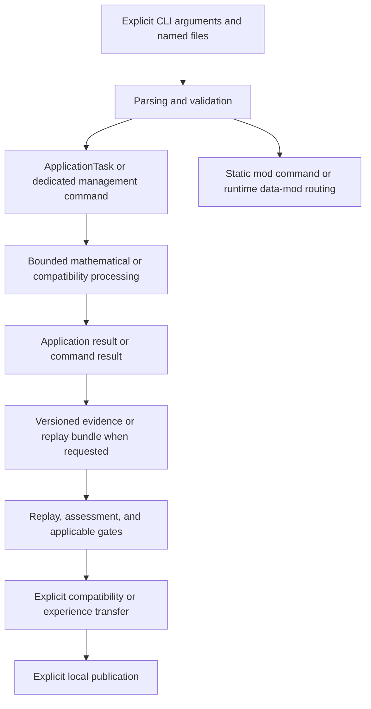

# BRUCE: architecture consolidation — Core 0.102

**IMPLEMENTED AND VERIFIED:** this document consolidates the current
source-tree boundaries for Core 0.102.0. Its implementation claims are tied to
the linked CMake targets, headers, source files, and tests; it does not turn a
roadmap, ADR, or historical acceptance record into a present-tense claim.

For prior architecture context, see the
[historical Blueprint through Core 0.93](03-blueprint-history-through-093.md).
For the original target model, see [system architecture](02-system-architecture.md).
For the current control boundary, see the
[control and publication contract](../contracts/06-control-and-publication.md).

## Scope and evidence boundary

BRUCE is a local Linux mathematical research CLI. The CMake build is C++20 and
links GMP/GMPXX and OpenSSL Crypto. It contains bounded research, Grid,
compatibility, evidence, replay, experience, rule, local-file, and routing
paths. The `bruce` CLI and the `bruce-mod-builder` local data-mod builder are
defined in `CMakeLists.txt`.

**IMPLEMENTED AND VERIFIED:** the optional static `Language` and `NanoCell`
mods are compiled through `BRUCE_BUILD_MOD_LANGUAGE` and
`BRUCE_BUILD_MOD_NANOCELL`. They are selected at configuration time and linked
into the fixed mod catalog; they are not dynamically loaded executable
plugins. Signed runtime data mods are a separate mechanism: they provide
validated Tree routing data and do not execute package-supplied code.

**DOCUMENTED / CONCEPT:** free-form dialogue, a general formula prover, GPU
execution, and Phase-DAG execution. The current CMake configuration contains
no `BRUCE_BUILD_MOD_COCKPIT` option or Cockpit target. Therefore a buildable
Cockpit feature is **NOT DERIVABLE FROM THE REPOSITORY**, regardless of
planning records or unbuilt source fragments.

Completion, successful replay, sample confirmation, and a proof within a
named domain are distinct claims. `VERIFIED_ON_SAMPLES` is not a general proof;
a digest binds bytes but does not authenticate a person; a gate report is an
assessment, not an authorization token.

## Current processing model

The arrows describe callable, explicit paths; they do not describe a hidden
scheduler, automatic promotion, or a universal execution graph. The optional
session controller has the linear states `CREATED → EXECUTING → SERIALIZING →
REPLAYING → READY` or `FAILED`; it does not orchestrate all management paths.

## Responsibilities and boundaries

| Area | Current entry points | Boundary |
| --- | --- | --- |
| Application tasks and results | [`application_task.hpp`](../../include/bruce/application/application_task.hpp) | Eight fixed task/run variants: research, exact research, Grid, Grid batch, Grid resume, Grid research, fraction comparison, and compatibility; no dynamic task registration. |
| Assessment and gates | [`application_task.hpp`](../../include/bruce/application/application_task.hpp), [`research_gates.cpp`](../../src/application/research_gates.cpp) | In-memory assessment does not verify provenance. Bundle-oriented paths replay before exposing a verified assessment. |
| Mathematical and compatibility work | [`math/`](../../include/bruce/math), [`compatibility/`](../../include/bruce/compatibility), [`application/`](../../src/application) | Bounded domain-specific processing; CLI exit code 0 is not a complete-search or general-proof claim. |
| Evidence and replay | [`evidence/`](../../include/bruce/evidence), [`application_replay.cpp`](../../src/application/application_replay.cpp) | Versioned bytes, digests, and replay bind a stated artifact; they do not authenticate a human author. |
| Experience and transfers | [`experience_task.hpp`](../../include/bruce/application/experience_task.hpp), [`experience_transfer.hpp`](../../include/bruce/application/experience_transfer.hpp), [`compatibility_transfer.hpp`](../../include/bruce/application/compatibility_transfer.hpp) | Explicit source and target checks; no general learning system or automatic rule promotion. |
| Rules and local files | [`rule_proposal.hpp`](../../include/bruce/application/rule_proposal.hpp), [`local_files.hpp`](../../include/bruce/io/local_files.hpp) | Local Linux file and terminal-confirmation model; confirmation binds content and is not an identity boundary. |
| Static mods | [`mod_api.hpp`](../../include/bruce/mod/mod_api.hpp), [`catalog.hpp`](../../include/bruce/mod/catalog.hpp), [`mods/`](../../mods) | Fixed catalog plus optional Language/NanoCell sources; no third-party binary discovery or loading. |
| Runtime data mods | [`runtime_package.hpp`](../../include/bruce/mod/runtime_package.hpp), [`runtime_registry.hpp`](../../include/bruce/mod/runtime_registry.hpp), [`tree/`](../../include/bruce/tree) | Explicitly trusted, signed, schema-checked routing data. Installation and activation are distinct; routes select templates and do not execute them. |

## Explicit local control

The [local human rule approval contract](../contracts/05-human-rule-approval.md)
defines the current local model. `rules-propose`/`rules-approve` create a
confirmed, exclusive new rule-file export without activation. `rules-stage`,
`rules-activate`, and `rules-status` manage an explicitly named active numeric
rule store, generation, base binding, and durable journal. A terminal dialogue
is a user-interface control, not an identity boundary against other programs
run by the same user.

`compatibility --rule-store` reads the named active rule revision into that
invocation. Direct `--rules` file paths remain explicit. Rejection histories,
migration, and journal rotation are not established as general capabilities.

## Control, publication, and verification

The [control and publication contract](../contracts/06-control-and-publication.md)
is the current reference for checkpoints, cancellation, error envelopes, and
publication boundaries. Session, gate, transfer, and management flows have
intentionally distinct contracts. Their counters are not universal measures of
mathematical operations, wall time, or process memory.

`scripts/verify_control_flow.py` and its linked acceptance record document a
specific reproducible control profile. That evidence does not replace a full
architecture acceptance or broaden the core’s claim scope. The
[CLI manual](../cli/README.md) remains the command and file-format authority.

## Local working areas and next decisions

`runs/`, `build*/`, and `.worktrees/` are ignored local working areas. The
reversible semantic Python-index experiment is archived under
`runs/retired-semantic-index/`; it is not an active build component.

**OPEN DECISION:** the next architectural work must explicitly choose whether
and how to harmonize controllers, failure models, or additional management
paths. Any such work must preserve existing command-specific behavior unless a
migration is stated and tested. **PROPOSAL:** treat free-form language,
NanoCell integration into `ApplicationTask`, a Cockpit, Phase-DAG execution,
and GPU work as separate, testable packages rather than implied extensions of
the current core.
