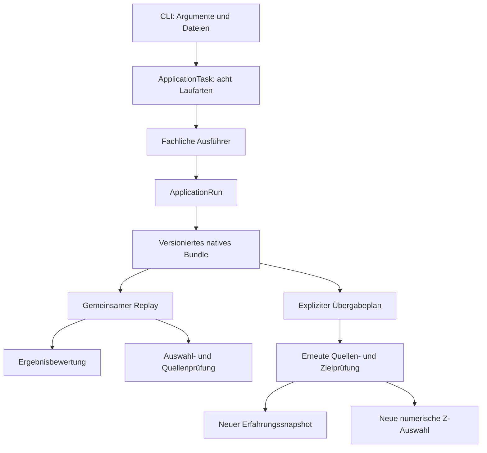

# BRUCE: konsolidierte Architektur – Core 0.102

Stand: 04.10.2026. Dieses Dokument beschreibt den vorhandenen Quellbaum und ersetzt die frühere Folge sich überlagernder Fortschreibungen. [Historischer Stand](03-blueprint-history-through-093.md), [ursprüngliches Zielbild](02-system-architecture.md), [M0–M2-Matrix](../implementation/136-m0-m2-acceptance-matrix.md).

## Einordnung

BRUCE ist ein lokaler mathematischer Forschungskern mit CLI. Das Grid gehört zu diesem Kern. C++20, GMP/GMPXX und OpenSSL bilden die vorhandene Implementierungsbasis. Zusätzlich existieren die optionalen, statisch gebauten Language- und NanoCell-Mods. NanoCell bietet mit `nanocell run`/`replay` drei begrenzte Byte-Techniken und neue herkunftsgebundene Mod-Exporte; historische direkte V1-Dateien bleiben lesbar. Die allgemeine Ausführung ist sequenziell. Es gibt keine freie Sprachschnittstelle, keine NanoCell-Einbindung in `ApplicationTask`, kein Cockpit, keine GPU- und keine Phase-DAG-Ausführung.

Abgeschlossene Verarbeitung, bestandener Replay, Bestätigung auf Stichproben und mathematischer Beweis innerhalb eines benannten Bereichs sind verschiedene Aussagen. `VERIFIED_ON_SAMPLES` ist kein allgemeiner Beweis. Ein Digest bindet Bytes und authentifiziert keinen Menschen. Gateberichte sind Befunde, keine Berechtigungstoken.

## Gemeinsamer Laufweg

Die Pfeile beschreiben aufrufbare Wege, keinen automatisch laufenden Aufgabenplaner. Der optionale Sitzungscontroller besitzt die linearen Phasen CREATED → EXECUTING → SERIALIZING → REPLAYING → READY beziehungsweise FAILED. Er orchestriert nicht sämtliche neueren Verwaltungs- und Übergabebefehle.

## Verantwortlichkeiten und Grenzen

| Baustein | Aktueller Einstieg | Grenze |
| --- | --- | --- |
| Acht gemeinsame Auftrag-/Laufvarianten | [application_task.hpp](../../include/bruce/application/application_task.hpp) | Forschung Int64, exakte Forschung, Grid, Grid-Stapel, Grid-Fortsetzung, Grid-Forschung, Bruchvergleich, Kompatibilität; keine dynamische Registrierung |
| Ergebnisbewertung und Gates | [application_replay.cpp](../../src/application/application_replay.cpp), [application_gates.cpp](../../src/application/application_gates.cpp) | In-Memory-Bewertung prüft keine Herkunft; bundlebasierte Wege führen Replay aus |
| Fachliche Gateentscheidung | [research_gates.cpp](../../src/application/research_gates.cpp) | Von JSON getrennt, unveränderte eingebaute Zulassungsregeln |
| Darstellung | [core/json.cpp](../../src/core/json.cpp), [research_gate_render.cpp](../../src/application/research_gate_render.cpp) | Keine fachliche Berechtigung aus formatierten Feldern |
| Erfahrungsein- und -ausgänge | [experience_task.hpp](../../include/bruce/application/experience_task.hpp) | Vier separate Aktionen add/revoke/replace/inspect; nicht Teil der acht allgemeinen Laufvarianten |
| Erfahrungsrouting | [experience_routing.cpp](../../src/application/experience_routing.cpp) | Kontextgebundene Stimmen für vorhandene Strategiereihenfolgen, kein allgemeines Lernen |
| Erfahrungsquellenaudit | [experience_source.cpp](../../src/application/experience_source.cpp) | Erneuter Replay und bestehende Eignungsprüfung; keine Regelpromotion |
| Erfahrungssnapshots | [experience/store.hpp](../../include/bruce/experience/store.hpp), [store.cpp](../../src/experience/store.cpp) | Öffentlicher Header ohne Forschungs-/Planungstypen; Implementierung hängt weiterhin vom Anwendungsaudit ab |
| Regelvorschläge und Historien | [rule_proposal.hpp](../../include/bruce/application/rule_proposal.hpp), [rule_history.hpp](../../include/bruce/application/rule_history.hpp) | Anwendungsmodelle ohne Terminal; keine Identitätsprüfung |
| Lokaler Regeldialog | [rule_store.hpp](../../apps/rule_store.hpp) | Argumente, Vorprüfung und menschliche Bestätigung |
| Lokale Dateipersistenz | [local_files.hpp](../../include/bruce/io/local_files.hpp), [local_files.cpp](../../src/io/local_files.cpp) | Lesen, exklusiver Export, Regelspeicherladen und bestätigter gesperrter Wechsel; lokales Linux-Modell |
| Erfahrungstransfer | [experience_transfer.hpp](../../include/bruce/application/experience_transfer.hpp) | Feste Aktion add; Quelle/Basis und Bytes gebunden, erneuter Import |
| Z-Auswahltransfer | [compatibility_transfer.hpp](../../include/bruce/application/compatibility_transfer.hpp) | Quelle/kanonische Regeln/Stelle/Budgets gebunden, erneute Auswahl |
| Optionale NanoCell-Mod | [nanocell.hpp](../../include/bruce/mods/nanocell/nanocell.hpp), [mod.hpp](../../include/bruce/mods/nanocell/mod.hpp), [nanocell_cli.hpp](../../apps/nanocell_cli.hpp) | Acht-Byte-Kern, drei feste Referenztechniken und `BRUCE_MOD_RUN_V1` für neue Exporte; direkte V1-Replays read-only, kein allgemeiner Auftragstyp oder Gate |
| Mod-Runtime und fester Katalog | [mod_api.hpp](../../include/bruce/mod/mod_api.hpp), [catalog.hpp](../../include/bruce/mod/catalog.hpp) | Manifestprüfung, feste Language-/NanoCell-Registrierung und Core-Adapter für die acht bestehenden Auftragstypen; keine dynamischen Plugins |
| Optionale Language-Mod | [language_run.hpp](../../include/bruce/mods/language/language_run.hpp), [bruce_cli.cpp](../../apps/bruce_cli.cpp) | Zwei feste Satzmuster, CMake-Schalter `BRUCE_BUILD_MOD_LANGUAGE`, neuer äußerer Mod-Run und direkter V1-Replay; kein freier Dialog |

Die früheren Aussagen „Experience hat keinen Anwendungseinstieg“, „Gateentscheidungen benötigen Forschungs-JSON“ und „es gibt kein Übergabeobjekt“ gelten nicht mehr. Vollständige Bibliotheksentkopplung ist dennoch nicht erreicht: insbesondere Store → Anwendungsaudit bleibt eine tatsächliche Abhängigkeit. Es gibt keine allgemeine Plugin- oder Übergaberegistrierung.

## Regelhoheit im vereinbarten lokalen Betrieb

[ADR-013](../adr/013-human-rule-authority.md) verlangt die konkrete menschliche Bestätigung einer Regeländerung. Getrennte Konten, Signierschlüssel und ein externer Aktivierungsdienst sind gemäß Nutzerentscheidung keine Voraussetzung des lokalen Modells.

Zwei implementierte Wege sind getrennt zu betrachten:

- `rules-propose`/`rules-approve`: bestätigter exklusiver Export einer neuen Regeldatei; keine Aktivierung.
- `rules-stage`/`rules-activate`/`rules-status`: expliziter aktiver numerischer Regelspeicher mit Generation, Basisbindung und dauerhaftem Journal bestätigter Wechsel. Nach Bestätigung erfolgt erneute Prüfung unter Schreibsperre und atomarer gemeinsamer Dateiersatz.

`compatibility --rule-store` übernimmt die aktuelle Fassung einmal in den Auftrag. Direkte `--rules`-Dateiwege bleiben möglich. Der Terminaldialog ist eine Bedienkontrolle, keine Identitätsgrenze gegen Programme desselben Benutzers. Abgelehnte Entscheidungen, Migration und Journalrotation sind nicht implementiert. Kein globaler Schutz aller Regelarten wird behauptet. [Vollständiger Vertrag](../contracts/05-human-rule-approval.md).

## Steuerung und Nachweise

Der [konsolidierte Bestandsvertrag](../contracts/06-control-and-publication.md) ist der aktuelle Einstieg für Abdeckung, Prioritäten, Fehlerhüllen und Veröffentlichung. Sitzungscontroller, Gateprüfung und Transfercontroller bleiben getrennte Wege. Ihre Punkte sind keine universellen Rechen-, Zeit- oder Speichermaße.

Die fünf Transferbefehle, einschließlich direktem kontrolliertem `experience add`, steuern Dateilesen, Quellen-/Regelprüfung, native Verarbeitung und Exportvorbereitung bis vor Veröffentlichung. Die allgemeine Session umfasst ihre angebundenen Ausführungs-/Serialisierungs-/Replaypunkte, aber nicht den nachfolgenden CLI-Dateiexport. Die übrigen Verwaltungswege sind nicht pauschal integriert. Einzelne Systemaufrufe und Fachoperationen bleiben atomar.

Die Z-Auswahl ist keine Erfahrungsquelle. Der unabhängige Forschungsbefund verzweigt separat in Auswahl und Erfahrungsimport; beide Ziele prüfen ihn erneut. Die Grafik oben zeigt diese Verzweigung. Es gibt keinen automatischen Aufgabenplaner und keine implizite Regelpromotion.

## Abnahme und nächste Arbeit

Die [Abnahme Core 0.101](../implementation/182-control-consolidation-usage.md) und ihr [ausführbarer Prüfer](../../scripts/verify_control_flow.py) verbinden Forschung, Gates, beide Übergaben, Replay/Audit und negative Quellen-/Budget-/Freigabefälle. Der Bericht hält Version, Binärdigest, Eingaben, Aufrufe, Antworten und Artefaktdigests fest. [CLI-Anleitung](../cli/control-overview.md).

Das [Profil Core 0.93](../implementation/174-local-cli-acceptance-profile.md) bleibt ein historischer Nachweis. Keine dieser Abnahmen ersetzt die M0–M2-Gesamtabnahme des ursprünglichen Zielbilds.

Nächste Architekturarbeit: explizite Entscheidung über Controller-/Fehlerharmonisierung und Erweiterung der tatsächlich benötigten Verwaltungswege. Unterschiedliche Fehlerprioritäten dürfen dabei nicht stillschweigend geändert werden. Freie Sprache, NanoCell-Einbindung in den allgemeinen `ApplicationTask`-Lauf, Cockpit, Phase-DAG und GPU bleiben eigene Pakete. Suchoptimierung bleibt nachrangig.

## Auslieferung und Herkunft

Auf Bruce-AI ist `/home/chris/Desktop/Bruce_raw/build/bruce` maßgeblich. Änderungen werden per SCP übertragen; lokale Prüfung und Remoteprüfung werden getrennt dokumentiert. Core 0.102 verlagert die Dateiverantwortung in einen gemeinsamen lokalen Adapter; mathematische und Steuerungsverträge bleiben unverändert. [Adapterabnahme](../implementation/183-local-file-adapter-usage.md), [ADR-014](../adr/014-local-file-adapter.md).

Die historischen Ausbaupakete [0.94](../implementation/175-transfer-control-usage.md), [0.95](../implementation/176-transfer-planning-control-usage.md), [0.96](../implementation/177-transfer-input-control-usage.md), [0.97](../implementation/178-transfer-rule-store-control-usage.md), [0.98](../implementation/179-transfer-export-control-usage.md), [0.99](../implementation/180-transfer-rule-validation-control-usage.md) und [0.100](../implementation/181-native-z-rule-control-usage.md) bleiben zur Herkunft erhalten. Für den aktuellen Gesamtvertrag ist die oben verlinkte Konsolidierung maßgeblich.
