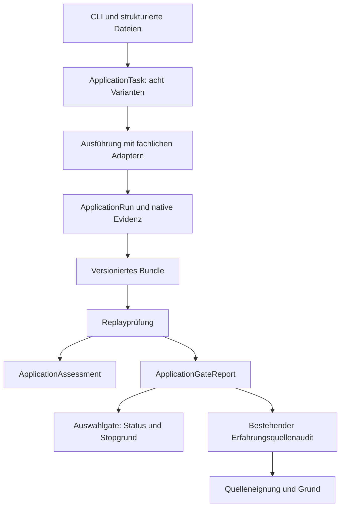

> Historischer Dokumentstand, am 26.09.2026 archiviert. Für aktuelle Aussagen gilt [03-blueprint-consolidation.md](03-blueprint-consolidation.md). Überholte Einschränkungen und Entwürfe sind hier bewusst unverändert erhalten.

## Fortschreibung Core 0.93

Die zweite [konkrete Ergebnisübergabe](../implementation/173-compatibility-transfer-usage.md) bindet Forschungsquelle, Regelfassung, Auswertungsstelle und Auswahlbudgets. Quelle und Regeln werden bei Ausführung erneut geprüft. Allgemeine Übergabeketten und universelle Rechenbudgets bleiben offen.

## Fortschreibung Core 0.92

Die erste [explizite Ergebnisübergabe](../implementation/172-experience-transfer-usage.md) bindet Forschungsquelle, Erfahrungsbasis und Bytegrenzen für `experience-add`. Die Ausführung wiederholt die fachliche Prüfung. Weitere Zielaktionen und universelle Arbeitsbudgets bleiben offen.

## Fortschreibung Core 0.91

[Aktive numerische Regelverwaltung](../implementation/171-active-rule-history-usage.md) ist für ausdrücklich benannte lokale Speicher implementiert. Initialisierung und Wechsel brauchen konkrete Terminalbestätigung; Journal und aktive Fassung werden gemeinsam ersetzt. Dies ersetzt die älteren Aussagen, es gebe überhaupt keine Aktivierungsverwaltung. Globale Durchsetzung für direkte Dateiwege und andere Regelarten besteht weiterhin nicht.

# Fortschreibung: lokale Regelprüfung

Core 0.90 trennt [Vorschlagsprüfung und Digestbindung](../implementation/170-rule-proposal-application-usage.md) vom CLI-Dialog. Der Anwendungseinstieg erteilt keine Zustimmung und aktiviert keine Regeln.

Die Nutzerentscheidung für lokalen Betrieb ersetzt die ältere Voraussetzung eines geschützten unabhängigen Freigabekanals. [Core 0.89](../implementation/169-local-rule-review-usage.md) implementiert Vorschlag, Terminalprüfung und bestätigten Export. Eine globale aktive Regelverwaltung bleibt offen; die nachfolgenden älteren Anforderungen an Signierung/Kontentrennung gelten nicht mehr.

# BRUCE Blueprint: Architekturfortschreibung nach Core 0.81

Stand: 25.09.2026. Dieses Dokument verbindet Zielbild und vorhandenen Code. **Bestand** bezeichnet hier im Quellbaum nachgewiesene Strukturen; **geplant** bezeichnet die nächsten Änderungen. Es führt keine neuen Runtimefunktionen ein. Architektur hat Vorrang vor weiterer Leistungsoptimierung.

## 1. Produkt und Wahrheitsgrenze

BRUCE bleibt ein integrierter mathematischer Forschungskern. Das Grid ist ein Bestandteil seiner Adressierung und Forschung, keine getrennte Anwendung. Dynamische Aufgaben und Regeln ersetzen keine expliziten Domänen-, Versions- und Evidenzverträge.

Vier Aussagen müssen getrennt bleiben:

1. Ein Lauf wurde vollständig abgearbeitet.
2. Ein Bundle wurde erfolgreich replaygeprüft.
3. Eine Hypothese stimmt mit den geprüften Stichproben überein.
4. Eine Aussage wurde innerhalb eines ausdrücklich benannten mathematischen Bereichs bewiesen.

Keine dieser Aussagen erteilt automatisch eine Lern-, Speicher- oder Veröffentlichungsfreigabe. Ein Digest bindet Bytes, beweist aber weder Herkunft noch mathematische Wahrheit. `VERIFIED_ON_SAMPLES` ist keine allgemeine Beweisaussage. Der begrenzte Bruchvergleich über Q besitzt einen eigenen Aussagebereich.

## Menschliche Regelhoheit

[ADR-013](../adr/013-human-rule-authority.md) ist eine verbindliche Vorgabe für alle folgenden Pakete: Vorschläge und Erfahrungsdaten dürfen aktive Regeln nicht selbst verändern. Eine konkrete Regeländerung braucht ausdrückliche menschliche Freigabe. Die aktuelle Runtime besitzt noch keine gegen den automatischen Ausführer geschützte Freigabe-/Aktivierungsverwaltung. Diese Lücke darf nicht mit dem Quellenfeld `manual` als erledigt gelten.

## 2. Vorhandener Ablauf

Das Diagramm beschreibt die vorhandenen Aufrufe, keine automatische Ausführungskette von einem Bericht zum nächsten Auftrag. `gate-run` schreibt keinen Erfahrungsspeicher. Der vorhandene Sitzungscontroller besitzt lineare Phasen, keine Phase-DAG.

| Bestand | Konkreter Einstieg | Wichtige Grenze |
| --- | --- | --- |
| Acht Auftrags-/Ergebnisvarianten | [application_task.hpp](../../include/bruce/application/application_task.hpp) | Keine dynamische Registrierung neuer Runtimearten |
| Lineare geprüfte Sitzung | [execution_session.cpp](../../src/application/execution_session.cpp) | READY ist keine mathematische oder fachliche Freigabe |
| Gemeinsame Ergebnisbewertung | [application_replay.cpp](../../src/application/application_replay.cpp) | In-Memory-Bewertung prüft nicht selbst die Herkunft |
| Typisierte Gateberichte | [application_gates.cpp](../../src/application/application_gates.cpp) | Bericht ist veränderbar; keine unverfälschbare Berechtigung |
| Gemeinsame Forschungsregeln | [research_gates.cpp](../../src/application/research_gates.cpp) | Auswahlzulassung garantiert keinen projizierbaren Kandidaten |
| Quellenprüfung und Erfahrungskorrekturen | [store.cpp](../../src/experience/store.cpp) | Quelleneignung garantiert keinen Import in einen bestimmten Snapshot |
| Prüfpunktkonto | [session_budget.cpp](../../src/application/session_budget.cpp) | Kontrollstellen sind keine universellen Rechenkosten |
| Einzel-Grid-Replaysteuerung | [grid.cpp](../../src/application/grid.cpp) | Berechnung selbst bleibt zusammenhängend |

## 3. Tatsächliche Modulgrenzen und Abweichungen

Die Verantwortlichkeitstabelle im [ursprünglichen Blueprint](02-system-architecture.md) ist ein Ziel, keine durchgesetzte Abhängigkeitsregel.

- Bis Core 0.81 rief die CLI `append_experience`, `replace_experience` und `revoke_experience` direkt auf. Seit Core 0.82 führt sie diese Aktionen über `execute_experience` aus. Diese Funktionen liefern neue Snapshotbytes; den exklusiven Dateiexport führt die CLI aus. Das ist keine versteckte Datenbankmutation, der begrenzte Anwendungseinstieg ist inzwischen vorhanden.
- `experience/store.hpp` band bis Core 0.82 `application/portfolio_order.hpp` ein. Core 0.83 entfernt diese Einbindung, behält aber vorwärts deklarierte Anwendungstypen in der Rankingdeklaration; die Implementierung benötigt den Planer weiterhin. Die Zielrichtung der Modulabhängigkeiten ist deshalb noch nicht sauber getrennt.
- Das Forschungs-Gate-Modul nutzt die JSON-Hilfe aus dem Forschungsmodul. Die fachliche Regel und ihre Darstellung sind dadurch noch über Header verbunden.
- Gateberichte und Ergebnisbewertungen sind zwei bewusst verschiedene Verträge. Es gibt noch kein typisiertes Übergabeobjekt für einen anschließenden Auftrag.

Diese Abweichungen rechtfertigen gezielte Konsolidierung. Sie belegen keine defekte Mathematik und werden nicht durch zusätzliche CLI-Schalter allein gelöst.

## 4. Nächste Architekturpakete – geplant

### Voraussetzung für jede künftige Regelaktivierung

Vor einem Aktivierungspfad sind der geschützte menschliche Freigabekanal und die Bindung von Zustimmung an Inhalt, Basis und Ziel festzulegen. Der [technische Entwurf V1](../contracts/05-human-rule-approval.md) konkretisiert nun getrennte Prüfstelle, geschützten Aktivierungsdienst, Inhalts-/Basisbindung, Challengeverbrauch und Abnahmetests. Das aktuelle gemeinsame Konto `chris` erfüllt diese Trennung nicht; eine Aktivierungsfunktion bleibt gesperrt bis zur technischen Umsetzung und Abnahme. Der Ausführer darf seine eigene Freigabe nicht erstellen können. Die Akzeptanzfälle stehen in ADR-013. Die folgenden Erfahrungsadapter dürfen ausschließlich ihre expliziten Snapshotaktionen ausführen und keine Regelaktivierung hinzufügen.

### A. Erfahrungsaufträge durch die Anwendungsschicht führen

**Begrenzt umgesetzt in [Core 0.82](../implementation/162-experience-application-usage.md).** Ein begrenzter Anwendungsauftrag beschreibt Hinzufügen, Widerrufen oder Ersetzen mit Quellbundle, vorigem Snapshot und erforderlichen Identifikatoren/Gründen. Die Anwendungsschicht ruft die vorhandenen geprüften Storefunktionen auf und liefert Snapshot plus Bericht. Die CLI bleibt für Lesen und exklusiven Export zuständig.

Abnahme:

- Für alle drei Aktionen entstehen dieselben Snapshotbytes und Berichte wie bisher.
- Fehler für ungeeignete Quellen, doppelte Einträge, unbekannte IDs und Kapazitätsgrenzen bleiben erhalten.
- Fehler verändern keine vorhandene Datei; Export überschreibt kein Ziel.
- CLI und C++-Auftrag benutzen denselben Anwendungseinstieg.
- Quelleneignung aus einem früheren Gatebericht umgeht keine erneute Prüfung des tatsächlich übergebenen Bundles.

Zunächst keine automatische Integration in die acht `ApplicationTask`-Varianten: Erst einen eigenen begrenzten Adapter liefern, bevor neue Bundle-/Replayfamilien oder Sitzungsphasen eingeführt werden.

### B. Fachliche Regeltypen von Darstellung und Planung entkoppeln

Nach A die notwendigen gemeinsamen Werttypen und Portfoliokontexte bestimmen. Nur nachgewiesene Abhängigkeiten herauslösen; keine universelle Pluginarchitektur vorwegnehmen. Zulassungsregeln benötigen keine CLI-/JSON-Helfer. Abnahme: unveränderte Regelmatrix, historische Replayformate und Ausgaben; explizite Prüfung der gewünschten Include-Richtung.

### C. Explizite Ergebnisübergabe

Eine spätere Übergabe benennt Quellbundle, Zielaktion, Versionsvertrag, Parameter und Budgets. Ein Bericht ist ein Befund, kein Berechtigungstoken. Der empfangende Anwendungseinstieg prüft die tatsächliche Quelle und den Zielkontext erneut. Abnahmefälle: veränderte Quelle nach Inspektion, unvollständiger Run, fehlender Kandidat, ungeeignete Projektion, voller Snapshot und Abbruch vor Export.

### D. M0–M2 nach begrenztem Freigabeprofil abnehmen

Ein dokumentiertes Profil beschreibt genau die unterstützten Auftragstypen, Zahlendomänen, Bundleversionen und Steuerungsgrenzen. Die [Abnahmematrix](../implementation/136-m0-m2-acceptance-matrix.md) wird anhand konkreter Nachweise geprüft. Offene Tokenrollen, externe Evidenz, allgemeine Expansion und dynamische Strategieports bleiben ausgewiesen. Keine pauschale Gesamtfreigabe aus einer erfolgreichen Testsuite ableiten.

## 5. Nachgelagerte Zielarchitektur

Aufgaben-/Sprachverständnis, NanoCell, Cockpit und Phase-DAG bleiben eigene Pakete. Das Cockpit soll vorhandene Anwendungsaufträge verwenden, keine zweite fachliche Implementierung erhalten. Parallelisierung, GPU-Ausführung und weitere Suchoptimierung folgen erst nach belastbaren Zustands-, Abhängigkeits- und Übergabeverträgen.

## 6. Auslieferungsregel

Auf Bruce-AI ist der Nutzerpfad `/home/chris/Desktop/Bruce_raw/build/bruce` maßgeblich. Ein erfolgreicher Build unter `/tmp` beweist nicht dessen Aktualisierung. Jede künftige Codelieferung prüft Version, konkreten neuen Beispielaufruf und relevante Tests an diesem Pfad. Quellen werden per SCP übertragen; lokaler Test, Transfer und Remoteprüfung werden getrennt berichtet.

## 7. Nachweis dieser Fortschreibung

Die genannten Quellstellen wurden für diese Fortschreibung gelesen. Die Architekturübersicht und M0–M2-Matrix wurden auf Core 0.81 aktualisiert. Dies ist eine Dokumentationslieferung ohne Versionssprung, neue Runtimefunktion oder erneute Gesamtfreigabe. Frühere Testzahlen bleiben historische Nachweise ihrer jeweiligen Codelieferungen.

## Fortschreibung Core 0.82

Paket A besitzt jetzt den eigenen Adapter mit drei expliziten Auftragsvarianten. Er verändert weder aktive Regeln noch die acht allgemeinen Laufarten. Als nächste strukturelle Arbeit verbleibt Paket B; ADR-013 bleibt für jede künftige Regelaktivierung verbindlich.

Core 0.83 beginnt Paket B mit der [Experience-Headerentkopplung](../implementation/163-experience-header-boundary-usage.md). Die fachliche Rankingabhängigkeit bleibt offen.

Core 0.84 verlagert [Erfahrungsrouting und Kontextableitung](../implementation/164-experience-routing-boundary-usage.md) in die Anwendungsschicht. Der Storeheader referenziert keine Forschungs-/Planungstypen mehr; die Storeimplementierung benötigt für den Quellenaudit weiterhin Anwendungskomponenten. Ältere Absätze dieses Abgleichs beschreiben den jeweils benannten Versionsstand.

Core 0.85 trennt [Gateentscheidung und JSON-Katalog](../implementation/165-gate-render-boundary-usage.md). Die Entscheidung ist isoliert übersetzbar; der Renderer nutzt weiterhin die vorhandene JSON-Hilfe. Die fachlichen Regeln bleiben unverändert.

Core 0.86 lagert den [Erfahrungsquellenaudit](../implementation/166-experience-source-boundary-usage.md) aus dem Store in einen eigenen Anwendungseinstieg aus. Der Store ruft ihn weiterhin bei der Quellenprüfung auf; eine vollständige Bibliotheksentkopplung wird daraus nicht abgeleitet.

Core 0.87 verlagert den unveränderten [JSON-Stringhelfer in den Core](../implementation/167-json-core-boundary-usage.md). Store und Gate-Renderer benötigen den Forschungsheader nicht mehr für ihre Darstellung; die Quellenaudit-Abhängigkeit bleibt bestehen.

Core 0.88 ergänzt den [Experience-Leseauftrag](../implementation/168-experience-inspection-entry-usage.md). Damit verwenden alle vier Experience-CLI-Aktionen den Anwendungseinstieg; die Inspektion schreibt keine Dateien oder Regeln.
