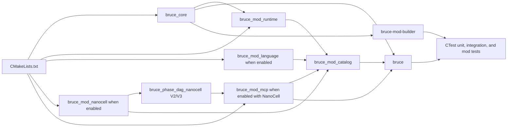
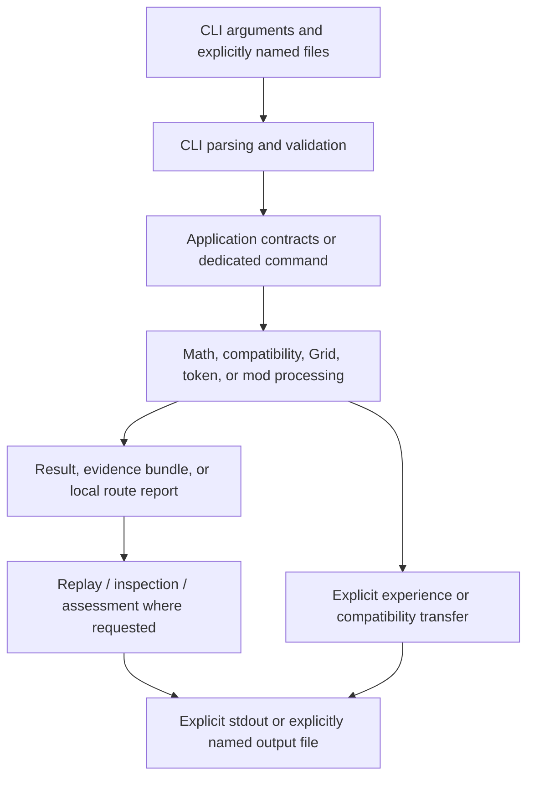

# Repository structure and evidence map

**IMPLEMENTED AND VERIFIED:** this guide maps the current tracked BRUCE_raw
tree to CMake targets, public headers, source files, and tests. It explains
responsibility boundaries; it does not elevate plans, audits, concepts, or
historical records into implementation claims.

## Relevant tracked areas

```text
apps/                         CLI entry point and local command helpers
benchmarks/                   Versioned compact benchmark reports and profiles
cmake/                        Build-information and version templates
docs/                         Reader documentation, contracts, evidence, and context
examples/                     Reproducible input data and local data-mod example
include/bruce/                Public C++ headers, grouped by domain
mods/                         Optional static Language, NanoCell, and MCP sources
scripts/                      Dependency wrapper and verification tooling
src/                          C++20 implementation, grouped by domain
tests/
  unit/                       C++ unit and contract tests
  integration/                CLI and end-to-end Python tests
  mods/                       Mod-specific C++ and Python tests
  fixtures/                   Controlled replay and parser fixtures
```

Top-level build and policy files have separate authority:

| Path | Responsibility |
| --- | --- |
| [`CMakeLists.txt`](../../CMakeLists.txt) | Defines the C++20 project, dependencies, libraries, executables, test registration, packaging metadata, and current optional static-mod switches. |
| [`README.md`](../../README.md) | Concise project entry point and build path. |
| [`CONTRIBUTING.md`](../../CONTRIBUTING.md) and [`AGENTS.md`](../../AGENTS.md) | Contribution and repository-working rules. |
| [`DEPENDENCIES.md`](../../DEPENDENCIES.md), [`LICENSE`](../../LICENSE), and notices | Distribution, dependency, and rights context. |
| [`.github/workflows/ci.yml`](../../.github/workflows/ci.yml) | Reproducible CI build, test, generated-CLI-documentation, link, and secret-scan checks. |

## C++ domains

Public headers in `include/bruce/` are the source-level boundary for consumers;
the corresponding `src/` directories provide implementation unless the feature
lives in `mods/`.

| Domain | Responsibility and relationship |
| --- | --- |
| `application` | Typed tasks, runs, research orchestration, Grid workflows, assessment, replay, gates, transfers, rule workflows, and control budgets. It composes other domains rather than making their data formats implicit. |
| `compatibility` | Bounded numeric Z-compatibility rules, snapshots, selection, traces, and results. Application commands call it through explicit tasks and files. |
| `coordinate` | Grid coordinates and paths used by Grid-related application work. |
| `core` | Shared primitive types, errors, JSON rendering, and replay-control plumbing. It is the common technical base rather than a mathematical strategy. |
| `evidence` | SHA-256 helpers, bounded reads, exclusive export, and evidence/replay bundle support. It binds named bytes and does not authenticate a human identity. |
| `experience` | Experience records, corrections, and snapshots. Application code performs source audit and routing; the store is not a general learning system. |
| `io` | Local Linux file operations, exclusive publication, atomic replacement, rule-store access, and explicit confirmation handoff. It supplies no terminal UI or mathematical planning. |
| `math` | Exact values, bounded number domains, polynomial, power-affine, rational-function, expression, normalization, and domain-cache mechanics used by research application paths. |
| `mod` | Fixed built-in catalog plus signed Data/Logic packages, trust, durable registries, common installed host, worker boundary, and local builders. |
| `token` | Versioned token/task-spec structures and parsing for tokenized task runs. |
| `tree` | Normalized route input, the immutable Core Tree, child mounts, and deterministic routing used by installed Data/Logic mods. |

`include/bruce/mods/language/`, `include/bruce/mods/nanocell/`, and
`include/bruce/mods/mcp/` define the three optional static-mod APIs.
Their corresponding `mods/` directories create static libraries consumed by
the fixed catalog and `bruce` executable. `include/bruce/phase_dag/` and
`src/phase_dag/` supply the separate bounded V2 and V3 execution/replay
contracts. Their fixed catalogs live in
`mods/nanocell/src/phase_dag_adapter_v2.cpp` and
`mods/nanocell/src/phase_dag_adapter_v3.cpp`, compiled into
`bruce_phase_dag_nanocell` for the CLI and MCP inspector.

## Build dependency flow



The CMake configuration links `bruce_core` to GMP/GMPXX and OpenSSL Crypto.
`bruce-mod-builder` links directly to `bruce_core`; it is a local package
builder, not a server and not an installer. CTest registers C++ unit tests and
Python integration and mod workflows. CI configures a Release Ninja build on
Ubuntu 24.04, runs CTest, verifies generated CLI artifacts in a temporary copy,
checks local documentation links, and scans for secrets.

## MCP Inspector

**IMPLEMENTIERT UND BELEGT:** `BRUCE_BUILD_MOD_MCP=ON` configures
the optional static `bruce_mod_mcp` and requires `BRUCE_BUILD_MOD_NANOCELL=ON`.
Its `bruce mcp [--port 1..65535]` command defaults to 8080 and binds only
`127.0.0.1`; an unavailable requested port causes controlled failure.
Only `GET /`, `GET /api/v1/health`, `POST /api/v1/inspect`,
`POST /api/v3/inspect` and `POST /api/dag-scheduler-v4/inspect` are registered.

The read-only Phase-DAG V2 and Phase-DAG V3 inspector uses fixed NanoCell
catalogs: NanoCell/Evidence-Gate for V2 and NanoCell/Payload-Gate for V3.
`POST /api/v1/inspect` retains its 1 MiB (1048576 bytes) limit and response
model; `POST /api/v3/inspect` accepts V3 bundles up to 5 MiB (5242880 bytes).
These two routes replay existing bundles; no new DAG executions, no jobs or
imports. Wrong-version bundles are rejected. The browser requires explicit
selection of Phase-DAG V2, Phase-DAG V3 or DAG-Scheduler V4, with no automatic
detection from file bytes. Its JSON and DOM expose metadata only;
`request_bytes`, `context_bytes`, `output_bytes`, `evidence_bytes` and
`payload_bytes` are never exposed. There are no adapter plugins.
Replay/digest establishes bundle consistency, not author identity or a general
mathematical proof. The 5-MiB limit does not override tighter core/catalog limits.

The `mcp_inspector_*` service/server/assets remain separate from preserved,
unbuilt historical `cockpit_assets.cpp`, `cockpit_tests.cpp` and `test_cockpit.py`.
See the [command contract](../cli/commands.md#mcp-inspector) and
[HTTP/DOM contracts](../../tests/mods/mcp/test_mcp_inspector.py).

**IMPLEMENTIERT UND BELEGT:** DAG-Scheduler V4 is a separate read-only
structural inspector at exact `POST /api/dag-scheduler-v4/inspect`, with
explicit selection and a 5 MiB (5242880 bytes) limit on local `127.0.0.1`.
It checks the V4 header, complete bundle digest, decoding and canonical
repacking; no callbacks and no re-execution. `VALID` confirms structural
bundle consistency only, not successful replay, callback purity, author
identity or a mathematical proof. A structurally valid alteration with a
recomputed digest may pass; the inspector does not establish that the recorded
receipts or trace were executed. Phase-DAG V2/V3 keep their existing
replay-based routes and independent 1-MiB-V2/5-MiB-V3 limits.

V4 JSON and text-safe DOM show metadata only: `scheduler_version` is
`dag-scheduler-v2`; the overview contains DAG ID, start/receipt budgets and
node count. Nodes expose IDs, dependencies, `callback_id`, `request_size`
and `request_digest`; receipts add outcome/failure code and direct input
references (`producer_node_id`, `result_code`, `payload_size`, `payload_digest`),
plus output version, result code, size and digest or null. Trace entries
contain event and node ID. V4 has no `scheduler_explanation`; the V3 logical
explanation stays hidden and cleared when V4 is selected. No request,
context, output, evidence, input or payload bytes, hex/base64 encodings,
source paths or raw bundle text are returned. Bundles are local confidential
artifacts containing raw requests and payloads; metadata filtering provides
no encryption and no authentication or access control. Bytes remain only in
request memory with no persistence. Reset/version change clears selection
and views and invalidates pending replies; release does not promise physical
memory erasure.

There are no new DAG executions, no jobs or imports, no adapter plugins,
no replay buttons or routes, no persistent uploads, no payload download,
no dynamic plugins and no external access. Free language, a general prover,
GPU/network execution, external payload stores, Redis/Language management,
process starts, filesystem browsing and general runtime orchestration remain
**DOKUMENTIERT / KONZEPT**. The unchanged CLI example verifier covers MCP
argument parsing and V2/V3 examples; V4 structural HTTP/DOM/privacy evidence
comes from the dedicated MCP contracts, not generated examples.


## Conceptual execution flow



No hidden configuration file or environment variable selects a strategy.
Input comes from command arguments and explicitly named files. A successful
exit status means the command completed its processing path; readers must
interpret the result status, scope, completeness, and evidence fields before
making mathematical claims.

## Built-in and installable Mods

| Mechanism | Built-in Language/NanoCell/MCP | Installed Data Mod | Installed Logic Mod |
| --- | --- | --- | --- |
| How supplied | C++ sources compiled by CMake | Signed, schema-checked routing package | Signed routing package plus one hash-bound worker |
| How selected | CMake build options | Explicit local `mods` lifecycle | Same explicit local lifecycle |
| Runtime effect | Fixed C++ implementation | `route` selects a template | `route` selects; `mods run` uses the isolated worker host |
| Activation | Build-time availability | Inactive install, explicit activation | Inactive install, explicit activation |

The local builder reads canonical Data inputs or a prepared Logic source,
plus an explicit protected signing file, then emits a package and trust store.
It does not install or activate the result and invokes no compiler or shell.
The common installed host retains side-by-side versions under an explicit
user-owned root. The reproducible Data example under
[`examples/local-data-mods/`](../../examples/local-data-mods/math-rational-power/README.md)
demonstrates the explicit lifecycle. The complete contract is
[Local Mod Lifecycle V2](../contracts/10-local-mod-lifecycle-v2.md).

## Documentation and evidence authority

| Need | Authoritative place |
| --- | --- |
| Current system boundary | [Blueprint](03-blueprint-consolidation.md), then linked source/tests |
| Control, publication, replay, and failure boundary | [Control and publication contract](../contracts/06-control-and-publication.md), then linked source/tests |
| Actual command usage and formats | [CLI manual](../cli/README.md) and its code-derived reference |
| Public C++ interfaces | `include/bruce/` |
| Implementation | `src/`, `mods/`, and `apps/` |
| Verifiable behavior | `tests/`, CI, reproducible acceptance records, and generated CLI validation evidence |
| Concepts and proposed work | `docs/concepts/`, `docs/adr/`, and `docs/superpowers/` — **DOCUMENTED / CONCEPT** unless source-backed evidence says otherwise |
| Historical sequence and snapshots | `HISTORY.md`, `docs/history/`, `docs/audit/`, and numbered implementation records |

## Generated and local-only paths

- `docs/cli/source-index.md`, `docs/cli/examples.json`, and
  `docs/cli/validation.md` are generated CLI artifacts. Do not edit them by
  hand; use `docs/cli/verify_examples.py` in a temporary copy.
- `build*/` are local generated build products. A local executable is
  implementation evidence only for the exact source revision and configuration
  that produced it; it is not current-source evidence after relevant source or
  build changes. Use `scripts/verify_current_source.sh` from a safe native path
  for a fresh verification.
- `build-host-deps/` is a local dependency root used by the supplied wrapper,
  not a source-of-truth implementation directory. The wrapper requires a path
  without `:` or whitespace because the bundled `pkg-config` otherwise cannot
  construct safe search paths.
- `runs/` and `.worktrees/` are ignored local working areas.
- `runs/retired-semantic-index/` is a reversible archive of a Python
  experiment, not an active build component.
- `benchmarks/` keeps only compact, versioned reports and profiles in Git; raw
  benchmark data remains local.
- `tests/fixtures/` and `examples/` are tracked controlled inputs, not hidden
  runtime configuration.
