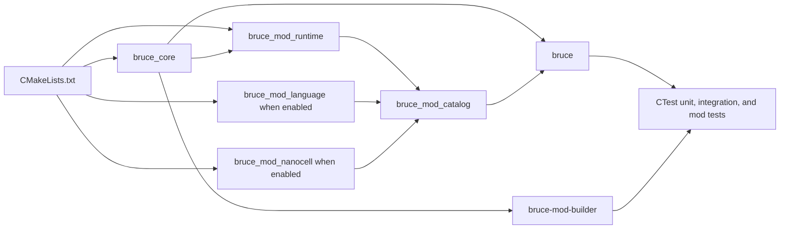
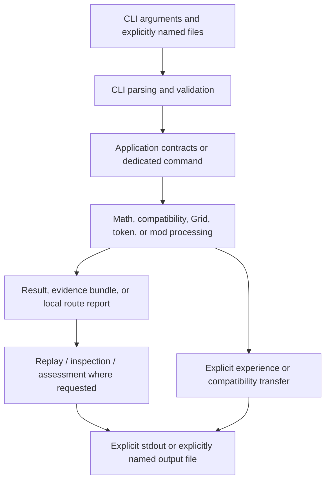

# Repository structure and evidence map

**IMPLEMENTED AND VERIFIED:** this guide maps the current tracked BRUCE_raw
tree to CMake targets, public headers, source files, and tests. It explains
responsibility boundaries; it does not elevate plans, audits, concepts, or
historical records into implementation claims.

## Relevant tracked areas

```text
apps/                         CLI entry point and local command helpers
benchmarks/                   Versioned compact benchmark reports and profiles
cmake/                        Build-information and version templates
docs/                         Reader documentation, contracts, evidence, and context
examples/                     Reproducible input data and local data-mod example
include/bruce/                Public C++ headers, grouped by domain
mods/                         Optional static Language and NanoCell mod sources
scripts/                      Dependency wrapper and verification tooling
src/                          C++20 implementation, grouped by domain
tests/
  unit/                       C++ unit and contract tests
  integration/                CLI and end-to-end Python tests
  mods/                       Mod-specific C++ and Python tests
  fixtures/                   Controlled replay and parser fixtures
```

Top-level build and policy files have separate authority:

| Path | Responsibility |
| --- | --- |
| [`CMakeLists.txt`](../../CMakeLists.txt) | Defines the C++20 project, dependencies, libraries, executables, test registration, packaging metadata, and current optional static-mod switches. |
| [`README.md`](../../README.md) | Concise project entry point and build path. |
| [`CONTRIBUTING.md`](../../CONTRIBUTING.md) and [`AGENTS.md`](../../AGENTS.md) | Contribution and repository-working rules. |
| [`DEPENDENCIES.md`](../../DEPENDENCIES.md), [`LICENSE`](../../LICENSE), and notices | Distribution, dependency, and rights context. |
| [`.github/workflows/ci.yml`](../../.github/workflows/ci.yml) | Reproducible CI build, test, generated-CLI-documentation, link, and secret-scan checks. |

## C++ domains

Public headers in `include/bruce/` are the source-level boundary for consumers;
the corresponding `src/` directories provide implementation unless the feature
lives in `mods/`.

| Domain | Responsibility and relationship |
| --- | --- |
| `application` | Typed tasks, runs, research orchestration, Grid workflows, assessment, replay, gates, transfers, rule workflows, and control budgets. It composes other domains rather than making their data formats implicit. |
| `compatibility` | Bounded numeric Z-compatibility rules, snapshots, selection, traces, and results. Application commands call it through explicit tasks and files. |
| `coordinate` | Grid coordinates and paths used by Grid-related application work. |
| `core` | Shared primitive types, errors, JSON rendering, and replay-control plumbing. It is the common technical base rather than a mathematical strategy. |
| `evidence` | SHA-256 helpers, bounded reads, exclusive export, and evidence/replay bundle support. It binds named bytes and does not authenticate a human identity. |
| `experience` | Experience records, corrections, and snapshots. Application code performs source audit and routing; the store is not a general learning system. |
| `io` | Local Linux file operations, exclusive publication, atomic replacement, rule-store access, and explicit confirmation handoff. It supplies no terminal UI or mathematical planning. |
| `math` | Exact values, bounded number domains, polynomial, power-affine, rational-function, expression, normalization, and domain-cache mechanics used by research application paths. |
| `mod` | Fixed static-mod manifest/catalog interfaces and the signed runtime data-mod package, trust-store, registry, and local builder APIs. |
| `token` | Versioned token/task-spec structures and parsing for tokenized task runs. |
| `tree` | Normalized route input, the immutable Core Tree, child mounts, and deterministic routing used by runtime data mods. |

`include/bruce/mods/language/` and `include/bruce/mods/nanocell/` define the
two optional static-mod APIs. Their sources live below `mods/language/` and
`mods/nanocell/`, and their CMake files create static libraries consumed by the
fixed catalog and `bruce` executable.

## Build dependency flow



The CMake configuration links `bruce_core` to GMP/GMPXX and OpenSSL Crypto.
`bruce-mod-builder` links directly to `bruce_core`; it is a local package
builder, not a server and not an installer. CTest registers C++ unit tests and
Python integration and mod workflows. CI configures a Release Ninja build on
Ubuntu 24.04, runs CTest, verifies generated CLI artifacts in a temporary copy,
checks local documentation links, and scans for secrets.

**NOT DERIVABLE FROM THE REPOSITORY:** a current static Cockpit target. The
configuration declares only `BRUCE_BUILD_MOD_LANGUAGE` and
`BRUCE_BUILD_MOD_NANOCELL`; do not document a `BRUCE_BUILD_MOD_COCKPIT` switch
or an available Cockpit command as part of the current build.

## Conceptual execution flow



No hidden configuration file or environment variable selects a strategy.
Input comes from command arguments and explicitly named files. A successful
exit status means the command completed its processing path; readers must
interpret the result status, scope, completeness, and evidence fields before
making mathematical claims.

## Static mods and runtime data mods

| Mechanism | Static Language/NanoCell mods | Runtime data mods |
| --- | --- | --- |
| How supplied | C++ sources compiled by CMake | Signed, schema-checked package data |
| How selected | `BRUCE_BUILD_MOD_LANGUAGE` or `BRUCE_BUILD_MOD_NANOCELL` at configure time | Explicit `mods` lifecycle commands and an explicitly selected registry |
| What changes | Which built-in command capabilities are registered | The active Tree routing data |
| Executable code from package | No | No |
| Activation | Built into the configured executable | Installed packages remain inactive until explicit activation |
| Runtime effect | Fixed C++ implementation runs | `route` selects a template deterministically; it does not execute that template |

The runtime data-mod builder reads canonical manifest, Tree, and golden-case
JSON and a protected local seed, then emits a package plus trust-store output.
It does not install or activate the result. The reproducible example under
[`examples/local-data-mods/`](../../examples/local-data-mods/math-rational-power/README.md)
demonstrates the full explicit lifecycle.

## Documentation and evidence authority

| Need | Authoritative place |
| --- | --- |
| Current system boundary | [Blueprint](03-blueprint-consolidation.md), then linked source/tests |
| Control, publication, replay, and failure boundary | [Control and publication contract](../contracts/06-control-and-publication.md), then linked source/tests |
| Actual command usage and formats | [CLI manual](../cli/README.md) and its code-derived reference |
| Public C++ interfaces | `include/bruce/` |
| Implementation | `src/`, `mods/`, and `apps/` |
| Verifiable behavior | `tests/`, CI, reproducible acceptance records, and generated CLI validation evidence |
| Concepts and proposed work | `docs/concepts/`, `docs/adr/`, and `docs/superpowers/` — **DOCUMENTED / CONCEPT** unless source-backed evidence says otherwise |
| Historical sequence and snapshots | `HISTORY.md`, `docs/history/`, `docs/audit/`, and numbered implementation records |

## Generated and local-only paths

- `docs/cli/source-index.md`, `docs/cli/examples.json`, and
  `docs/cli/validation.md` are generated CLI artifacts. Do not edit them by
  hand; use `docs/cli/verify_examples.py` in a temporary copy.
- `runs/`, `build*/`, and `.worktrees/` are ignored local working areas.
- `runs/retired-semantic-index/` is a reversible archive of a Python
  experiment, not an active build component.
- `benchmarks/` keeps only compact, versioned reports and profiles in Git; raw
  benchmark data remains local.
- `tests/fixtures/` and `examples/` are tracked controlled inputs, not hidden
  runtime configuration.
