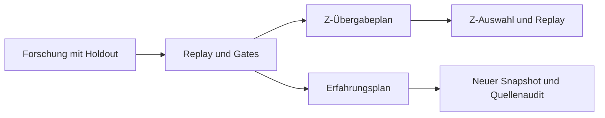
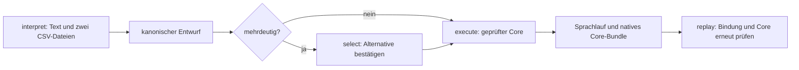

# Steuerung im Überblick – Core 0.102.0

[CLI-Handbuch](README.md) · [Bestandsvertrag und Abdeckungsmatrix](../contracts/06-control-and-publication.md)

## Welcher Weg passt?

| Zweck | Verwendung |
| --- | --- |
| Zwei feste deutsche Forschungsformulierungen in einen expliziten Lauf überführen | `language interpret` → bei Mehrdeutigkeit `language select` → `language execute` → `language replay` |
| Rechnen und Ergebnis im selben Aufruf reproduzieren | Fachbefehl mit `--verification replay`; optional `--max-session-checkpoints N` |
| Vorhandenen Forschungsbefund auf seine Eignung prüfen | `gate-run RUN --max-session-checkpoints N` |
| Inhaltlich gebundenen Erfahrungsimport oder eine Z-Auswahl planen/ausführen | Die sieben Transferbefehle einschließlich direktem `experience add`, `experience revoke` und `experience replace`, jeweils mit `--max-transfer-checkpoints N` und optional `--transfer-cancellation checkpoints` |
| Regeln ändern | Bestehender Vorschlags- und menschlicher Bestätigungsweg; kein Budget oder Gate ersetzt die Zustimmung |

Sitzungs- und Transferpunkte sind keine austauschbaren Einheiten. Die Konten beginnen pro Aufruf neu. Ein früher gemessener Verbrauch ist keine versionsübergreifende Zusage. Die [Kompatibilitätsmatrix](../contracts/06-control-and-publication.md#kompatibilitätsmatrix-der-steuerungswege) dokumentiert die vorhandenen Wege je Einstieg; sie schafft keine einheitliche Runtime. [Sessiondetails](results-and-control.md), [Transferdetails](transfer-control.md).

## Der geprüfte Ablauf



Beide Zweige binden dieselbe ursprüngliche Forschungsdatei. Das Z-Ergebnis wird nicht als Erfahrungsquelle weitergereicht: Dieser Versuch wird abgelehnt. Die Pfeile sind explizite CLI-Aufrufe, kein automatischer Aufgabenplaner.

## Optionale Language-Mod



Die Mini-Grammatik ist deterministisch und hat genau zwei unterstützte Formulierungen; hier läuft kein LLM und kein Netzwerkzugriff. Sie wird nur als statische CMake-Mod mit `BRUCE_BUILD_MOD_LANGUAGE=ON` registriert. Die Auswahl benennt nur die Trainings- und Holdout-Rollen. Der bestehende geprüfte Core bleibt für Rechenstatus, Replay-Evidenz und Gates maßgeblich. Ein natives `INCOMPLETE` wird nicht hochgestuft. NanoCell und eine Graph-/DAG-Laufzeit sind durch diesen Sprachpfad nicht implementiert. [Befehle](commands.md#language--optionale-deterministische-language-mod) und [Dateiformate](formats.md#sprachentwurf-und-sprachlauf) beschreiben die Grenzen.

## Optionale NanoCell-Mod

`nanocell run` führt nur die drei festen Byte-/Kontexttechniken aus. Bei `BRUCE_BUILD_MOD_NANOCELL=ON` schreibt `--output` einen Mod-Umschlag, der Manifest, kanonische Anfrage und den unveränderten inneren V1-Lauf bindet. `nanocell replay` liest diesen Umschlag oder historische direkte V1-Dateien. `MATCHED` bleibt ein lokaler technischer Status: Er ist weder `VERIFIED_ON_SAMPLES` noch ein Core-Gate oder eine Regelentscheidung. Der Mod erzeugt keinen `ApplicationTask`, keine allgemeine Sitzung und keine Phase-DAG. Bei `BRUCE_BUILD_MOD_NANOCELL=OFF` existiert der Befehl nicht. [Befehle](commands.md#nanocell--optionaler-statischer-nanocell-mod) und [Dateiformate](formats.md#nanocell-kontext-und-bundle) beschreiben die bytegenaue Grenze.

## Ablauf selbst prüfen

Vom Projektstamm, nach dem Build:

```bash
python3 scripts/verify_control_flow.py ./build/bruce --report /tmp/bruce-control-acceptance.json
```

Der Berichtspfad muss neu sein und sein Elternverzeichnis existieren. Der Prüfer benutzt ein eigenes temporäres Verzeichnis, verändert keine produktiven Daten und entfernt seine Testdateien anschließend. Der Bericht enthält Version, Binärprüfsumme, Eingabedaten, alle Aufrufe und Antworten sowie Prüfsummen der Testartefakte. Die aufgezeichneten relativen Argumente beziehen sich auf dieses temporäre Verzeichnis. Das ist ein Prüfbericht, kein Replaybundle.

Geprüft werden Forschung/Replay/Gates, beide Plan-/Ausführungswege, exaktes und um einen Punkt zu kleines Budget, Bindung an Quelle/Regeln/Basis, Replay des Z-Ergebnisses, Audit des Erfahrungssnapshots, native Teilbefunde und fehlende menschliche Regelbestätigung. Bei unerwartetem Verhalten scheitert der Prüfer mit Fehlerstatus und erzeugt keinen neuen Erfolgsbericht. Die ganze Testsuite enthält zusätzlich echte Signaltests und Prüfungen jeder Export-/Regelkontrollstelle.

## Grenzen richtig lesen

Ein Steuerungsfehler ist etwas anderes als ein regulärer fachlicher Teilbefund. Erfolg ist kein allgemeiner Beweis. Regeländerungen brauchen menschliche Bestätigung. Dateisystemaufrufe und einzelne Fachoperationen können weiterhin blockieren; eine maximale Abbruchzeit oder allgemeine Prozessspeichergrenze ist nicht zugesichert.
