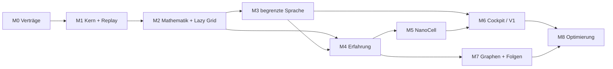

# BRUCE – konsolidierte Entwicklungsroadmap

**Verbindliche Ergänzung:** [Menschliche Regelhoheit](../adr/013-human-rule-authority.md). Keine aktive Regeländerung ohne konkrete menschliche Freigabe; technische Durchsetzung noch offen.

**Aktuelle Architekturfortschreibung:** [Blueprint nach Core 0.81](../architecture/03-blueprint-consolidation.md), 25. September 2026. Architektur vor Optimierung; als nächstes Erfahrungsaktionen durch die Anwendungsschicht führen.

**Ursprünglicher Planungsstand:** 22. September 2026  
**Status:** Planungsvorschlag auf Basis des Designs in `Bruce_raw`; keine Implementierungsfreigabe und kein Nachweis vorhandener Runtime-Funktionen.  
**Ziel:** Eine integrierte mathematische Forschungs- und Lösungsmaschine, die Aufgaben in begrenzte Such- und Rechenwege übersetzt, Ergebnisse unabhängig prüft, ihre Herkunft erhält und aus belegten Erfahrungen bessere Wege auswählt.

**Fortschreibung nach Programmierfreigabe:** Der Nutzer hat anschließend den Implementierungsstart beauftragt. Der erste Durchstich und seine Grenzen sind in [Core V1](06-core-v1-usage.md) beschrieben. Abschnitt 2 hält den Zustand vor diesem Start fest; die vollständigen Meilensteine bleiben bis zu ihrer jeweiligen Abnahme offen.

**Zweiter Ausbau:** [Core 0.2](08-z-compatibility-usage.md) liefert numerische Z-Regelsnapshots, 64-Bit-Filtergruppen, Forschungsimport und Replay. Das zugehörige Teilpaket ist [abgenommen](acceptance/z-compatibility-v1-2026-09-22.md); spätere Experience-/Sprachfunktionen bleiben offen.

**Dritter Ausbau:** [Core 0.3](10-exact-domains-usage.md) ergänzt GMP-basierte BigInt-/Brucharithmetik und exakte affine Forschung mit großen oder rationalen Koeffizienten, begrenzter Suche und eigenem Replayformat. [Abnahme](acceptance/exact-domains-v1-2026-09-22.md). Allgemeine Formelsynthese, BigInt-Grid/Z-Prädikate und der vollständige M2-Abschluss bleiben offen.

**Vierter Ausbau:** [Core 0.4](12-power-research-usage.md) untersucht zusätzlich nichtlineare Kandidaten `a*x^p+b` mit selbst erzeugtem p=1..8, getrenntem Rechenweg zur Gegenprüfung, Hold-out, Replay und Z-Import. [Abnahme](acceptance/power-research-v1-2026-09-22.md). Diese explizit begrenzte Formelklasse ersetzt keine allgemeine Formelsynthese oder adaptive Strategieplanung.

**Fünfter Ausbau:** [Core 0.5](14-adaptive-search-usage.md) wählt für dieselbe Familie datenabhängig zwischen exakter Koeffizientenableitung und vollständiger Suche. Planungsarbeit und Entscheidungen sind budgetiert und replaybar; [Abnahme](acceptance/adaptive-search-v1-2026-09-22.md). Beispielmessung: 4 statt 1105 Kandidaten bei gleichem Befund. Planung über verschiedene Strategien und gelerntes Ranking bleiben offen.

**Sechster Ausbau:** [Core 0.6](16-polynomial-research-usage.md) ergänzt mehrtermige Polynome bis Grad 8 mit exakter Newton-Ableitung und getrennter Horner-/Potenzsummenprüfung. Hold-out, Grenzen, Replay und Z-Projektion sind integriert; [Abnahme](acceptance/polynomial-research-v1-2026-09-22.md). Ein interpolierter Kandidat beweist keine allgemeine Beziehung; freie Ausdrucksgrammatik und Strategieorchestrierung bleiben offen.

**Siebter Ausbau:** [Core 0.7](18-strategy-portfolio-usage.md) orchestriert die Potenz- und Polynomstrategie unter gemeinsamen Budgets. Gleiche Formeln werden mit Herkunft zusammengeführt, unvollständige Teilruns halten den Gesamtbefund offen; [Abnahme](acceptance/strategy-portfolio-v1-2026-09-22.md). Die feste versionierte Reihenfolge ersetzt kein gelerntes Strategieranking.

**Achter Ausbau:** [Core 0.8](20-rational-linear-usage.md) untersucht `(a*x+b)/(x+c)` mit exakter Ableitung, begrenztem Fallback bei Rangmangel, expliziten Definitionslücken, Hold-out, Replay und Z-Projektion; [Abnahme](acceptance/rational-linear-v1-2026-09-22.md). Höhergradige rationale Funktionen und die Einbindung dieser Familie ins gemeinsame Portfolio bleiben offen.

**Neunter Ausbau:** [Core 0.9](22-rational-portfolio-usage.md) integriert die begrenzte Bruchfunktionsfamilie in ein gemeinsames Dreistrategien-Portfolio. Definitionslücken bleiben Teil der Identität, Budgets und Abbruchpositionen gelten gemeinsam; [Abnahme](acceptance/rational-portfolio-v2-2026-09-22.md). Gelerntes Ranking und allgemeine Formelsynthese bleiben offen.

**Zehnter Ausbau:** [Core 0.10](24-adaptive-portfolio-usage.md) ergänzt eine optionale, budgetierte Auswahl der Strategiereihenfolge anhand der ersten Lernpaare. Alle Familien bleiben Teil der Untersuchung; [Abnahme](acceptance/adaptive-portfolio-v3-2026-09-22.md). Die feste Heuristik ersetzt kein Erfahrungslernen oder allgemeines Strategieranking.

**Elfter Ausbau:** [Core 0.11](26-experience-routing-usage.md) ergänzt einen optionalen, begrenzten Erfahrungsspeicher für die Suchreihenfolge: geprüfte Quellruns, unveränderliche Snapshots, Deduplizierung und Widerruf; [Abnahme](acceptance/experience-routing-v1-2026-09-22.md). Externe Evidenzprüfung, allgemeines Erfahrungslernen und der vollständige M4-Abschluss bleiben offen.

**Zwölfter Ausbau:** [Core 0.12](28-rational-quadratic-usage.md) ergänzt `(a*x+b)/(x²+c*x+d)` als eigene Strategie mit exakter Ableitung, begrenztem Fallback, erhaltener Nennerbedingung, Hold-out, Replay und Z-Projektion; [Abnahme](acceptance/rational-quadratic-v1-2026-09-22.md). Die Einbindung in Portfolio und Experience sowie allgemeinere Ausdruckssynthese bleiben offen.

**Dreizehnter Ausbau:** [Core 0.13](30-quadratic-portfolio-usage.md) integriert quadratische Nenner in ein Viererportfolio mit gemeinsamem Budget, datenabhängiger Reihenfolge, passenden Erfahrungsstimmen und historischen Zuständen; [Abnahme](acceptance/quadratic-portfolio-v1-2026-09-22.md). Freie Synthese, weitergehende Experience-Verträge und der vollständige M2-/M4-Abschluss bleiben offen.

**Vierzehnter Ausbau:** [Core 0.14](32-expression-synthesis-usage.md) ergänzt eine eigenständige begrenzte Grammatik aus rationalen Konstanten, x und den vier Grundrechenarten. Lazy Baumgenerierung, getrennte Gegenrechnung, Definitionsbedingungen und Replay sind integriert; [Abnahme](acceptance/expression-synthesis-v1-2026-09-22.md). Allgemeinere Synthese, algebraische Zusammenführung und ihre Portfolio-/Experience-Einbindung bleiben offen.

**Fünfzehnter Ausbau:** [Core 0.15](34-expression-equivalence-usage.md) ergänzt optionale exakte Bruchnormalformen mit erhaltenen Ausschlusspolynomen, Originalherkünften und budgetierter Zusammenführung; [Abnahme](acceptance/expression-equivalence-v1-2026-09-22.md). Die Beispielmehrdeutigkeit wird auf eine geprüfte Gruppe reduziert. Vollständigere Definitionsbereichsvergleiche, Portfolio-/Experience-Einbindung und allgemeine Formelentdeckung bleiben offen.

**Sechzehnter Ausbau:** [Core 0.16](36-expression-portfolio-usage.md) integriert die Ausdruckssynthese in ein Fünferportfolio mit gemeinsamen Budgets, familienübergreifender Normalisierung und erhaltenen Definitionslücken und Herkünften; [Abnahme](acceptance/expression-portfolio-v1-2026-09-22.md). Adaptive und erfahrungsbasierte Reihenfolge dieser fünf Familien bleiben das nächste Paket.

**Siebzehnter Ausbau:** [Core 0.17](38-five-experience-usage.md) ergänzt adaptive und erfahrungsbasierte Reihenfolge für das Fünferportfolio, stabile Gruppenidentitäten, kontextgebundene Stimmen, gemischte Speicher und Widerruf; [Abnahme](acceptance/five-experience-v1-2026-09-22.md). Die Ausdruckssuche kann durch geprüfte Erfahrung priorisiert werden; allgemeines Lernen, externe Evidenz und M2-/M4-Abschluss bleiben offen.

**Achtzehnter Ausbau:** [Core 0.18](40-indexed-expression-usage.md) ergänzt einen optionalen Grammatikindex für dieselben Ausdruckskandidaten und Prüfungen; [Abnahme](acceptance/indexed-expression-v1-2026-09-22.md). Der Beispielaufwand sinkt von 105518 auf 93297 logische Einheiten. Indexeinbindung in Portfolio/Experience, allgemeinere Synthese und der vollständige M2-Abschluss bleiben offen.

**Neunzehnter Ausbau:** [Core 0.19](42-indexed-portfolio-usage.md) integriert den Grammatikindex in das feste, adaptive und erfahrungsbasierte Fünferportfolio, mit getrennten Erfahrungskontexten, gemischten Speichern, Widerruf und V11–V13-Replay; [Abnahme](acceptance/indexed-portfolio-v1-2026-09-22.md). Der feste Beispielaufwand sinkt von 105744 auf 93523 Einheiten bei gleichen Befunden. Weitere Suchoptimierung, allgemeinere Synthese und M2-/M4-Abschluss bleiben offen.

**Zwanzigster Ausbau:** [Core 0.20](44-expression-operators-usage.md) erlaubt explizite Teilmengen der vier Grundrechenarten in der eigenständigen Ausdruckssuche; [Abnahme](acceptance/expression-operators-v1-2026-09-22.md). Beide Planer, Gegenprüfung, Definitionsbedingungen, V4-Replay und Z-Projektion sind integriert. Der verkleinerte Suchraum ist Teil des Auftrags, kein allgemeiner Ausschluss anderer Formeln. Portfolio-/Experience-Einbindung der Auswahl und allgemeinere Operatoren bleiben offen.

**Einundzwanzigster Ausbau:** [Core 0.21](46-portfolio-operators-usage.md) integriert die Operatorauswahl in das Fünferportfolio und seine Erfahrungsplanung, mit getrennten Kontexten, V5-Speichern, Widerruf und V14–V16-Replay; [Abnahme](acceptance/portfolio-operators-v1-2026-09-22.md). Die Auswahl betrifft ausschließlich das Ausdruckskind; Beispielarbeit 5431 → 1822 Einheiten. Neue Operatorarten, weitere Suchoptimierung und M2-/M4-Abschluss bleiben offen.

**Zweiundzwanzigster Ausbau:** [Core 0.22](48-expression-powers-usage.md) ergänzt optionale literale Potenzen von 2 bis 8 in der eigenständigen Ausdruckssuche, mit beiden Planern, getrennter Gegenrechnung, erhaltenen Definitionslücken, V5-Replay und Z-Projektion; [Abnahme](acceptance/expression-powers-v1-2026-09-22.md). x³+x benötigt im Beispiel fünf statt sieben Baumknoten. Portfolio-/Experience-Einbindung und allgemeinere Synthese bleiben offen.

**Dreiundzwanzigster Ausbau:** [Core 0.23](50-portfolio-powers-usage.md) integriert literale Potenzausdrücke in das Fünferportfolio und seine Erfahrungsplanung, mit beiden Ausdrucksplanern, getrennten Kontexten, V6-Speichern, Widerruf, V17–V19-Replay und Z-Projektion; [Abnahme](acceptance/portfolio-powers-v1-2026-09-22.md). Das Beispiel x³+x benötigt 3717 statt 62278 logische Portfolioeinheiten bei kleinerer gewählter Ausdrucksgrammatik. Allgemeinere Synthese, weitere Suchoptimierung und M2-/M4-Abschluss bleiben offen.

**Vierundzwanzigster Ausbau:** [Core 0.24](52-cached-expression-usage.md) ergänzt einen optionalen Teilbaumcache in der eigenständigen Ausdruckssuche, mit 64 begrenzten Einträgen, unveränderten Kandidaten, budgetierter Verwaltung, V6-Replay und Z-Projektion; [Abnahme](acceptance/cached-expression-v1-2026-09-22.md). Der Beispielaufwand sinkt bei identischen 2802 Kandidaten von 93297 auf 86860 logische Einheiten. Portfolio-/Experience-Einbindung und weitergehende Optimierung bleiben offen.

**Fünfundzwanzigster Ausbau:** [Core 0.25](54-cached-portfolio-usage.md) integriert den begrenzten Teilbaumcache in das Fünferportfolio und seine Erfahrungsplanung, mit getrennten Kontexten, V7-Speichern, Widerruf, V20–V22-Replay und Z-Projektion; [Abnahme](acceptance/cached-portfolio-v1-2026-09-22.md). Die feste Beispielarbeit sinkt bei identischen Befunden von 93523 auf 87086 logische Einheiten. Weitere Suchoptimierungen, allgemeinere Synthese und vollständige M2-/M4-Abnahme bleiben offen.

**Sechsundzwanzigster Ausbau:** [Core 0.26](56-fraction-comparison-usage.md) ergänzt einen eigenständigen exakten Vergleich zweier Polynombrüche als partielle Funktionen auf Q. Gemeinsame Ausschlussfaktoren und rationale Nullstellen verbleibender Faktoren bis Grad 2 werden entschieden, unterschiedliche Lücken mit einer gegengeprüften Stelle belegt; Grenzen, offene Fälle und Replay sind explizit. [Abnahme](acceptance/fraction-comparison-v1-2026-09-22.md). Die Einbindung in Forschung/Portfolio/Experience und allgemeinere Nullstellenverfahren bleiben offen.

**Siebenundzwanzigster Ausbau:** [Core 0.27](58-q-expression-usage.md) integriert den begrenzten rationalen Bereichsvergleich in die eigenständige Ausdruckssuche: optionale Q-Gruppen, alle drei Planer, erhaltene Ursprünge und Budgets, V7-Replay und Z-Import. [Abnahme](acceptance/q-expression-v1-2026-09-22.md). Portfolio-/Experience-Einbindung und allgemeinere Nullstellenentscheidungen bleiben offen.

**Achtundzwanzigster Ausbau:** [Core 0.28](60-q-portfolio-usage.md) integriert rationale Bereichsgleichheit in die Vereinigung aller fünf Familien und in getrennte V8-Erfahrungskontexte. Feste Vereinigung nach der geplanten Suche, gemeinsame Budgets, Widerruf, V23–V25-Replay und Z-Import sind enthalten. [Abnahme](acceptance/q-portfolio-v1-2026-09-22.md). Allgemeinere Nullstellenentscheidungen, effizientere Gruppenvergleiche und vollständige M2-/M4-Abnahme bleiben offen.

**Neunundzwanzigster Ausbau:** [Core 0.29](62-modular-comparison-usage.md) ergänzt den eigenständigen Polynombruchvergleich um optionale, budgetierte Primzahlzertifikate für rationale Nullstellenfreiheit bei höheren Restgraden. Zertifikat und V2-Replay sind Bestandteil des Pakets; Einbindung in Suche/Portfolio/Erfahrung und vollständige Nullstellenentscheidung bleiben offen.

**Dreißigster Ausbau:** [Core 0.30](64-modular-research-usage.md) integriert die modulare Q-Prüfung als eigenen Gleichheitsmodus in alle drei Ausdrucksplaner, die feste Familienvereinigung und getrennte V9-Erfahrungskontexte. Originalerhalt, gemeinsame Grenzen, V8-/V26–V28-Replay und Z-Auswahl gehören zum Paket. Vollständigere Nullstellenentscheidung und effizientere Gruppenvergleiche bleiben offen.

**Einunddreißigster Ausbau:** [Core 0.31](66-domain-cache-usage.md) ergänzt die eigenständige modulare Ausdruckssuche um einen optionalen, budgetierten Cache für bis zu 64 bewiesene Bereichsgleichheiten. Exakte Schlüsselprüfung, eigener V9-Replay, Z-Auswahl und gemessene Vergleichskosten gehören zum Paket. Portfolio-/Experience-Einbindung bleibt offen.

**Zweiunddreißigster Ausbau:** [Core 0.32](68-domain-cache-portfolio-usage.md) integriert getrennte Bereichscaches in Ausdruckskind und Familienvereinigung sowie V10-Erfahrungskontexte. Gemeinsame Budgets, vollständige Herkunft, V29–V31-Replay und Z-Auswahl sind enthalten. Beispielabhängige Mehr- und Minderarbeit werden ausgewiesen; weitere Optimierung bleibt offen.

**Dreiunddreißigster Ausbau:** [Core 0.33](70-rational-witness-usage.md) ergänzt den eigenständigen Bruchvergleich um begrenzte exakte rationale Nullstellenzeugen, unabhängige Gegenprüfung und V3-Replay. Eine erfolglose endliche Suche bleibt offen. Integration in Forschung/Portfolio und vollständigere Nullstellenverfahren stehen aus.

**Vierunddreißigster Ausbau:** [Core 0.34](72-witness-expression-usage.md) integriert rationale Gegenzeugen in die eigenständige Ausdruckssuche, mit begrenzter Prüfspur, gemeinsamem Budget, optional bis 256 Originalen, V10-Replay und Z-Auswahl. Portfolio, Erfahrung und passende Bereichscaches bleiben das folgende Integrationspaket.

**Fünfunddreißigster Ausbau:** [Core 0.35](74-witness-portfolio-usage.md) integriert rationale Gegenzeugen in Portfolio und V11-Erfahrungsplanung mit V32–V34-Replay, Widerruf und Z-Auswahl. Die Versionsauswahl des Fünferportfolios ist zentralisiert. [Aktueller Architekturstand und konkrete M0–M2-Abnahmelücken](75-current-architecture-and-milestones.md) ergänzen die historische Planung.

**Sechsunddreißigster Ausbau:** [Core 0.36](77-grid-replay-usage.md) verschiebt die lokale Grid-Einzelauswertung aus dem CLI-Zweig in einen versionierten Anwendungsauftrag mit Export, Prüfschritten und Replay. Bestehende Modi, lokale Werte und Ausgaben bleiben erhalten. GridSpec/Cacheidentität, BigInt und Forschungseinbindung bleiben offen.

**Siebenunddreißigster Ausbau:** [Core 0.37](79-grid-cache-usage.md) ergänzt die versionierte GridSpec für das bestehende UInt64-Grid, vollständige Adress-/Konfigurationsschlüssel und einen lokalen FIFO-Cache mit Eintrags- und logischem Bytebudget. Stapelabfragen exportieren und replayen auch Cacheentscheidungen und lokale Stopps. Forschungseinbindung, allgemeinere Grid-Formen, Expansion und BigInt bleiben offen.

**Achtunddreißigster Ausbau:** [Core 0.38](81-grid-research-usage.md) verbindet geprüfte exakte Grid-Stapelexporte eines festen Ausschnitts mit der bestehenden Formelforschung. Quellen, Samplebindung, Forschungsreplay und anschließende Z-Auswahl bleiben in einem selbständigen Herkunftsbundle erhalten. Andere Projektionen, Expansion, gemeinsame Phasenbudgets und Experience-Import dieses Wrappers bleiben offen.

**Neununddreißigster Ausbau:** [Core 0.39](83-grid-axis-usage.md) ergänzt die Exponentenrichtung Y bei fester Basis. Die bisherige X-Richtung behält ihr V1-Format; Y erhält einen eigenen V2-Forschungsexport mit vollständiger Quellenbindung und Z-Auswahl. Neue allgemeine Exponentialformelsuche, mehrdimensionale Projektionen, gemeinsame Phasenbudgets und Expansion bleiben offen.

**Vierzigster Ausbau:** [Core 0.40](85-grid-budget-usage.md) ergänzt einen optionalen gemeinsamen logischen Rahmen für atomar zugelassene Grid-Quellenprüfung und anschließende Forschung. Quellenbytes werden vorab berechnet, die Forschung erhält höchstens das Restbudget. V3 hält Abrechnung, Quellen und replaybare Forschungsabbrüche fest. Allgemeine Phasensteuerung, unterbrechbarer Import, Wiederaufnahme und Expansion bleiben offen.

**Einundvierzigster Ausbau:** [Core 0.41](87-grid-partial-usage.md) ergänzt Schrittgrenzen und Abbruch zwischen Abfragen im Grid-Stapelexecutor. V2 speichert vollständige Aufgabenliste, bearbeitetes Präfix, Cacheentscheidungen und Abbruchgrund. Forschung weist unvollständige Quellen ab und akzeptiert vollständig abgearbeitete V2-Stapel. Unterbrechbarer Quellenimport innerhalb der Forschung, Wiederaufnahme und allgemeine Phasensteuerung bleiben offen.

**Zweiundvierzigster Ausbau:** [Core 0.42](89-grid-resume-usage.md) ergänzt [Grid-Fortsetzung](89-grid-resume-usage.md): geprüfte Elternquelle, rekonstruierter Cache, nächste Abfragen und eigenständig replaybare Herkunft; Audit- und neue Berechnungen werden getrennt gezählt. Vollständige Fortsetzungen sind Forschungsquellen. Allgemeine Phasen-/Strategie-/Gate-Verträge bleiben offen.

**Dreiundvierzigster Ausbau:** [Core 0.43](91-grid-experience-usage.md) verbindet replaygeprüfte Grid-Portfolios einschließlich fortgesetzter Quellen mit Experience V12. Herkunft, Deduplizierung über CSV/Grid und Widerruf bleiben erhalten; bereits erfahrungsgeleitete Quellen bleiben ausgeschlossen. Dies ist begrenzte Stimmenplanung, kein allgemeines Lernen oder M4-Abschluss.

**Vierundvierzigster Ausbau:** [Core 0.44](93-experience-replacement-usage.md) ergänzt explizite Korrekturketten: geprüfter Nachfolger ersetzt einen aktiven Datensatz in einem Ereignis; Grund, Vorgänger und Originalquellen bleiben erhalten. Nur aktive Nachfolger liefern Stimmen. Externe Evidenz und automatische Korrektur-/Lernentscheidungen bleiben offen.

**Fünfundvierzigster Ausbau:** [Core 0.45](95-grid-experience-budget-usage.md) zählt bei gelerntem Grid-Gesamtrahmen auch vollständige Experiencebytes, begrenzt die neue Suche durch den Rest und erhält die Abrechnung in V4. Historische V3-Semantik bleibt unverändert. Das ist logische Zulassung, keine CPU-/Zeitmessung oder unterbrechbare Auditphase.

**Sechsundvierzigster Ausbau:** [Core 0.46](97-research-contract-usage.md) konsolidiert Exact-Auftragsvalidierung, zehn eingebaute Strategievarianten und Gates für Forschungsübergänge. CLI und Engine verwenden denselben Katalog; Z/Experience gemeinsame Freigaben. Allgemeine Task-/Plugin-/Phasengates bleiben offen; M0–M2 werden nicht pauschal abgeschlossen.

**Siebenundvierzigster Ausbau:** [Core 0.47](99-application-task-usage.md) verbindet acht Laufarten über typisierte gemeinsame Aufträge, Ausführung, Ergebnisse und Exportserialisierung. Die CLI nutzt diesen Einstieg, lokale Validatoren/Abbruchpunkte und alte Formate bleiben erhalten. Allgemeine Phasen-/Budget-/Gateverträge und dynamische Plugins bleiben offen.

**Achtundvierzigster Ausbau:** [Core 0.48](101-application-result-usage.md) vereinheitlicht typisierten Replay und Ergebnisinspektion für acht Laufarten. Vollständiger Replay geht der Zusammenfassung voraus; Ausführungsabschluss bleibt vom fachlichen Wahrheitsstatus getrennt. Die allgemeine Phasensteuerung bleibt offen.

**Neunundvierzigster Ausbau:** [Core 0.49](103-execution-phases-usage.md) ergänzt einen optionalen gemeinsamen linearen Phasencontroller: ausführen, serialisieren, replayprüfen, freigeben. Teilbefunde bleiben unvollständig; alte Exporte bleiben unverändert. Allgemeine Phasengraphen und phasenübergreifende Kosten-/Abbruchsteuerung bleiben offen.

**Fünfzigster Ausbau:** [Core 0.50](105-execution-failure-usage.md) erhält bei fehlgeschlagenen Prüfsitzungen die Arbeitsphase, den terminalen Verlauf und die ursprüngliche Exception. Die CLI liefert strukturierte Fehler ohne Ergebnisexport. Erfolgsformate bleiben erhalten; allgemeine Phasengraphen, gemeinsame Kostensteuerung und persistente Sitzungsbelege bleiben offen.

**Einundfünfzigster Ausbau:** [Core 0.51](107-replay-byte-budget-usage.md) begrenzt optional die vollständigen Bundlebytes vor der Replayzulassung. Das Budget bleibt während der Sitzung fest; überschrittene Grenzen führen ohne Export zu FAILED. Dies begrenzt Prüfdaten, nicht Rechenzeit oder Gesamtspeicher. Allgemeine Operationsbudgets und unterbrechbare Verifikation bleiben offen.

**Zweiundfünfzigster Ausbau:** [Core 0.52](109-verification-cancellation-usage.md) ergänzt optionale Abbruchprüfungen vor Serialisierung, vor Replay und vor Freigabe. Erkannte Anforderungen verhindern den Export. Laufende Prüfoperationen bleiben atomar; sofortiger Abbruch und gemeinsame Operationsbudgets bleiben offen.

**Dreiundfünfzigster Ausbau:** [Core 0.53](111-grid-replay-checkpoints-usage.md) ergänzt interne Abbruchpunkte für Grid-Stapelreplay und rekursive Fortsetzungsketten einschließlich Cache-Rebuild. Unterbrochene Prüfungen erzeugen keinen geprüften Teilbefund. Andere Replayfamilien, Hashing und Serialisierung bleiben ohne innere Unterbrechungspunkte.

**Vierundfünfzigster Ausbau:** [Core 0.54](113-research-replay-checkpoints-usage.md) ergänzt innere Replaypunkte für Int64- und exakte Forschung einschließlich Strategien und Portfolios. Prüfungsabbrüche verändern keine gespeicherten Suchgrenzen und liefern keinen Teilbefund. Zusammengesetzte Aufträge, geschachtelte Erfahrungsprüfung und Einzeloperationen bleiben weitere Arbeit.

**Fünfundfünfzigster Ausbau:** [Core 0.55](115-grid-research-replay-usage.md) verbindet die inneren Prüfpunkte von Gridquellen und Formelforschung im zusammengesetzten Grid-Forschungsreplay. Samplebindung, Zulassung und V1–V4-Budgetregeln bleiben erhalten. Erfahrungs-Quellaudits und weitere atomare Operationen bleiben offen.

**Sechsundfünfzigster Ausbau:** [Core 0.56](117-comparison-replay-checkpoints-usage.md) ergänzt innere Replaypunkte für alle drei exakten Bruchvergleichsverfahren. Callbackfehler bleiben von mathematischen Grenzfällen getrennt; native Aussagen, Operationszähler und Exporte bleiben erhalten. Z-Kompatibilität, Erfahrungs-Quellaudits und atomare Unteroperationen bleiben weitere Arbeit.

**Siebenundfünfzigster Ausbau:** [Core 0.57](119-compatibility-replay-checkpoints-usage.md) ergänzt innere Z-Kompatibilitätsreplaypunkte einschließlich eingebetteter Forschungsnachweise. Auswahl, gespeicherte Abbrüche und native Bundles bleiben erhalten. Erfahrungs-Quellaudits, atomare Unteroperationen und gemeinsame Operationsbudgets bleiben offen.

**Achtundfünfzigster Ausbau:** [Core 0.58](121-experience-replay-checkpoints-usage.md) reicht den Replaycallback durch Erfahrungs-Quellaudits einschließlich Gridquellen und Korrekturketten. Stimmen, Auditkosten und native Abbruchgrenzen bleiben erhalten. Serialisierung, Erstlaufunterbrechung und gemeinsame Operationsbudgets bleiben weitere Arbeit.

**Neunundfünfzigster Ausbau:** [Core 0.59](123-serialization-digest-checkpoints-usage.md) ergänzt optionale Abbruchpunkte zwischen 64-KiB-Blöcken der äußeren Bundle-Prüfsumme. Alle acht Auftragstypen verwenden unveränderte native Formate; Abbrüche werden SERIALIZING zugeordnet. Payloadaufbau, innere Digests und gemeinsame Budgets bleiben weitere Arbeit.

**Sechzigster Ausbau:** [Core 0.60](125-grid-serialization-records-usage.md) ergänzt Abbruchpunkte beim Inhaltsaufbau von Grid-Stapeln und Fortsetzungen. Pfade, Trace-Einträge und Ergebniszeilen werden einzeln begrenzt; native Bytes und Rechenergebnisse bleiben erhalten. Große Einzelteile und weitere Ergebnisfamilien bleiben offen.

**Einundsechzigster Ausbau:** [Core 0.61](127-execution-experience-checkpoints-usage.md) ergänzt einen separaten Importabbruch für erfahrungsbasierte exakte und Grid-Forschung im Erstlauf. Quellauditabbrüche scheitern in EXECUTING, während native Suchabbruchregeln erhalten bleiben. Weitere Erstlaufquellen, Payloadfamilien und gemeinsame Budgets bleiben offen.

**Zweiundsechzigster Ausbau:** [Core 0.62](129-execution-grid-source-checkpoints-usage.md) ergänzt getrennte Abbruchpunkte für Grid-Eingangsquellen und Sampleprojektion im Erstlauf. Grid- und Erfahrungsimporte sind kombinierbar; Zulassung, Budgets und native Befunde bleiben erhalten. Weitere Quellenimporte, Payloadfamilien und gemeinsame Budgets bleiben offen.

**Dreiundsechzigster Ausbau:** [Core 0.63](131-execution-compatibility-source-usage.md) ergänzt Importabbruchpunkte für die Forschungsquellen der Z-Auswahl einschließlich verschachtelter Erfahrungsnachweise. Projektion und native Kandidatenbewertung bleiben getrennt; Auswahl und native Bytes bleiben erhalten. Fortsetzungsimporte, weitere Payloadfamilien und gemeinsame Budgets bleiben offen.

**Vierundsechzigster Ausbau:** [Core 0.64](133-execution-resume-import-usage.md) ergänzt Importabbruchpunkte für Vorgängerprüfung und Cachewiederaufbau nativer Grid-Fortsetzungen. Neue Abfragen behalten ihren separaten Abbruchpfad; native Bytes und Zähler bleiben erhalten. Weitere Payloadfamilien, große Kopien und gemeinsame Budgets bleiben offen.

## 1. Mein Verständnis deines Designs

BRUCE speichert kompakte Zustände, Regeln und Erfahrungen. Daraus öffnet es bei Bedarf passende Berechnungswege in einem großen virtuellen Prozessraum. Die ausgewählten Wege erzeugen Ergebnisse mit nachvollziehbarer Herkunft. Erst Prüfung und Replay bestimmen, welche Aussage diese Ergebnisse tragen. Erfahrungen sollen spätere Aufgaben besser routen, ohne historische Fakten umzuschreiben.

Die Bausteine gehören zu **einem System**:

| Baustein | Aufgabe innerhalb von BRUCE |
| --- | --- |
| BRUCE-Core | Aufgabe verstehen, Suchstrategie auswählen, Budgets und Gates durchsetzen |
| Single-Triangle-/Koordinaten-Kernel | stabile, reversible Adressen; getrennt von den berechneten Werten |
| Z-Kompatibilität | Regeln, Kontext, Ausschlüsse und konkurrierende Kandidaten nachvollziehbar bewerten |
| KEVIN / Lazy Parameter Grid | Prozessräume adressieren und nur benötigte Kandidaten erzeugen |
| BRUCE-Math | exakt rechnen, Hypothesen gegenprüfen und Gegenbeispiele behandeln |
| NanoCell | kompakte Zustände durch kleine, klar definierte Operatorprogramme verarbeiten |
| AnswerPoints | Ergebnis, Kontext, Technik, Gültigkeitsbereich und Nachweis zusammenführen |
| Experience-System | Erfolge, Fehlschläge und Korrekturen versioniert speichern und wiederverwenden |
| Peacemaker / Sprachrekonstruktion | strukturierte Bedeutung in nachvollziehbare Sprache überführen |
| Affine Phase-DAG | gemeinsame Zustände und Ausdrücke nutzen, ohne unterschiedliche Rechenwege zu verlieren |
| Research-Cockpit | diesen gesamten Ablauf für den Benutzer sichtbar und bedienbar machen |

**Der zentrale Entwicklungsnachweis:** BRUCE muss an einer konkreten Aufgabe zeigen, warum es einen Weg gewählt hat, was tatsächlich berechnet wurde, welche Prüfung das Ergebnis trägt und wie derselbe Lauf reproduziert wird.

## 2. Tatsächlicher Ausgangsstand

Am 22.09.2026 wurden in diesem Arbeitsordner vor der Roadmap-Erstellung 21 Dateien festgestellt: neun ausführliche Entwurfs-/Reviewtexte, die Haupt-README und elf Dateien unter `docs/`. Es gibt hier keine C++-Quellen, kein Build-System, keine CLI, keine Persistenzimplementierung und keine ausführbaren Produkttests. Git meldete für den Ordner kein gültiges Repository; das sichtbare `.git`-Verzeichnis allein belegt keine eingerichtete Versionsverwaltung.

Die Aussage „vollständig leer“ am Anfang von `Bruce_8x8-Bit.md` beschreibt einen älteren Stand und ist für die heutige Dokumentationsbasis überholt. Die dort vorgeschlagenen Funktionen sind weiterhin nicht implementiert. Hinweise auf einen „bestehenden Research Core“ oder ein „bestehendes Cockpit“ in älteren Upgrade-Plänen sind ebenfalls kein Implementierungsnachweis für diesen Ordner.

Andere BRUCE-/KEVIN-Arbeitsordner wurden für diese Roadmap nicht als vorhandene Abhängigkeit übernommen. Eine spätere Wiederverwendung benötigt eine eigene Prüfung des jeweiligen Codes, seiner Verträge und Tests.

## 3. Leitplanken und Abnahmeprinzip

- BRUCE bleibt ein Softwareprojekt. CPU und optionale GPU sind Ausführungsressourcen.
- Adresse, Wert, Bedeutung, Herkunft, Evidenz und Freigabe bleiben unterscheidbar.
- Große Prozessräume werden lazy erzeugt. Ihre theoretische Größe ist weder erreichte Suchleistung noch Speicherkompression beliebiger Daten.
- Exakte, modulare, symbolische und metrische Ergebnisse besitzen unterschiedliche Typen und Aussagegrenzen.
- Eine Schätzung darf einen exakten Wert nicht still ersetzen. Ein Rest ungleich null ist kein ganzzahliger Treffer.
- Reproduktion desselben Laufs ist Replay, keine unabhängige Gegenprüfung. Ein Hold-out ist eine weitere Prüfung, kein allgemeiner Beweis.
- Jeder bestätigte Befund braucht einen expliziten Gültigkeitsbereich (`claim_scope`). Ein begrenzter negativer Suchlauf ist kein Unmöglichkeitsbeweis.
- Ausführung, Aufbewahrung, Lernen und Veröffentlichung besitzen getrennte Gates. Ein lokaler Ausschluss darf keinen unbeteiligten Ast stoppen.
- Versionen und Erfahrungen bleiben nachvollziehbar. Cacheverlust darf das fachliche Ergebnis nicht verändern.
- Die erste Runtime ist sequenziell und CPU-basiert. Parallelisierung folgt einer gemessenen Referenz.
- Sprache erklärt oder schlägt vor. Sie vergibt keine Wahrheitsstatus und verändert keine Budgets oder Gates.

Jeder Meilenstein wird erst abgenommen, wenn **Eingabe → sichtbare Ausgabe → Prüfspur → Wiederholung** sowie seine Fehler- und Budgetpfade funktionieren. Die folgenden Checkboxen sind bewusst offen.

## 4. Entscheidungen, die das Design noch benötigt

Diese Tabelle enthält Empfehlungen, keine bereits akzeptierten ADRs. Die vorhandenen ADR-001 bis ADR-008 bleiben Ausgangspunkt; zusätzliche Entscheidungen erhalten bei ihrer Ausarbeitung eigene Dateien unter `docs/adr/`.

| Thema und Fundstelle | Problem | Empfohlene Auflösung | Spätestens |
| --- | --- | --- | --- |
| Priorität der Quellen: `docs/`, Scope-Korrektur, ältere Gesamtkonzepte | unterschiedliche Entwicklungsstände und teilweise überholter Hardware-/Hosting-Scope | kompakte Verträge als aktuelle Basis; ausdrückliche Scope-Korrekturen beachten; zusätzliche Module aus den Langentwürfen übernehmen; Konflikte einzeln als ADR lösen | M0 |
| Zahlentyp, ADR-001; Lazy-Grid-Plan | UInt64, BigInt und signed-512-Bit werden an verschiedenen Stellen genannt | Adressdarstellung und Zahlenbackend getrennt entscheiden; begrenzte Integerwerte mit geprüften Überläufen zuerst; ein tatsächliches BigInt-Backend vor großen Exact-Aufgaben festlegen | M0/M2 |
| Koordinaten: Single Triangle gegenüber Gridpfad | Cantor-Paarung, lokales `8*y+x` und hierarchischer Pfad sind verschiedene Adressräume | eigene Typen; Domain und Layer mitführen; Konvertierungen explizit; die Hierarchie ist kein geometrischer Kind-Dreiecksbaum | M0 |
| Tiefe 12 gegenüber 64-Bit-Pfad: Lazy-Grid-Plan / KEVIN-Review | 12 Schritte brauchen 72 Pfadbits; vorgeschlagenes 64-Bit-Format fasst nur zehn Schritte plus Tiefe | versionierter Pfad mit separater Länge als allgemeines Format; gepacktes 64-Bit-Format optional für Tiefe ≤ 10 | M2 |
| Tiefer Gridpfad, KEVIN-Review | unklar, ob Elternkoordinaten den Wert beeinflussen | V1 ausdrücklich `LEAF_LOCAL_POWER`; spätere Faltungen sind eigene Regelversionen. Mehr Tiefe vergrößert bei dieser V1 nicht den lokalen Potenz-Wertevorrat | M2 |
| Harte Ausschlüsse, Z-Vertrag | Score könnte einen unzulässigen Kandidaten vorziehen, wenn Widersprüche nur ein Tie-Break sind | harte Ausschlüsse vor Ranking anwenden; verworfene Kandidaten mit Grund im Trace erhalten | M1 |
| Mehrdeutigkeit, Z-Vertrag | eine eindeutige Kandidaten-ID löst jeden vollständigen fachlichen Gleichstand auf | fachliche Gleichrangigkeit als `AmbiguitySet` erhalten; IDs ordnen die Ausgabe oder die nächste Ausführung, entscheiden aber keine Bedeutung | M1 |
| Replay, Invarianten / Budgetvertrag | Zeitlimits und ein warmer Cache können Ausführungsablauf und Stopzeit ändern | logischen Trace von Laufzeittelemetrie trennen; Operationen deterministisch zählen; Abbruchposition protokollieren; Referenz-Replay mit festem Cachezustand und gespeicherter Abbruchgrenze | M0/M1 |
| `VERIFIED`, Math-/Evidence-Verträge | bestandene Stichproben könnten wie eine allgemeine mathematische Wahrheit erscheinen | Status immer zusammen mit Aussageart, geprüftem Bereich und Prüfmethode anzeigen; empirische Hypothese bleibt ohne Beweis allgemein unbestätigt | M0/M2 |
| Replay ohne Persistenz, bisherige Phase 1 | prozessübergreifendes Replay braucht gespeicherte Eingaben und Versionen | kleines exportierbares Run-Bundle bereits M1; langfristiger Experience Store erst M4 | M1 |
| Persistenz, ADR-002 und Scope-Korrektur | JSONL/CBOR-MVP gegenüber ausdrücklich PostgreSQL für Peacemaker | Run-/Experience-Dateien als lokaler Einstieg; PostgreSQL bleibt Ziel des Peacemaker-Wissensspeichers. Gemeinsame IDs und Versionsbezüge; kein stiller Ersatz durch SQLite | M4/M6 |
| Lernen gegenüber Fehlschlagsarchivierung | ein geschlossenes LearnGate könnte die Aufzeichnung negativer Erfahrung verhindern | geprüfte Protokollierung von Erfolg/Fehlschlag von Promotion zur wiederverwendbaren Regel trennen; Wiederholung ist keine neue unabhängige Evidenz | M4 |
| NanoNeuron-Layout, NanoCell §8.1 | alle genannten Felder passen nicht selbstverständlich in acht Byte | lokaler Index, festes Layout und Seitentabellen anhand dreier realer Techniken vergleichen; ein Byte ist nur aktive Zustandsprojektion | M5 |
| Pfadgewichte, Phase-DAG | mathematische Aufhebung einer Pfadsumme könnte als Widerlegung missverstanden werden | Algebraresultat, Evidenzunabhängigkeit und Wahrheitsstatus getrennt auswerten; Herkunft trotz Aufhebung behalten | M7 |

M0 klärt nur die Entscheidungen für den ersten ausführbaren Durchstich. NanoCell-Packing, Graphbackends und Rendererwahl sollen ihn nicht monatelang blockieren.

## 5. Empfohlene Reihenfolge

| Meilenstein | Priorität | Sichtbares Ergebnis | Voraussetzung |
| --- | --- | --- | --- |
| M0 – Startverträge | P0 | eindeutige Eingabe-, Status-, Budget- und Replay-Beispiele | Dokumentationsbasis |
| M1 – Prüfbarer Kern | P0 | Koordinaten, Kandidatenauswahl, Erklärung und Replay per CLI | M0 |
| M2 – Mathematischer Durchstich | P0 | begrenzte Formelsuche mit Gegenprüfung und Lazy Grid | M1 |
| M3 – Begrenzte Sprache | P1 | Tokens, Rollen, Kontext und sichtbare Alternativen | M1, gemeinsamer Aufgabenvertrag aus M2 |
| M4 – Erfahrung und Wiederabruf | P1 | historische Runs und Korrekturen verbessern nachvollziehbar die Auswahl | M2; Integration der Sprachfälle aus M3 |
| M5 – NanoCell-Referenz | P1 | kompakte Techniken erzeugen geprüfte AnswerPoints und Erfahrungen | M2, M4 |
| M6 – Research-Cockpit / BRUCE V1 | P1 | vollständiger bedienbarer Forschungsworkflow | M2–M5 |
| M7 – Graph- und Sequenzforschung | P2 | affine Pfade, Provenienz, Zyklen und symbolische Folgen | M2, M4; Integration in M6 |
| M8 – Optimierung und optionale Modelle | P3 | gemessene Verbesserungen bei erhaltenen Ergebnissen | belastbare Referenzläufe |

P0 bedeutet: zuerst umsetzen. P1 vervollständigt die integrierte erste Produktversion. P2 erweitert die mathematischen Fähigkeiten. P3 folgt nur bei belegtem Nutzen.



**Abweichung vom bisherigen Fünf-Phasen-Plan:** Ein kleiner BRUCE-Math-Durchstich rückt vor vollständige Sprache und Experience-Verarbeitung. So wird früh die eigentliche Forschungsfunktion sichtbar. NanoCell und Phase-DAG erhalten eigene Abnahmen, statt in der Gesamtarchitektur nur als Namen aufzutauchen. Eine einfache Cockpit-Ansicht kann nach M2 entstehen; die vollständige V1-Abnahme bleibt M6.

## 6. Meilensteine und konkrete Abnahmen

### M0 – Einen gemeinsamen Startvertrag festlegen

**Lieferung:** Ein abgestimmtes Beispielpaket für gültige Aufgabe, Mehrdeutigkeit, Gegenbeispiel und Budgetabbruch; zugehörige Daten- und Statusverträge.

- [ ] `TaskSpec`, `VersionBundle`, `RunBudget`, `ResultStatus`, `claim_scope` und logischen Trace beschreiben.
- [ ] Run-, Technik- und Ast-Abbruch sowie getrennte Verify-/Learn-/Publish-Gates festlegen.
- [ ] Das Run-Bundle definieren: Originalinput, normalisierter Input, Versionen/Artefakte, Regeln, Parameter, Budget, Strategie, Trace und Prüfergebnisse.
- [ ] C++20 mit CMake/Ninja als vorgeschlagene lokale Basis prüfen; Zahlenbackend und Abhängigkeiten dokumentieren.
- [ ] Die Konflikte für M1 entscheiden und die bisherigen Dokumente nach akzeptierter Entscheidung angleichen.

**Abnahme:** Jedes Referenzbeispiel hat eine erwartete Ausgabe, eine nachvollziehbare Statusbegründung und einen festgelegten Stopgrund. Fehlende Versionen dürfen keinen bestätigten Status ergeben. Aktuell ist noch kein ADR durch diese Roadmap akzeptiert.

### M1 – Koordinaten, Auswahl und Replay als nutzbare CLI

**Lieferung:** Ein kleines Programm nimmt Koordinaten und einen Regel-Snapshot entgegen, zeigt Filter und Kandidaten an und exportiert einen wiederholbaren Lauf.

- [ ] Build, Test-Harness und eine gemeinsame CLI mit den Modulen `core`, `coordinate`, `compatibility`, `evidence` und `application` aufbauen.
- [ ] Lokales 8×8-Adressmodell und Cantor-Paarung mit exakter Rückrechnung und expliziten Grenzen implementieren.
- [ ] Positive Treffer, harte Ausschlüsse, negative Evidenz und Rollenfilter getrennt behandeln; Gruppen mit mehr als 64 Kandidaten unterstützen.
- [ ] Integer-Score, stabile Ausgabereihenfolge und fachliche Mehrdeutigkeit umsetzen.
- [ ] Operationen, Kandidaten und Trace begrenzen; bei Traceverlust keine Bestätigung ausgeben.
- [ ] Run-Bundle exportieren und in einem neuen Prozess ohne aktuelle Regeldefaults replayen.

**Abnahme:**

1. Alle 64 lokalen Koordinaten werden exakt hin- und zurückgewandelt; Grenzfälle der Cantor-Arithmetik erzeugen keine stillen Überläufe.
2. `(2,6)` und `(4,3)` bleiben trotz gleichem Potenzwert unterschiedliche Adressen.
3. Ein Kandidat mit hohem Score und hartem Ausschluss wird nie gewählt. Zwei fachlich gleichrangige Kandidaten bleiben sichtbar.
4. Eine geänderte aktuelle Regelversion verändert den archivierten Replay nicht. Fehlende oder manipulierte Artefakte werden abgelehnt.
5. Kandidaten-/Tracebudget und Benutzerabbruch liefern nachvollziehbare unvollständige Ergebnisse.

**Bestehende Testbezüge:** COORD-01–03, COMP-01–03, BUDGET-01, EVID-01; zusätzliche Fälle `COMP-HARD-REJECT`, `REPLAY-VERSION`, `REPLAY-STOP`.

### M2 – Ein vollständiger mathematischer Forschungsablauf

**Lieferung:** BRUCE verarbeitet ein strukturiertes mathematisches Problem, erzeugt begrenzte Kandidaten, prüft sie und erklärt den Befund mit Replay. KEVIN ist dabei eine interne Suchstrategie.

- [ ] Einen gemeinsamen Strategie-Port für exakte Auswertung und begrenzte Kandidatenerzeugung bereitstellen.
- [ ] Lazy Grid mit versionierter `GridSpec`, Pfadadresse, `Exact`/`Modular`/`Metric`, `0^0`-Policy und begrenztem Cache integrieren.
- [ ] Cache-Schlüssel mindestens aus Grid-ID, Spec-Version, Adresse, Modus und Modusparametern bilden; Cachebudget auch in Bytes messen.
- [ ] `LEAF_LOCAL_POWER` als Grid-Referenz implementieren. Lokale `x,y ∈ [0,7]` allein belegen noch keine Großzahlfähigkeit.
- [ ] Als ersten Forschungsvorgang eine begrenzte affine Kandidatenfamilie `f(x)=a*x+b` mit offen gelegtem Parameterraum vorschlagen.
- [ ] Lern-, Hold-out- und Gegenbeispieldaten getrennt führen; das gesuchte Ergebnis nicht als verdeckte Laufzeiteingabe verwenden.
- [ ] Kandidaten unabhängig gegenrechnen und mit Aussagebereich, Widersprüchen, Kosten und vollständigen Versionen ausgeben.

**Konkreter Referenzfall:**

```text
Suchraum: ganze a,b in [-8,8]
Lerndaten: (0,3), (1,5), (4,11)
Zurückgehaltene Prüfdaten: (2,7), (10,23)
Erwarteter Kandidat: f(x)=2*x+3
Zusätzliches Gegenbeispiel: (10,24)
```

Die Gegenprüfung bestätigt die konkrete Rechnung und die Übereinstimmung mit den geprüften Paaren. Sie beweist keine allgemeine Beziehung für beliebige zukünftige Daten. Das zusätzliche Gegenbeispiel muss die behauptete Beziehung für den erweiterten Datensatz widerlegen. Ein erschöpfter Suchraum bedeutet nur „kein Kandidat in dieser Familie und diesen Grenzen“.

**Abnahme:**

1. Eine Adresse in Tiefe 12 ist darstellbar; der Raum von `64^12` Möglichkeiten wird nicht angelegt. Zähler zeigen ausschließlich angeforderte Auswertungen.
2. Die beiden Adressen für `2^6` und `4^3` bleiben getrennt. `0^0` folgt der Policy; ein lokaler Sentinel stoppt nur seinen Ast.
3. Ein anderer Modulus oder eine neue Regelversion verwendet keinen fremden Cachewert. Kalter, warmer und geleerter Cache liefern denselben fachlichen Befund.
4. Bitlimit und ungültiger Modulus werden vor unzulässiger Expansion behandelt. Unpräzise Größenmetriken sind als Schranken/Schätzungen markiert und dürfen keine gültigen Kandidaten fälschlich ausschließen.
5. Der affine Referenzfall, sein Gegenbeispiel und ein Budgetabbruch sind nach Neustart reproduzierbar; ganzzahlige Divisionen mit Rest werden abgewiesen.

**Bestehende Testbezüge:** MATH-01, CACHE-01, HOLDOUT-01; zusätzlich `GRID-DEPTH12`, `GRID-ROW-BOUNDARY`, `GRID-CACHE-KEY`, `MATH-CLAIM-SCOPE`, `MATH-NO-CANDIDATE`, `MATH-REMAINDER`.

**Produktmeilenstein:** Ab hier existiert ein erster benutzbarer BRUCE-Forschungsablauf per CLI.

### M3 – Tokens, Rollen und Kontext in einer begrenzten Domäne

**Lieferung:** BRUCE übersetzt dokumentierte mathematische Satz-/Aufgabenformen in den vorhandenen Aufgabenvertrag und erklärt mögliche Lesarten.

- [ ] Enge Sprachdomäne und Normalisierung entscheiden; unbekannte Zeichen, Wörter und nicht unterstützte Formen sichtbar behandeln.
- [ ] Versionierte Token-Tabelle, Rollen und Relationen an die Z-Kompatibilität anschließen.
- [ ] Negation, Kontext und konkurrierende Rollen als Regeln modellieren.
- [ ] Einen deterministischen Renderer aus Trace und strukturiertem Ergebnis erstellen.

**Abnahme:** Normalisierung ist idempotent; eine alte Token-Tabelle bleibt replaybar; zwei gleichrangige Lesarten bleiben Alternativen; eine unbekannte Form erfindet keine Aufgabe. Ein Gegenbeispiel kann eine Relation nur über eine neue Version einschränken. Jede ausgegebene Zahl, Negation und Statusaussage stammt aus dem strukturierten Befund.

**Bestehende Testbezüge:** TOKEN-01, REL-01, COMP-03; zusätzlich `TOKEN-UNKNOWN`, `TOKEN-NEGATION`, `RENDER-CLAIM-BOUNDARY`.

### M4 – Erfahrungen speichern und nachvollziehbar wiederverwenden

**Lieferung:** Nach Neustart lassen sich frühere Aufgaben, angewandte Techniken, Resultate und Korrekturen abrufen. Eine erneute ähnliche Aufgabe kann belegte Erfahrung zur Reihenfolge der Suche verwenden.

- [ ] Append-only Experience Store mit stabilen IDs, Versionen, Eingabefingerprints und Evidenzreferenzen umsetzen.
- [ ] Absturzsicheren Append, Wiederanlauf, Integritätsprüfung und Backup-/Restore-Pfad definieren.
- [ ] Erfolg, Fehlschlag, Gegenbeispiel und unvollständigen Lauf mit unterschiedlicher Bedeutung archivieren.
- [ ] Deterministische Situationssignatur und Ranking zuerst über explizite Merkmale umsetzen.
- [ ] LearnGate für Promotion von bloßer Aufzeichnung trennen; Konsolidierung in ExperienceCells muss Quellen und Gegenbeispiele erhalten.
- [ ] Hot-Skill-Cache begrenzen; Rankingänderungen erzeugen einen neuen Snapshot und erhalten alte Replay-Snapshots.

**Abnahme:** Alte Records bleiben bei Korrektur unverändert. Ein unterbrochener Schreibvorgang wird erkannt; beschädigte Evidenz wird nicht verwendet. Wiederholung desselben Inputs erhöht nicht die Zahl unabhängiger Belege. Eine häufige widerlegte Technik schlägt keine passende geprüfte Technik. Der Wiederabruf-Test dokumentiert Sucharbeit mit und ohne Erfahrung; ein Leistungsgewinn wird nur bei tatsächlicher Messung ausgewiesen.

**Bestehende Testbezüge:** EXP-01–03, EVID-01, CACHE-01; zusätzlich `EXP-CRASH-RECOVERY`, `EXP-RESTORE`, `EXP-RANKING-SNAPSHOT`.

### M5 – NanoCell als zweite ausführbare Strategie integrieren

**Lieferung:** Eine ExecutionCell verarbeitet kompakte NanoNeuron-Zustände durch wenige feste Techniken; Ergebnis und Erfahrung erscheinen im selben BRUCE-Ablauf wie die mathematischen Strategien.

- [ ] Drei Referenztechniken festlegen: direktes Maskenmatch; Rotation mit anschließendem Match; Formtreffer mit widersprechendem Kontext.
- [ ] An diesen Techniken ein festes 8-Byte-Core-Layout, lokale Indizes/Sprungziele und nötige Seitentabellen bestimmen.
- [ ] Aktive Zustandsprojektion mit einem Byte pro NanoNeuron sowie ihre Quellen-/Versionsreferenzen definieren.
- [ ] `UniverseSpec` und `TechniqueDefinition` als begrenzte Operatorprogramme aus Shift, Rotation, AND, OR, XOR, NOT, Masken und Kontext ausführen.
- [ ] Typisierte AnswerPoints mit Technik, Kontext, Status und Nachweis erzeugen; Bedeutung nicht in das Ergebnisbyte hineininterpretieren.
- [ ] Positive und negative Erfahrung über M4 speichern, erneut abrufen und per Template erklären.

**Abnahme:** Byteoperatoren werden gegen eine einfache Referenz für alle 256 Eingabebytes geprüft; binäre Gates zusätzlich über alle Eingabepaare. Shiftbreiten und Sprunggrenzen sind definiert. Ein passendes Bitmuster im falschen Kontext wird verworfen. Gleiches Ergebnisbyte mit unterschiedlicher Herkunft bleibt unterscheidbar. Die drei Techniken laufen nach Neustart reproduzierbar.

**Speicherabnahme:** Acht Byte Core und ein Byte Zustandsprojektion getrennt nachweisen; zusätzlich Seitentabellen, Indizes, Programme, Cache, AnswerPoints und Trace messen. Die Gesamt-Runtime darf nicht mit „ein Byte je Neuron“ gleichgesetzt werden.

**Zusätzliche Testbezüge:** `NANO-LAYOUT`, `NANO-BYTE-OPS`, `NANO-CONTEXT`, `NANO-JUMP-BOUNDARY`, `NANO-PROVENANCE`, `NANO-E2E`.

### M6 – Research-Cockpit und integrierte V1

**Lieferung:** Eine Oberfläche für Aufgabe, Budget, laufende Forschung, Ergebnis, Erklärung, Erfahrung und Replay.

- [ ] Eingabe aus Datei oder Formular über denselben `application`-Pfad wie die CLI führen.
- [ ] Strategie, Suchraum, tatsächlich berechnete Kandidaten, Ausschlüsse und Kosten anzeigen.
- [ ] Kandidat, widerlegt, unvollständig und im angegebenen Bereich geprüft verständlich unterscheiden.
- [ ] Run starten, abbrechen, archivieren, exportieren und nach Neustart wiederholen.
- [ ] Historische Erfahrungen und Korrekturketten bis zu ihrer Evidenz öffnen können.
- [ ] Peacemaker-Integration über den vereinbarten PostgreSQL-Vertrag ausarbeiten, falls der Wissensspeicher in V1 aufgenommen wird; Template-Ausgabe bleibt bereits ohne Modell nutzbar.

**Abnahme:** Ein Benutzer kann den M2-Referenzfall und die M5-Techniken vollständig bedienen, den ersten Widerspruch finden und einen alten Run trotz neuer Regeln replayen. Verbindungsabbruch der Oberfläche erzeugt keinen unsichtbaren neuen Lauf; Abbrechen und Wiederverbinden haben definierte Zustände. Fehlende Evidenz verhindert einen bestätigten Befund. Startanleitung und Export/Restore sind auf einer frischen lokalen Umgebung geprüft.

**Bestehende Testbezüge:** E2E-01 einschließlich Tokenpfad; zusätzlich `E2E-CANCEL`, `E2E-RECONNECT`, `E2E-OLD-RUN`, `E2E-CLEAN-START`.

**Freigabepunkt BRUCE V1:** M0–M6 samt Abnahmen sind erfüllt. Eine schöne Oberfläche allein erfüllt diesen Meilenstein nicht.

### M7 – Affine Phase-DAG, Zyklen und symbolische Folgen

Diese Ausbaustufe besteht aus separat abnehmbaren Paketen. Sie verwendet dieselben Budgets, Traces, AnswerPoints und Erfahrungen.

| Paket | Lieferung | Konkrete Abnahme |
| --- | --- | --- |
| M7a: affine Pfade | Integer-Affine-Kernel, Execution DAG, zustandsbezogene Kanonisierung und Provenienz | Start `2`, Regeln `x+2` und `2*x`: beide ergeben `4`, beide Herkünfte bleiben erhalten. Komposition stimmt mit schrittweiser Ausführung überein |
| M7b: Graphtrennung und Algebra | Semantic Graph mit Zyklen, SCC-Verdichtung, begrenzte Provenienzlisten, signierte Pfadgewichte | `5 → -5 → 5` ist im Zustandsgraphen zyklisch und im zeitlich entfalteten Ausführungsgraphen azyklisch. `+1` und `-1` ergeben Gewicht `0`, ohne historische Nachweise zu löschen |
| M7c: Folgen und Formelausdrücke | versionierte Sequence Registry, Formula DAG, Fibonacci und kontrollierte symbolische Auswertung | Exact/Modular/Metric/Symbolic bleiben unterscheidbar; Größenprüfung erfolgt vor Expansion; gleiche Folgenwerte verlieren nicht ihre verschiedenen Indizes |
| M7d: Relationen und diskrete Phasen | begrenzte Relationstests in Spielzeugstrukturen; optional Gaußsche Ganzzahlgewichte | extrahierte Relation wird unabhängig in der ursprünglichen Struktur geprüft; nicht invertierbare Fälle werden ausgewiesen; keine Beschleunigungsbehauptung aus bloßen Pfadzahlen |

Die im „Final Upgrade“ genannte Modulo-256-Periode von Fibonacci wird erst nach eigener exakter Periodenprüfung als versioniertes Registry-Artefakt eingesetzt. Sie gilt nur für den modularen Wert. Allgemeine Hyperoperationen beginnen symbolisch; ein kleiner Ausdruck garantiert keine kleine Expansion.

Der ältere Phase-DAG-Entwurf enthält zusätzlich reale kryptografische Benchmarkideen. Diese Roadmap übernimmt sie nicht in den aktiven Produktumfang: Die aktuelle README/Architektur setzt eine engere Grenze. Über einen späteren Forschungsumfang wäre separat zu entscheiden; er ist keine Voraussetzung für BRUCE V1 oder die Graphabnahme.

### M8 – Gemessene Optimierung und optionale Sprachmodelle

- [ ] CPU-Referenz auf festgehaltenen Aufgaben vermessen: Laufzeit, Auswertungen, maximaler Speicher, Cache, Tracevolumen und Gegenprüfungen.
- [ ] Filter gegen ungefilterte kleine Referenzräume prüfen: kein gültiger Kandidat darf durch einen als korrekt bezeichneten Filter verloren gehen.
- [ ] Threadpool oder SIMD einzeln einführen und logische Ergebnisse/Traces gegen die sequenzielle Referenz vergleichen.
- [ ] Konkurrenz bei Abbruch, Trace-Limits und Gatezuständen gezielt prüfen; Stopgrund und Scope bleiben konsistent.
- [ ] GPU, alternative Graphbackends und größere Speicherstrukturen nur bei nachgewiesenem Engpass ergänzen.
- [ ] Optionalen SLM-/LLM-Renderer über geschlossene strukturierte Befunde anbinden; ungültige zusätzliche Aussagen führen zum Template-Fallback.

**Abnahme:** Gleiche fachliche Ergebnisse, erhaltene Evidenz und reproduzierbarer logischer Ablauf. Leistungsberichte nennen Hardware, Datensatz, Versionen, Cachezustand und Wiederholungen. Mehr theoretische Koordinaten gelten nicht als Beschleunigungsnachweis. Ein Sprachmodell kann keine Status-/Gateentscheidung überschreiben.

## 7. Fortschritt messen

Für jeden Referenzlauf werden diese Werte getrennt ausgewiesen:

| Messgröße | Bedeutung |
| --- | --- |
| `P_theoretical` | beschreibbare Koordinaten/Rezepte; gegebenenfalls symbolisch |
| `P_generated` | tatsächlich erzeugte Kandidatenbeschreibungen |
| `P_candidates` | nach der Filterung zur Auswertung vorgesehene Kandidaten |
| `P_executed` | tatsächlich ausgewertete Kandidaten |
| `P_retained` | aufbewahrte AnswerPoints mit Status |
| `P_verified` | im jeweils angegebenen Gültigkeitsbereich bestätigte Befunde |
| Speicher | Core, aktive Projektionen, Seitentabellen, Cache, Graphen, Trace getrennt |
| Qualität | Gegenbeispiele, Mehrdeutigkeiten, unvollständige Läufe, Replayfehler |
| Erfahrungsnutzen | Sucharbeit mit/ohne Experience bei gleichem Problem und gleichem Erfolgsmaßstab |

Jeder abgeschlossene Meilenstein erhält einen Abnahmebericht unter `docs/implementation/acceptance/`: Stand/Version, Referenzinput, Ausgabeartefakt, verwendete Tests, Messergebnisse und verbleibende Grenzen. Dieser Ordner wird erst mit tatsächlichen Nachweisen angelegt.

**Zeitplanung:** Aktuell fehlen Teamgröße, verfügbare Entwicklungszeit, geprüfte Wiederverwendungsbausteine und Laufzeitmessungen. Deshalb werden keine verbindlichen Wochen- oder Fertigstellungstermine erfunden. Nach M1 lässt sich aus tatsächlichem Aufwand erstmals eine belastbarere Planung für M2–M6 ableiten. Jedes Paket wird an seinem Ergebnis abgenommen, nicht an einer behaupteten Prozentzahl.

## 8. Ursprünglich vorgeschlagene erste Umsetzungspakete

Dieser Abschnitt dokumentiert den Startplan. Die aktuellen nächsten Abnahmen stehen in der [Architektur-/Meilensteinmatrix](75-current-architecture-and-milestones.md).

1. **Startvertrag und Demonstrationsfälle:** M0 für M1 abschließen; besonders Mehrdeutigkeit, harte Ausschlüsse, Replay und Statusgrenzen lösen. Ergebnis sind überprüfbare Ein-/Ausgabebeispiele und die zugehörigen Entscheidungen.
2. **Lauffähiger Kern:** M1 als kleines C++-Programm mit Koordinaten, Kandidatenauswahl, Budgetabbruch, Traceexport und Replay liefern. Ergebnis ist eine vorführbare CLI.
3. **Erste echte Forschungsaufgabe:** M2 mit Lazy Grid und begrenztem affinem Referenzfall ergänzen. Ergebnis ist eine nachvollziehbare Hypothese mit Gegenprüfung, Gegenbeispielpfad und ehrlichem Aussagebereich.

Die genaue Datei-/Funktionsplanung und Testimplementierung werden jeweils für das nächste Paket ausgearbeitet. Diese Roadmap legt Reihenfolge, Grenzen und Abnahmen fest; sie gibt keine noch ungeprüften API-Details als fertig abgestimmten Implementierungsplan aus.

## 9. Zuordnung zur vorhandenen Dokumentation

| Quelle | Beitrag zu dieser Roadmap |
| --- | --- |
| [Produktidentität](../architecture/01-identity-and-invariants.md), [Architektur](../architecture/02-system-architecture.md) | gemeinsamer Kern, Modulgrenzen, Identitäten und Reproduzierbarkeit |
| [Z-Vertrag](../contracts/01-z-compatibility.md) | M1, harte Ausschlüsse, Ranking und Mehrdeutigkeit |
| [Token-Vertrag](../contracts/02-token-language-relations.md) | M3 und Sprachpfad in M6 |
| [Experience-Vertrag](../contracts/03-evidence-and-experience.md) | M4, Korrekturketten, LearnGate |
| [Math-/Replay-Vertrag](../contracts/04-math-evidence-replay.md) | M1/M2, unabhängige Prüfung und Aussagegrenzen |
| [Teststrategie](01-test-strategy.md), [bisherige Phasen](02-implementation-phases.md), [offene ADRs](03-open-decisions.md) | vorhandene Test-IDs und Ausgangsreihenfolge; hier erweitert und begründet priorisiert |
| [Bruce 8×8](../concepts/bruce-8x8-bit.md) | C++-Blueprint und gemeinsame Pipeline; historische Bestandsbeschreibung ist überholt |
| [Scope-Korrektur](../concepts/bruce-scope-correction.md) | Softwaregrenze, PostgreSQL für Peacemaker, getrennte Prozesszähler |
| [Lazy Parameter Grid](../concepts/lazy-parameter-grid-v1.md) | M2, Modi, Tiefe 12, exakte Kandidatenprüfung |
| [KEVIN Grid](../concepts/kevin-grid-engine-v1.md), [KEVIN-Präzisierungen](../concepts/kevin-grid-engine-notes.txt) | Adress-/Werttrennung, Blattauswertung, versionierter Cache, lokale Stopps |
| [NanoCell-Konzept](../concepts/nanocell-deterministic-concept.md), [NanoCell-Agenda](../concepts/nanocell-agenda.txt) | M4/M5, Layout, aktive Projektion, Techniken, AnswerPoints, ExperienceCells |
| [Final Upgrade](../concepts/final-upgrade.md) | Gatebereiche, kontrollierte Expansion, Folgenmodi und Ressourcenmessung |
| [Affine Phase-DAG](../concepts/affine-phase-dag.md) | M7, Provenienz, Graphtrennung, Pfadalgebra und symbolische Ausdrücke |

Die Originalentwürfe bleiben erhalten. Die Roadmap konsolidiert ihre Abhängigkeiten; ihre vorgeschlagenen Konfliktauflösungen müssen bei Umsetzung in die jeweiligen Verträge und ADRs übernommen werden.


**Fünfundsechzigster Ausbau:** [Core 0.65](135-session-work-budget-usage.md) ergänzt ein optionales gemeinsames Prüfpunktkonto über alle drei Sitzungsphasen und vorhandene innere Import-/Arbeitsstellen. Einheitliche mathematische Rechenkosten, Prozess-RAM und Zeitgrenzen folgen daraus nicht. Die [Architekturübersicht](75-current-architecture-and-milestones.md) ist konsolidiert; die [M0–M2-Abnahmematrix](136-m0-m2-acceptance-matrix.md) benennt noch offene Gesamtverträge und die nächste Auslieferungsabnahme.

**Sechsundsechzigster Ausbau:** [Core 0.66](138-installation-usage.md) ergänzt Versionsauskunft, installierte Build-/Quellenidentität und wiederholbare Prüfungen verschobener Installationen sowie lokal erzeugter Archive. Die Abnahme gilt für die vorhandene Linux-Umgebung. Öffentliche Lizenzierung, signierte Releases, Fremdrechnerprüfung und bitidentische Builds sind nicht enthalten.

**Siebenundsechzigster Ausbau:** [Core 0.67](140-resume-copy-blocks-usage.md) bindet die Elternkopie im Grid-Fortsetzungs-Payload blockweise an vorhandene Serialisierungs- und Sitzungsbudgets. Die übrigen atomaren Aufbau-/Kopierstellen sowie separate Byte-/Speicherverträge bleiben offen.

**Achtundsechzigster Ausbau:** [Core 0.68](142-serialized-byte-budget-usage.md) ergänzt eine eigenständige Bundlegrößenprüfung nach SERIALIZING und vor REPLAYING. Sie ist von Replaybytes und Prüfpunktbudget getrennt und begrenzt weder CPU-Zeit noch Prozessspeicher.

**Neunundsechzigster Ausbau:** [Core 0.69](144-grid-research-copy-usage.md) führt bei `GridResearch` einen gemeinsamen 64-KiB-Kopierpfad für eingebettete Forschungsbundles ein. Die bestehenden Bytes, Digests und Replayverträge bleiben unverändert; jeder Block kann über die vorhandenen Serialisierungsprüfpunkte beobachtet oder abgebrochen werden.

**Siebzigster Ausbau:** [Core 0.70](147-exact-research-copy-usage.md) erweitert denselben Pfad auf große `experience_snapshot`-Inhalte in `ExactResearch`. Der bestehende Sitzungsbudgetpfad beobachtet diese Kopie automatisch; das Bundleformat bleibt unverändert.

**Einundsiebzigster Ausbau:** Der blockweise Serialisierungspfad erreicht nun auch große `Compatibility`-Payloads. Regeln, Kandidaten und Ursprungsbundles bleiben bytegleich; der gemeinsame Sitzungsbudgetpfad zählt die Kopiergrenzen.

**Zweiundsiebzigster Ausbau:** `FractionComparison` verwendet denselben Pfad für Aufgaben- und Ergebnispayloads. Auch hier bleiben Format, Digest und Replay unverändert.

**Auslieferungsergänzung zu Core 0.72:** [Systembibliotheks-Hinweise](151-third-party-notices-usage.md) installiert und prüft die Hinweise zu GMP/GMPXX und OpenSSL zusammen mit Lizenz, NOTICE und Buildidentität. Christopher Flegel ist als Rechteinhaber dokumentiert; eine öffentliche Releasesignatur bleibt offen.

**Dreiundsiebzigster Ausbau:** [Gemeinsame Ergebnisbewertung](153-result-assessment-usage.md) vereinheitlicht Status, Vollständigkeit und typisierte Aussagebereiche für alle acht Anwendungsergebnisse. `assess-run` liefert diese Bewertung nach Replay. Die nächsten Schritte priorisieren Architektur- und Gateverträge; zusätzliche Leistungsoptimierung ist zurückgestellt.

**Vierundsiebzigster Ausbau:** [Forschungszulassungsgründe](154-research-gate-reasons-usage.md) ergänzen den gemeinsamen Gateauswerter um typisierte Gründe und einen CLI-Regelkatalog. Die bisherigen Zulassungsbedingungen bleiben erhalten.

**Fünfundsiebzigster Ausbau:** [Zulassungsinspektion konkreter Läufe](155-run-gates-usage.md) verbindet Replay, Auswahlgate und vorhandenen Erfahrungsquellenaudit im lesenden Befehl `gate-run`.

**Sechsundsiebzigster Ausbau:** [Strukturierter Zulassungsbericht](156-typed-gate-report-usage.md) trennt Gateprüfung und Darstellung bei unverändertem CLI-Vertrag.

**Siebenundsiebzigster Ausbau:** [Gate-Prüfpunkte](157-gate-checkpoints-usage.md) verbinden Zulassungsprüfung und Erfahrungsquellenaudit mit der vorhandenen Replaysteuerung.

**Achtundsiebzigster Ausbau:** [Gate-Budget](158-gate-budget-usage.md) verbindet `gate-run` mit dem bestehenden gemeinsamen Prüfpunktzähler.

**Neunundsiebzigster Ausbau:** [Gate-Eingabegrenze](159-gate-input-budget-usage.md) begrenzt Bundlebytes vor Replay und lässt sich mit dem Prüfpunktbudget kombinieren.

**Achtzigster Ausbau:** [Signalsteuerung](160-gate-signal-control-usage.md) verbindet SIGINT/SIGTERM optional mit den vorhandenen Gateprüfpunkten.

**Einundachtzigster Ausbau:** [Einzel-Grid-Replaysteuerung](161-single-grid-replay-control-usage.md) schließt die bisherige Callbacklücke im gemeinsamen Replayadapter.

**Zweiundachtzigster Ausbau:** [Erfahrungsaufträge](162-experience-application-usage.md) führen explizites Hinzufügen, Widerrufen und Ersetzen durch die Anwendungsschicht, ohne Regelaktivierung.

**Dreiundachtzigster Ausbau:** [Experience-Headergrenze](163-experience-header-boundary-usage.md) entfernt die indirekte Einbindung vollständiger Forschungs- und Planungstypen aus der öffentlichen Store-Schnittstelle.

**Vierundachtzigster Ausbau:** [Experience-Routinggrenze](164-experience-routing-boundary-usage.md) verlagert Reihenfolgeplanung und gemeinsame Kontextableitung in die Anwendungsschicht, ohne Regelsemantikänderung.

**Fünfundachtzigster Ausbau:** [Gate-/Darstellungsgrenze](165-gate-render-boundary-usage.md) ermöglicht die isolierte Verwendung der unveränderten Forschungszulassungsregeln ohne JSON-Helfer.

**Sechsundachtzigster Ausbau:** [Quellenaudit-Baustein](166-experience-source-boundary-usage.md) trennt Erfahrungsquellenprüfung von Ereignisverwaltung bei erhaltenen Prüfregeln.

**Siebenundachtzigster Ausbau:** [Core-JSON-Helfer](167-json-core-boundary-usage.md) entfernt die Forschungsabhängigkeit aus der Stringdarstellung von Store und Gatekatalog.

**Achtundachtzigster Ausbau:** [Experience-Leseauftrag](168-experience-inspection-entry-usage.md) führt auch die reine Inspektion durch den gemeinsamen Anwendungseinstieg.

**Blueprint-Fortschreibung nach Core 0.88:** [Menschlicher Freigabekanal](../contracts/05-human-rule-approval.md) konkretisiert Rollen und Vertrauensgrenzen. Nächster Schritt ist das versionierte Paket-/Signaturformat ohne Aktivierung; kein weiterer Versionssprung durch diesen Entwurf.

## Fortschreibung Core 0.89: lokale Regelprüfung

Die Nutzerentscheidung für lokalen Betrieb ersetzt die früher geplante Kontentrennung und Signierung. [Vorschlag und bestätigter Export](169-local-rule-review-usage.md) sind implementiert. Verwaltung einer aktiven Version mit atomarer Basisprüfung und dauerhaftem Entscheidungsjournal bleiben offen. Bestehende direkte Regeldateiaufrufe sind dadurch nicht global abgesichert.

## Fortschreibung Core 0.90: gemeinsamer Vorschlagseinstieg

[Vorschlagsprüfung und Digestbindung](170-rule-proposal-application-usage.md) sind aus dem CLI-Dialog in die Anwendungsschicht verlagert. Aktive Version und dauerhaftes Entscheidungsjournal bleiben offen.

## Core 0.91: lokale aktive Regeln

[Generationsgebundene Aktivierung mit Journal](171-active-rule-history-usage.md) ist für numerische Kompatibilitätssnapshots umgesetzt. Gemeinsame Ergebnisübergaben und M0–M2-Abnahme bleiben nächste Konsolidierungspakete.

## Core 0.92: erste gebundene Ergebnisübergabe

[Forschung → Erfahrung](172-experience-transfer-usage.md) ist für explizites Hinzufügen umgesetzt. Weitere Übergaben und M0–M2-Abnahme bleiben offen.

## Core 0.93: gebundene Z-Auswahl

[Forschung → Z-Auswahl](173-compatibility-transfer-usage.md) ergänzt die Erfahrungsübergabe. Danach folgen Bestandsbereinigung und eine begrenzte M0–M2-Abnahme.

## Konsolidierung Core 0.93 am 26.09.2026

[Architekturübersicht](../architecture/03-blueprint-consolidation.md), [aktuelle Matrix](136-m0-m2-acceptance-matrix.md) und [begrenztes lokales Abnahmeprofil](174-local-cli-acceptance-profile.md) ersetzen die überholten Statusaussagen. Die Laufzeitversion bleibt unverändert; offene Gesamtanforderungen werden nicht als erledigt umbenannt.

## Core 0.94: kontrollierte Übergabeausführung

[Gemeinsame Prüfpunkte und Abbruchprüfung](175-transfer-control-usage.md) steuern beide Ausführungswege. Planung, inneres Dateilesen und weitere atomare Arbeit bleiben offen.

## Core 0.95: Transferplanung steuern

Beide Planungsvorläufe besitzen jetzt die gemeinsame optionale Transfersteuerung. [Umfang und Grenzen](176-transfer-planning-control-usage.md). Universelle Zeit-/RAM-Limits und durchgängige Dateisteuerung bleiben offen.

## Core 0.96: Transferdateien kontrolliert lesen

Direkte Quellen-, Basis-, Plan- und Regeldateien verwenden das gemeinsame Transferkonto beim blockweisen Lesen. [Umfang und Grenzen](177-transfer-input-control-usage.md). Blockierende Dateiaufrufe, Regelspeicher und Export bleiben ohne durchgängige Unterbrechung.

## Core 0.97: Regelspeicher im Transferkonto

Z-Transferplanung und -ausführung kontrollieren Regelspeicherlesen und Historienprüfung mit ihrem bestehenden Konto. [Umfang und Grenzen](178-transfer-rule-store-control-usage.md). Export, atomare Regelvorschlagsprüfung und allgemeine Verwaltungssteuerung bleiben offen.

## Core 0.98: kontrollierter Transferexport

Alle vier Transferwege steuern Schreiben und Exportvorbereitung bis vor die exklusive Veröffentlichung. [Umfang und Grenzen](179-transfer-export-control-usage.md). Blockierende Systemaufrufe und atomare Fachprüfungen bleiben ohne garantierte Signallatenz.

## Core 0.99: eingebettete Regelprüfung steuern

Kontrollpunkte reichen in Vorschlagsprüfsummen und Regelzeilen. [Umfang und Grenzen](180-transfer-rule-validation-control-usage.md). Keine Änderung der menschlichen Freigabe. Atomare Textoperationen und blockierende Systemaufrufe bleiben offen.

## Core 0.100: native Z-Regelsteuerung

Transferkonto bis in native Snapshotverarbeitung und einzelne Regelprüfungen erweitert. [Umfang und Grenzen](181-native-z-rule-control-usage.md). Kein 1.0-Abschluss und keine universelle Rechenkosten-/Zeitsteuerung.

## Core 0.101: Steuerung konsolidieren und Ablauf abnehmen

[Bestandsvertrag und ausführbarer Nachweis](182-control-consolidation-usage.md) verbinden die vorhandenen Wege. Keine neue gemeinsame Runtime, keine mathematische Änderung und keine Gesamtfreigabe.

## Core 0.102: lokale Dateiverantwortung

[Gemeinsamer Adapter](183-local-file-adapter-usage.md) für Lesen, exklusiven Export und bestätigten Regelspeicherwechsel. Bestehende Budgets und menschliche Bestätigung bleiben erhalten.
