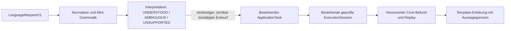

# Sprachauftrag → geprüfter Core-Lauf → Erklärung

**Status:** Ursprüngliche Entwurfs-Spezifikation; der später freigegebene V1-Durchstich ist inzwischen umgesetzt. Die unten ausdrücklich als Folgeschritte bezeichneten Einrichtungen sind nicht Teil der aktuellen CLI.

## Ausgangslage und Ziel

`IMPLEMENTIERT UND BELEGT`: Der Core besitzt acht `ApplicationTask`-Varianten, versionierte Bundles, Replay, Ergebnisbewertung und einen linearen optionalen `ExecutionSession`-Ablauf. Nachweis: `include/bruce/application/application_task.hpp`, `src/application/execution_session.cpp`, `apps/bruce_cli.cpp`.

`IMPLEMENTIERT UND BELEGT`: Die begrenzte V1-Sprachschnittstelle besitzt `interpret`, `select`, `execute` und `replay`. Der äußere Lauf hält die sieben unten genannten Phasenlabels in fester Reihenfolge und bindet Entwurf, Eingaben und Core-Bundle kanonisch auf Laufebene. Nachweis: `src/language/language.cpp`, `src/application/language_run.cpp`, `apps/bruce_cli.cpp` und `tests/integration/test_language.py`. Eine NanoCell-Runtime oder generische Phase-DAG-Ausführung ist damit nicht implementiert.

**Ziel dieses ersten Architekturpakets:** Eine Person kann eine eng definierte mathematische Forschungsfrage in deutscher Sprache formulieren, sieht die erkannte Bedeutung oder sichtbare Alternativen, lässt ausschließlich einen bereits vorhandenen typisierten Core-Auftrag ausführen und erhält eine Erklärung, die nur aus Ergebnis, Trace, Replay und Aussagegrenzen abgeleitet ist.

Der erste Durchstich ist absichtlich sequenziell. Er etabliert einen kleinen, dauerhaft versionierbaren Phasenvertrag, aber keine allgemeine Scheduler-, Plugin- oder NanoCell-Runtime.

## Betrachtete Ansätze

| Ansatz | Vorteil | Risiko | Entscheidung |
| --- | --- | --- | --- |
| Freier Modellaufruf erzeugt direkt CLI-Argumente | schnelle, flexible Texteingabe | nicht deterministisch; kann Budgets, Pfade oder fachliche Bedeutung halluzinieren | ausgeschlossen |
| Regelbasierte, versionierte Mini-Grammatik erzeugt einen typisierten Auftragsentwurf | replaybar, testbar, sichtbare Mehrdeutigkeit | zunächst kleine Sprachdomäne | **gewählt** |
| Vollständige NanoCell-/Graph-Runtime vor dem ersten Sprachlauf | ein gemeinsamer großer Zielentwurf | koppelt drei unbewiesene Subsysteme; kein früher End-to-End-Nutzen | auf spätere Pakete verschoben |

## Begrenzter Eingabevertrag

Die Sprachschicht verarbeitet keinen freien Dateisystemtext und keine frei formulierten Budgets. Der Aufrufer übergibt einen strukturierten Rahmen:

```text
LanguageRequestV1 {
  text: UTF-8,
  inputs: genau zwei Alias-zu-lokalem-Quellverweis-Bindungen,
  requested_budget: optionaler bereits typisierter Core-Budgetwert,
  grammar_version: Sprachgrammatik-Version
}
```

Die erste eindeutige deutsche Form beschreibt nur rationale Portfolios mit den zuvor gebundenen Eingaben `train` und `holdout`, beispielsweise:

```text
Untersuche @train mit @holdout auf rationale Formeln.
```

Die Markierungen `@train` und `@holdout` referenzieren ausschließlich Schlüssel aus `inputs`. Ein Pfad, ein Shell-Argument, eine Regeländerung, ein Exportziel oder ein Budget wird nicht aus dem Satz abgeleitet.

Für die sichtbare Mehrdeutigkeitsbehandlung erkennt V1 zusätzlich ausschließlich `Untersuche @left und @right auf rationale Formeln.` mit den beiden ausdrücklich gebundenen Aliasnamen `left` und `right`. Dieser Satz erzeugt zwei gleichrangige Rollenbelegungen, aber keinen ausführbaren Auftrag, bis eine davon explizit ausgewählt wurde. Weitere Aliasnamen oder Satzformen sind in V1 `UNSUPPORTED`.

V1 verwendet drei neue, getrennte CLI-Operationen als sichtbaren Bestätigungspfad: `language interpret` erzeugt nur einen versionierten Entwurf, `language select` wählt bei Mehrdeutigkeit eine vorhandene Alternativen-ID und `language execute` akzeptiert nur einen eindeutigen oder ausgewählten Entwurf. Erst `execute` startet den Core. Die Eingabeverweise und Budgets werden bei jedem Schritt gegen den Entwurf gebunden und erneut geprüft.

Der Parser liefert genau einen von drei Befunden:

| Befund | Bedeutung | Folgeschritt |
| --- | --- | --- |
| `UNDERSTOOD` | Eine zulässige, eindeutige Zuordnung zu einem vorhandenen Auftrag | Entwurf anzeigen; erst dann ausführen |
| `AMBIGUOUS` | Mehrere gleichrangige, zulässige Deutungen | Alternativen mit ihren Regeln zeigen; keine automatische Auswahl |
| `UNSUPPORTED` | Keine zulässige Zuordnung | Erklären, welche Form oder Referenz fehlt; keinen Auftrag erfinden |

Die eindeutige V1-Zuordnung erzeugt ausschließlich einen bereits vorhandenen `ExactResearchTask` mit `domain=rational`, `strategy=portfolio-rational`, gebundenem Train-/Holdout-Eingang und den im strukturierten Rahmen festgelegten bestehenden Budgets. Sie erweitert weder `ApplicationTask` noch mathematische Strategien.

## Komponenten und Verantwortlichkeiten



| Baustein | Verantwortung | Verbotene Verantwortung |
| --- | --- | --- |
| `LanguageRequestV1`-Adapter | Normalisierung, Tokenisierung, Regeln und Entwurfsbildung | Core-Auftrag direkt ausführen oder Regeln ändern |
| Interpretationsbefund | Eindeutigkeit, Alternativen oder fehlende Form sichtbar machen | Wahrheitsstatus vergeben |
| Auftragsadapter | Nur geprüfte vorhandene Auftragstypen bauen | neue mathematische Semantik oder eigene Suchgrenzen definieren |
| Core-Session | Bestehende Ausführung, Serialisierung und Replay | Sprachregeln oder Darstellung bewerten |
| Template-Renderer | Fakten aus strukturiertem Befund erklären | Zahlen, Status, Evidenz oder Freigaben hinzufügen |

## Kleinste Phase-DAG

Der äußere Sprachlauf hält in V1 einen deterministischen, **linearen** Trace mit diesen sieben Labels fest; er ist kein generischer Phase-DAG-Scheduler:

```text
RECEIVED → INTERPRETED → CONFIRMED → CORE_EXECUTED → CORE_REPLAYED → EXPLAINED → COMPLETED
```

- `AMBIGUOUS` und `UNSUPPORTED` enden nach `INTERPRETED`; sie starten keinen Core-Lauf.
- `CONFIRMED` bedeutet nur, dass der Benutzer einen sichtbaren Entwurf auswählte. Es ist keine Rule-, Learn- oder Publish-Freigabe.
- `CORE_EXECUTED` und `CORE_REPLAYED` enthalten die bestehenden inneren Phasen samt Ergebnis oder Fehler unverändert; die äußere DAG ersetzt den `ExecutionSession`-Vertrag nicht.
- Der implementierte V1-Trace enthält die geordneten Phasenlabels. Entwurf, Eingaben und Core-Bundle sind kanonisch auf Laufebene gebunden; die Bindung ist keine Telemetrie für jeden einzelnen Übergang. Zeitstempel, Eingabefingerprints und Core-Referenzen je Übergang sind versionierte Folgeschritte, keine vorhandenen Felder oder Zusagen der aktuellen CLI. Der deterministische Trace ist von einer solchen künftigen Laufzeittelemetrie zu unterscheiden.
- Abbruch und Budgets bleiben im bestehenden Core-Vertrag. V1 führt kein neues universelles Zeit-, RAM- oder Phasenbudget ein.

## Nachweis- und Speichervertrag

Ein erfolgreicher Sprachlauf schreibt ein separates, versioniertes `LanguageRunBundleV1`. Es enthält Rohtext, normalisierten Text, Grammatikversion, Eingabereferenzen und -digests, alle Interpretationsalternativen, die explizit ausgewählte Alternative, die unveränderten Core-Bundlebytes samt SHA-256-Digest, äußeren Phasentrace sowie den deterministischen Erklärungstext.

Ein Sprachbundle ist replaybar, wenn dieselbe Grammatikversion und die gebundenen Eingabebytes verfügbar sind. Ein späterer Sprachregelstand darf einen alten Lauf nicht umdeuten. Ein Replay bestätigt weiterhin nur die reproduzierbare Ausführung; er ist kein unabhängiger mathematischer Beweis.

## Fehler- und Sicherheitsgrenzen

- Unbekannte Wörter, fehlende `@`-Referenzen, doppelte Rollen und ungültige Unicode-Normalisierung sind strukturierte Interpretationsfehler, keine stillen Defaults.
- Ein fehlendes oder verändertes Eingabeartefakt verhindert den Core-Start beziehungsweise den Replay.
- Ein Core-Fehler bleibt ein Core-Fehler mit dessen vorhandener Hülle; die Sprachphase fügt keine alternative fachliche Diagnose hinzu.
- Sprache kann weder aktive Regeln verändern noch Learn-/Publish-Gates öffnen. Die bestehende menschliche Regelbestätigung bleibt unverändert.
- Kein LLM, kein Netzwerk, keine Datenbank, keine GPU, kein NanoCell-Programm und keine parallele Ausführung gehören zu diesem Paket.

## Akzeptanzkriterien

1. Die unterstützte Satzform erzeugt nach idempotenter Normalisierung denselben eindeutigen Entwurf und startet erst nach sichtbarer Bestätigung einen Core-Lauf.
2. Zwei gleichrangige Deutungen liefern `AMBIGUOUS`, listen ihre Regeln und starten keinen Lauf.
3. Eine unbekannte Form liefert `UNSUPPORTED` und erzeugt keinen Auftrag, Export oder Regelzustand.
4. Ergebniszahlen, Status, `claim_scope` und Hinweise auf Teilbefunde in der Erklärung stimmen byte- bzw. feldgenau mit dem strukturierten Core-Befund überein.
5. Sprachbundle-Replay mit identischen Eingabebytes und Grammatikversion reproduziert Interpretationsbefund, ausgewählten Auftrag, Core-Bundle und Erklärung.
6. Veränderte Eingabebytes, Grammatikversion oder fehlender Holdout schlagen vor der behaupteten erfolgreichen Wiederholung fehl.
7. Alle bestehenden Core-Tests bleiben grün; die V1-Suite enthält E2E für Erfolg, Mehrdeutigkeit, unbekannte Form, budgetinduziertes natives Core-`INCOMPLETE` und Bundle-Replay. Ein kontrollierter Core-Abbruch-E2E setzt eine eigene Abbruchsteuerung der Sprach-CLI voraus und bleibt ein versionierter Folgeschritt, keine Zusage dieses Durchstichs.

## Bewusst nicht enthalten und Folgeschritte

**Nicht Teil dieser Spezifikation:** NanoCell-Ausführung, Verzweigungen/Zyklen der Phase-DAG, freie Sprache, ein Modellanbieter, Cockpit/Web-UI, Datenbank, automatische Erfahrungspromotion und Änderungen mathematischer Algorithmen.

**Nächster unabhängiger Architekturvertrag:** `NanoCellExecutorV1` wird erst nach der Sprach-Core-Abnahme entworfen. Er muss einen typisierten Eingabe-/Ergebnisvertrag, eigene Byteoperator-Referenztests, Kontext- und Herkunftstrennung, Budget-/Abbruchpunkte und Replay festlegen. Erst dann kann er als weiterer Knoten in einer späteren, weiterhin nachvollziehbaren Phase-DAG erscheinen.

## Rückfallstrategie

Die Sprachschnittstelle ist ein neuer, separater Einstieg. Bei Fehlern kann sie vollständig deaktiviert oder entfernt werden, ohne den bestehenden CLI- und Core-Bundle-Vertrag zu ändern. Bereits geschriebene Sprachbundles bleiben als Daten lesbar; sie führen ohne passende Grammatikversion keinen neuen Lauf aus.
