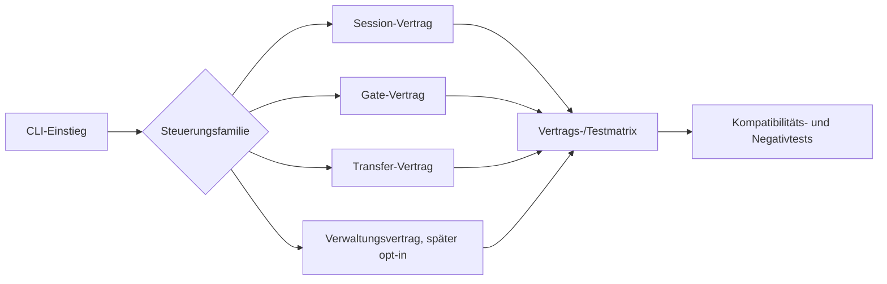

# Steuerungs- und Fehlerverträge harmonisieren

**Status:** Vorgeschlagene Architektur-Spezifikation. Sie beschreibt zuerst
einen kompatiblen Bestandsvertrag und erst danach eine schmale, opt-in
Migration eines Verwaltungswegs.

## Ausgangslage

BRUCE besitzt drei voneinander getrennte Steuerungsfamilien:

| Familie | Einstieg | Heutige Semantik |
| --- | --- | --- |
| Sitzung | acht `ApplicationTask`-Varianten | `session-checkpoints-v1`; Phasen EXECUTING, SERIALIZING und REPLAYING; Fehlerhülle versionsabhängig (`v1` ohne Budget, `v2` für Sitzungsprüfpunkte, `v3` für Serialisierungsbytes) |
| Gate | `gate-run` | Replay und Gates; eigene Signalreihenfolge und einfaches Fehler-JSON |
| Transfer | `compatibility-*`, `experience plan-add/apply-add/add` | `transfer-checkpoints-v1`; Signal vor Budgetprüfung und einfaches Fehler-JSON |

Die Unterschiede sind gegenwärtig Bestand, nicht zufällige Inkonsistenz. Sie
stehen im [Steuerungs- und Veröffentlichungsvertrag](../../contracts/06-control-and-publication.md).
Weitere Verwaltungswege wie `experience revoke`, `experience replace` und
`experience inspect` besitzen bislang keinen solchen CLI-Kontrollrahmen.

## Ziel und Nichtziel

**Ziel:** Jede öffentliche Steuerungsfamilie erhält eine versionierte,
prüfbare Beschreibung ihrer Punkte, Zähler, Abbruchreihenfolge, Fehlerhülle,
Dateigrenzen und ausdrücklich nicht abgedeckten Arbeit. Bestehende CLI-
Aufrufe und gespeicherte Bundles bleiben dabei unverändert.

**Nichtziele:**

- keine gemeinsame universelle Budgeteinheit;
- keine rückwirkende Änderung der Fehlerpriorität;
- keine Umstellung sämtlicher Verwaltungswege in einem Paket;
- keine neue Phase-DAG, Parallelität, GPU-Ausführung oder UI;
- keine Änderung fachlicher Mathematik-, Gate-, Regel- oder Replaysemantik.

## Entscheidung

### Paket A: Bestand versionieren und absichern

ADR-015 und der Bestandsvertrag werden um eine verbindliche
Vertrags-/Testmatrix ergänzt. Für jeden öffentlichen Weg dokumentiert sie:

1. den Namen und die Einheit des Budgets;
2. die konkreten Kontrollstellen und ob sie vor oder nach nativer Arbeit
   liegen;
3. die Signal- und Budgetreihenfolge bei gleichzeitigem Eintreten;
4. die Fehlerhülle, Exit-Code und die Zusage zu Teilverbrauch;
5. Dateilesen, temporäre Datei, Export und nicht instrumentierte Bereiche;
6. die zugehörigen ausführbaren Negativ- und Kompatibilitätstests.

Paket A führt keine neue CLI-Option, keine neue Bibliotheks-API und keine
andere JSON-Ausgabe ein. Es macht die vorhandene Semantik nur zu einem
testbaren, migrationsfähigen Vertrag.

### Paket B: erster opt-in Verwaltungsweg

Nach Paket A wird ausschließlich der mutierende Experience-Lebenszyklus
`experience revoke` und `experience replace` als Kandidat für einen neuen,
eigenen Kontrollvertrag entworfen. `inspect` bleibt lesend und außerhalb
dieses ersten Pakets.

Der neue Vertrag erhält einen eigenen Versionsnamen und eigene CLI-Optionen;
er übernimmt weder stillschweigend Session- noch Transfersemantik. Die alten
Aufrufe ohne die neue Option behalten ihr derzeitiges Verhalten byte- und
fehlerkompatibel. Ob die neue Einheit Transfer-Checkpoints oder eine eigene
Verwaltungseinheit verwendet, wird in diesem Folgeentwurf anhand der in Paket
A erfassten Kontrollstellen entschieden.

## Komponenten und Datenfluss

- Die Vertragsmatrix ist Dokumentation und Testzuordnung, kein Runtime-
  Dispatcher.
- Bestehende Controller (`ExecutionSession`, Gate-Inspektion,
  `TransferControl`) bleiben Eigentümer ihrer Zähler und Fehler.
- Die spätere Verwaltungssteuerung darf nur über einen explizit benannten
  Adapter in die betroffenen CLI-Zweige gelangen.

## Fehler- und Kompatibilitätsregeln

1. Bestehende Befehle behalten Optionen, Exit-Codes, JSON-Hüllen und
   Fehlerpriorität.
2. Ein Kontrollfehler veröffentlicht kein neues fachliches Teilresultat.
3. Ein fachliches `INCOMPLETE` bleibt ein regulärer, replaybarer Befund und
   wird nicht zu einem Steuerungsfehler umgedeutet.
4. Exporte überschreiben keine Ziele. Abbruch vor Veröffentlichung räumt die
   temporäre Datei nach bestehender Best-Effort-Semantik auf.
5. Der spätere Verwaltungsadapter darf eine Regelaktivierung oder andere
   menschliche Freigabe nicht auslösen oder ersetzen.
6. Fehlerhüllen werden nicht durch einen gemeinsamen Text normalisiert; eine
   künftige Vereinheitlichung wäre eine explizite, versionierte Migration mit
   eigener Test- und Migrationsstrategie.

## Abnahmekriterien für Paket A

1. ADR-015 benennt für Sitzung, Gate und Transfer alle oben genannten sechs
   Vertragsdimensionen ohne Platzhalter.
2. Die Matrix verweist für jede garantierte Semantik auf mindestens einen
   vorhandenen oder neu ergänzten Test.
3. Testfälle decken je Familie Erfolg, Budgeterschöpfung, Signalabbruch und
   einen Dateibezugs-/Exportfall ab, soweit die Familie einen solchen Weg
   besitzt.
4. Gleichzeitige Signal-/Budgetfälle bleiben mit der heutigen priorisierten
   Fehlermeldung getestet.
5. Die vollständige bestehende Test-Suite bleibt grün; keine CLI-Dokumentation
   behauptet eine universelle Budget-, Zeit-, Speicher- oder Fehlersemantik.

## Abnahmekriterien für Paket B

1. Die neuen Verwaltungsoptionen sind opt-in; historische Aufrufe und deren
   Resultate bleiben unverändert.
2. Der gewählte Weg besitzt ein versioniertes Konto, definierte Kontrollstellen
   und eine dokumentierte Signal-/Budgetpriorität.
3. Abbruch vor Zustandsänderung verändert weder Experience-Snapshot noch
   Ausgabeziel.
4. Wiederholung eines erfolgreichen `revoke`/`replace` prüft die vorhandenen
   Quellen und die bestehende fachliche Semantik erneut.
5. Unit- und Prozessintegrationstests belegen Erfolg, Budget, Signal, falsche
   Quelle und Kompatibilität ohne neue Optionen.

## Rückfall und Reihenfolge

Paket A ist reine Vertrags- und Testarbeit und kann ohne Laufzeitmigration
ausgeliefert werden. Paket B bleibt ein separates Folgepaket; falls dessen
Adapter fehlschlägt, werden nur die neuen opt-in Optionen entfernt. Die
bestehenden Experience-Verwaltungsbefehle und alle historischen Bundles
bleiben davon unberührt.

Erst nach der Abnahme von Paket B wird die nächste Roadmapentscheidung
getroffen: weitere Verwaltungswege, NanoCell-Integration oder ein stabiler
Auftragskatalog als Voraussetzung für freie Sprache.
